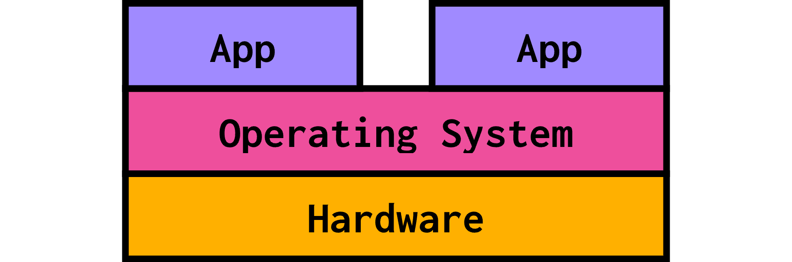
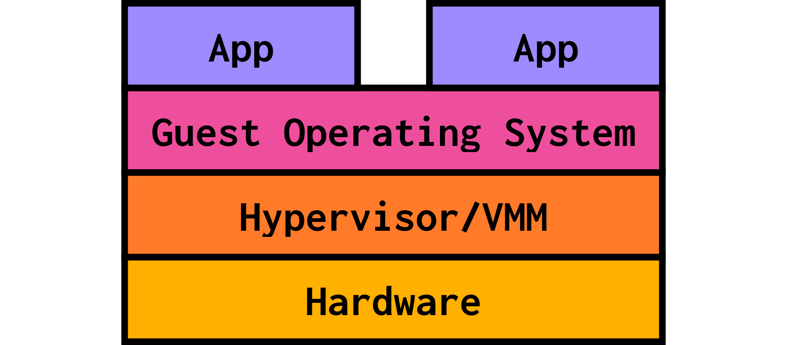
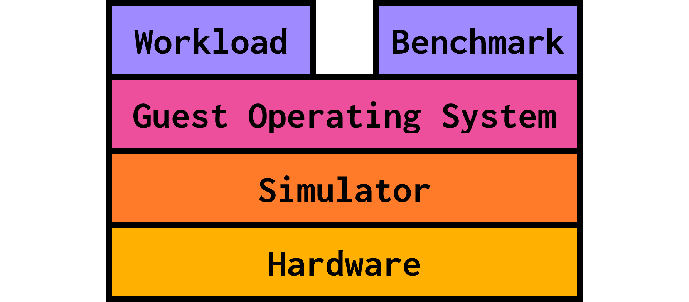

# Why simulation?

gem5 might be your first time exploring hardware simulation (if that's true, don't worry! You're going to be alright). Naturally, you might be wondering why researchers want to simulate hardware at all.  

> By the end of this section, you will be able to:  
>  
> - **Explain** why simulation is a useful tool for computer architecture research.  
> - **Define** functional, instrumentation-based, trace-based, execution-driven, and full-system simulation.
>

## Computer architecture research

Computer architecture research focuses on *innovative* ways of building processors. There are many avenues of research to explore:

### Processors  

- How many cores to use?  
- Should they be all the same?  
- Can we instrument the hardware to do more complex functions?  
- Can we accelerate certain operations?  

### Caches and memory  

- Which technology to use?  
- How should the cache architecture look like?  
- How about the cache hierarchy?  

### Overall system  

- How should cores communicate?  
- What should the network architecture look like?  
- Should chips be able to share data? If so, how?  
- How about consistency and coherence?

...and a bunch of others.

## Problem: what you're making *doesn't exist yet*  

What all of the above research opportunities have in common is that the system being evaluated is one that *no one has built before*. This is made worse by the fact that individual hardware components (for example, a specific cache hierarchy or a new memory unit) cannot be tested in isolation; they are likely dependent on other parts of the computer system, which means you have to build that entire system.

## Solution: simulation

Faced with this problem, you have two choices: build the hardware yourself or simulate it. Building custom hardware for research is *very* expensive. Simulation is not! In addition, simulation is parameterized. This means that you can explore your design space more thoroughly and perform [sensitivity analysis](https://en.wikipedia.org/wiki/Sensitivity_analysis) by adjusting simulation parameters, no soldering required. While it's not the same as actually observing real hardware, it's very often accurate enough.

## Simulation terminology

We use specific terminology to talk about simulators. This terminology mirrors the language we use to talk about virtual machines.

> If you're not familiar with virtual machines, that's okay! Virtual machines are pieces of software that **mimic a full computer system**. Being software, they need to run on an actual machine, but they might simulate an **entirely different operating system** than that machine's operating system.

Without virtual machines, we can think of the way your computer runs code like a "layer cake" of sorts:

We call this **native execution**: your native operating system runs on your machine's hardware directly and allows your favorite apps to run on top.

In virtual machine land, we add another layer to this cake: the hypervisor, that sits on top of hardware. You end up with four layers:

- The **hardware**, also referred to as the **host**, is your actual, physical machine.
- The **hypervisor/VMM (Virtual Machine Monitor)** is a software layer running on the host that emulates hardware for any virtual machines running.
- The **guest** is the code running not directly on your machine's hardware, but "on top" of the hypervisor, which emulates the hardware for it. In the context of virtual machines, this is the guest operating system.
- The **apps** are whatever code the guest operating system has running on top of it. These might be pieces of software you couldn't run on your native OS.

For simulators, this "layer cake" looks really similar, with a few names swapped around:

- The **hardware/host** is still your machine's hardware.
- The hypervisor is replaced by the **simulator**, which runs directly on the host. The simulator exposes simulated hardware to the guest.
- The **guest** is the code that runs on this simulated hardware. The operating system running in-simulation is the guest operating system.
- The **workload/benchmark** is the code that the guest operating system (running on simulated hardware) is running. We use this code to assess something about our simulated system.

This means that the **simulator's code** executes *natively* (on the host's hardware), while the **guest's code** runs on the simulator. The simulator's code emulates the guest's code!

As such, we have two different ways to discuss performance:

- The **simulator's performance**, which refers to how quickly gem5 can simulate on the host machine.
  - This the amount of time that the simulation takes as we perceive it (AKA the wallclock time).
- The **simulated performance** is the time that the simulator predicts it takes for the *guest code* to run on the *simulated system*.
  - This amount of time will be *less* than the wallclock time: simulators take a while to simulate, but that doesn't change the predicted performance of the simulated system!

## Types of simulation

There are quite a few types of simulation out there to fulfill different needs. Let's focus on 5 common simulation types and what they're used for. You don't need to be an expert on these, but it's helpful to know what they refer to.

![A pictorial representation of 5 simulation types. Functional simulation is depicted as programs being executed correctly. Instrumentation-based simulation is depicted as binaries and measurement tools yielding execution details. Trace-based simulation is depicted as programs generating traces which can then be re-executed. Execution-driven simulation is depicted as functional simulation combined with timing information. Full-system simulation is depicted as programs being applications run on top of a simulated OS.](img/sim-types.png)

### Functional simulation

Functional simulation executes programs correctly, but usually provides no timing information. This makes it useful for validating the correctness of things like compilers or a new ISA, but not for assessing whether a configuration is faster or more efficient.

> If you're familiar, some examples of functional simulation include [RISC-V Spike](https://chipyard.readthedocs.io/en/latest/Software/Spike.html) and [QEMU](https://www.qemu.org).

### Instrumentation-based simulation

Instrumentation-based simulation is often binary translation: recompiling a binary into either the same ISA or a different ISA and adding testing/debugging features like breakpoints and instruction traces. This type of simulation runs on actual, non-simulated hardware and uses callbacks. This is great for assessing performance bottlenecks, but it's not very flexible to new ISAs and some things are opaque.

> Some examples of instrumentation-based simulation are [PIN](https://www.intel.com/content/www/us/en/developer/articles/tool/pin-a-dynamic-binary-instrumentation-tool.html) and [NVBit](https://research.nvidia.com/publication/2019-10_nvbit-dynamic-binary-instrumentation-framework-nvidia-gpus).

### Trace-based simulation

Trace-based simulators generate traces of addresses and events, then re-execute those traces. This can be very fast, since you can reuse the traces and don't have to do functional simulation every time. However, if the execution of a program depends on timing, then the trace becomes invalidated! Think about a multithreaded program where the time that individual threads take affects their interleaving and thus the overall execution. The same is true for programs that make calls to the operating system or use I/O. This simulation technique is great for specialized applications like cache hit/miss analysis or branch prediction, but it's difficult to get the performance of an entire system.

> An example of a trace-based simulator is [ChampSim](https://github.com/ChampSim/ChampSim).

### Execution-driven simulation

Execution-driven simulation is the combination of functional simulation and timing simulation. This makes it a highly accurate simulation technique capable of yielding performance data, but execution-driven simulators also tend to be slower than their functional counterparts.

> Intel's [Simics](https://www.intel.com/content/www/us/en/developer/articles/tool/simics-simulator.html) simulator is an example of an execution-driven simulator.

### Full-system simulation

Full-system simulation simulates every component of a system in high enough fidelity such that mostly unmodified apps can run entirely in-simulation. This is often "bare metal" simulation, meaning that the simulator interacts directly with hardware instead of with the operating system. The operating system is run entirely in the simulator: it cannot be faked.

Being full-system is a separate property, different from being any of the other simulation types discussed above. Any of the kinds of simulators discussed above can also be full-system simulators, but it's most common for functional simulators and execution-driven simulators to also be full-system.

> For example, QEMU, a functional simulator we mentioned above, is also full-system.
