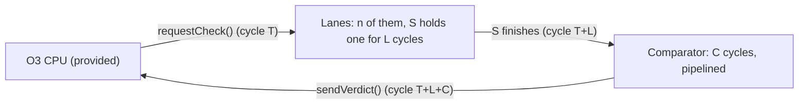
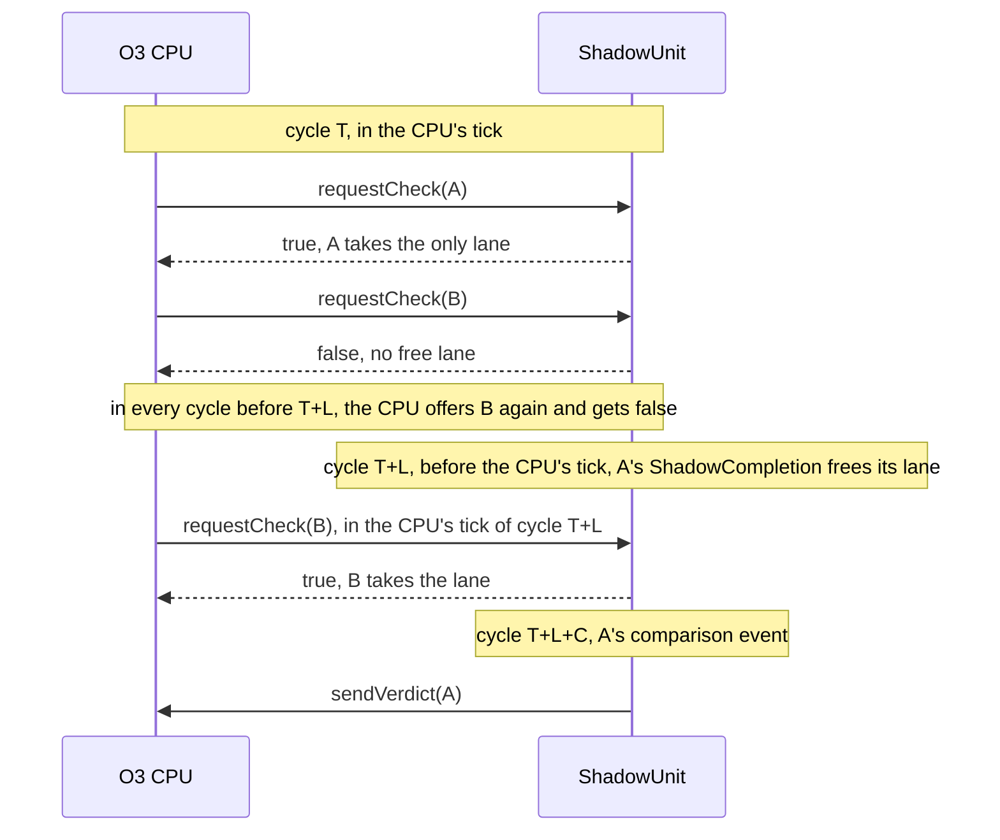

# gem5 Workshop Assignment #3

In this assignment, you'll use SimObjects and events to model a piece of fault-tolerant hardware: a **shadow unit** that executes every instruction a second time and checks the core's result before the core is allowed to commit it.

> In this assignment, you will:
>
> - **Create** a new SimObject from scratch, with parameters, statistics, and a debug flag.
> - **Implement** an interface that the CPU calls into, the way gem5 connects the units inside a core.
> - **Schedule** events to model latency and limited hardware resources.
> - **Measure** the cost of redundant execution and explain it with simple models.
> - **Modify** the O3 CPU so that it speculates past the check (Part 5, extra).

This assignment builds on the CPU track of Unit 4. You may want to refresh these lessons

| Lesson | Relevant Topics |
|---|---|
| [SimObjects](../../lessons/04-gem5-models/04a-cpus/01-sim-objects.md) | the declaration, header, and source files; parameters; `SConscript` |
| [Event-driven simulation](../../lessons/04-gem5-models/04a-cpus/02-event-driven-sim.md) | `schedule()`, `EventFunctionWrapper`, scheduling an event vs. calling a function, SimObjects as parameters |
| [Debugging](../../lessons/04-gem5-models/04a-cpus/04-debugging.md) | debug flags, `DPRINTF`, `panic_if` and `fatal_if` |
| [Writing a gem5 branch predictor](../../lessons/04-gem5-models/04a-cpus/05-branch-predictors.md) | extending a base class that the CPU calls into |
| [Modeling processors](../../lessons/02-beginning-simulation/02-processors.md) | the O3 CPU, and building your own standard library processors |

A few things you'll need aren't covered in the lessons: `ClockedObject` and statistics. They're explained where they come up, in notes marked **New here**.

## Catching transient faults with instruction duplication

A **transient fault** is a bit that flips for a moment, for example when a particle strike or a voltage droop hits a circuit. If it hits a functional unit, the instruction computes a wrong value and nothing in the core notices. The program keeps running and may produce a wrong answer: a **silent data corruption**.

**Instruction duplication** catches these faults by executing every instruction twice and comparing the two results before the result value can leave the FU. A single transient fault hits only one of the two executions, so if the results differ, something went wrong and the instruction is executed again.

In this assignment:

- The **primary execution (P)** is the normal one. It runs on the core's functional units, exactly as in stock gem5. But the CPU **holds** P's result until the check passes: instructions that depend on it wait, and so does commit.
- The **shadow execution (S)** runs on your **shadow unit**, a new SimObject that the CPU calls into, the same way it calls its branch predictor. When P executes, the CPU asks the shadow unit for a **check**. The unit runs S on one of its **lanes**, compares S's result with P's, and sends back a **verdict**.
- When the check passes, the CPU **writes the instruction back**: the instructions that depend on it can use its result, and it moves on to **commit**. On a **mismatch**, nothing has used P's result yet, so there's nothing to squash: the CPU executes the instruction again and asks for a new check. That's a **replay**.



Every checked result waits for its verdict, and so does every instruction that depends on it: dependent instructions pay for the check. Whether redundancy is cheap or expensive comes down to two things your unit controls: whether a lane is free when a check arrives, and how long a verdict takes. In [Part 5 (extra)](#part-5-extra-speculative-checking), you'll remove that wait by speculating: the CPU writes P's result back right away, and only commit waits for the verdict.

| Symbol | Meaning |
|---|---|
| P, S | the primary and shadow executions of one instruction |
| T | the cycle in which P executes and the CPU asks for its check |
| L | the latency of the functional unit P ran on: 1 cycle for `add`, 3 for `mul`, 20 for `div` |
| n | the number of lanes in your unit (`num_lanes`) |
| C | the comparator's latency in cycles (`compare_latency`) |

> **Timing vs. function.** gem5 computes each instruction's result once, functionally, when P executes (see [ISA implementation in gem5](../../lessons/04-gem5-models/04a-cpus/06-isas.md)). Your unit doesn't recompute anything. The CPU gives it P's result (`primary`) and the result a fault-free execution produces (`golden`). S's result is `golden`, unless your own fault injector flips one of its bits (Part 3). What your unit models is *when* S runs, *whether there's room* for it, and *what the comparator sees*. The memory system works the same way: the data is correct from the start, and the timing model decides when it arrives.

## CPU side skeleton code

Stock gem5's O3 CPU doesn't know about shadow units, so the starter files include the **CPU side**: a few of gem5's own source files, changed so that the O3 CPU asks for checks. You'll copy them over gem5's in [Getting started](#the-cpu-side). You won't change them until Part 5 (extra), but your unit implements the interface they call, so you need to know how the CPU uses it.

| Name | Kind | Purpose |
|---|---|---|
| `BaseShadowUnit` | abstract SimObject, in `src/cpu/` | The base class your unit extends: the interface below. |
| `shadowUnit` | O3 CPU parameter | The CPU's shadow unit. With the default, `NULL`, the CPU checks nothing and behaves exactly like stock gem5. |
| `faultInjectPeriod` | O3 CPU parameter | The CPU's fault injector flips the top bit of P's result in about one in this many checked instructions. 0, the default, turns it off. It works with or without a shadow unit. |
| `faultInjectSeed` | O3 CPU parameter | Seed for the CPU's fault injector. |
| `shadowSpeculative` | O3 CPU parameter | Write P's result back right away, before its verdict, and squash on a mismatch. `False`, the default, holds the result until the check passes. You'll use it in Part 5. |
| `shadowChecks` | CPU stat | Checks your unit accepted. |
| `shadowReplays` | CPU stat | Checks the CPU had to repeat after a mismatch. |
| `shadowSquashes` | CPU stat | Squashes caused by mismatch verdicts, in Part 5. |
| `shadowCommitStalls` | CPU stat | Cycles in which the oldest instruction had executed P but was still waiting for its verdict. |
| `faultsInjected` | CPU stat | P results the CPU's injector corrupted. |
| `faultsCommitted` | CPU stat | Instructions that committed with a corrupted result: silent data corruptions. |

The CPU's stats are in `m5out/stats.txt` under `board.processor.cores.core`.

### The interface

`BaseShadowUnit` is to your unit what `BPredUnit` was to your branch predictor: the CPU only knows the base class, and calls the method your unit overrides. Here's all of it:

```c++
// src/cpu/base_shadow_unit.hh (provided), without its include guard and includes

class ShadowClient;

/** One check. The CPU fills in everything except shadow and match. */
struct ShadowCheck
{
    /** The CPU that asked for the check. sendVerdict() answers it. */
    ShadowClient *client;
    /** Sequence number of the instruction (for debug output). */
    InstSeqNum seqNum;
    /** PC of the instruction (for debug output). */
    Addr pc;
    /** Latency of the functional unit P ran on. S takes as long. */
    Cycles latency;
    /** P's result: the value the core wrote to the register file. */
    RegVal primary;
    /** The value a fault-free execution produces. */
    RegVal golden;

    /** S's result. Written by the shadow unit. */
    RegVal shadow;
    /** True if S's result equals P's. Written by the shadow unit. */
    bool match;
};

/** Implemented by the CPU: where verdicts go. */
class ShadowClient
{
  public:
    virtual ~ShadowClient() = default;

    /** Record check's verdict. Never calls back into the shadow unit. */
    virtual void recvVerdict(ShadowCheck *check) = 0;
};

/**
 * The base class of every shadow unit. The CPU calls requestCheck() in
 * the cycle an instruction executes, and the unit answers later, from
 * one of its events, with sendVerdict().
 */
class BaseShadowUnit : public ClockedObject
{
  public:
    BaseShadowUnit(const BaseShadowUnitParams &params)
        : ClockedObject(params)
    {}

    /**
     * Offer the unit a check. Return true to accept it, or false if the
     * unit can't take it this cycle; the CPU offers it again next cycle.
     */
    virtual bool requestCheck(ShadowCheck *check) = 0;

  protected:
    /** Send check's verdict to the CPU that asked for it. */
    void
    sendVerdict(ShadowCheck *check)
    {
        check->client->recvVerdict(check);
    }
};
```

A verdict is just a function call: `sendVerdict()` calls the CPU's `recvVerdict()` right away. All the timing comes from *when* your unit calls it, and that's what your events decide.

These are the rules both sides follow. Most bugs in this assignment break one of them.

1. The CPU checks every instruction that isn't a memory access, a branch or jump, or serializing, and writes one integer or floating-point register other than `x0`. Make sure the check only occurs for the correct instructions.
2. In the cycle T in which P executes, from inside its own tick, the CPU calls your `requestCheck()` with a new `ShadowCheck`.
3. If `requestCheck()` returns `false`, the CPU keeps the check and offers it again in each following cycle until you accept it. It offers waiting checks oldest first, and stops for the cycle at the first one you reject. You never have to tell the CPU that a lane has freed up, just as a busy functional unit doesn't tell the issue queue.
4. Fill in `shadow` and `match`, then call `sendVerdict(check)`. The CPU records the verdict and returns, without calling back into your unit. Until its verdict arrives, the CPU holds the instruction's result: no other instruction can use it, and the instruction can't commit. On a passing verdict, the CPU writes the instruction back in that same cycle: its dependents wake up, and it moves on to commit.
5. You can send verdicts in any order. The CPU owns every `ShadowCheck` and keeps it alive until its verdict comes back, even if the instruction is squashed in the meantime. Send each check's verdict exactly once.
6. When `match` is `false`, the CPU executes the instruction again and asks for a new check in the same cycle. Nothing younger has used the wrong value, so nothing is squashed.
7. The CPU may squash an instruction while your unit is checking it, for example when an older branch was mispredicted. Finish the check and send the verdict anyway; the CPU drops it.

In Part 5, you'll change what the CPU does in rules 4 and 6: it writes the result back before the verdict, and squashes on a mismatch. Your unit's side of the rules stays the same.

## The Shadow Unit

`ShadowUnit` extends `BaseShadowUnit`, which is a `ClockedObject`, and has two stages:

- **The lanes:** n generic functional units. Any lane can run S for any instruction, and S takes as long as the functional unit P ran on: L cycles. Lanes aren't pipelined, so S holds its lane for all L cycles, like the O3 CPU's divider. When all n lanes are busy, reject the check; the CPU will offer it again next cycle.
- **The comparator:** When S finishes, it leaves its lane and enters the comparator, which takes C cycles. The comparator is pipelined, so it never runs out of room. When it's done, the verdict goes back to the CPU.

One check, cycle by cycle:

| Cycle | CPU | Shadow unit |
|---|---|---|
| T | P executes; the CPU holds its result and calls `requestCheck()` | S takes a free lane, and the check's `ShadowCompletion` event is scheduled for T+L |
| T+L | | the `ShadowCompletion` runs: S finishes and frees its lane, and the check's comparison event is scheduled for T+L+C |
| T+L+C | the CPU writes the instruction back, and its dependents wake up | the comparison event runs: `sendVerdict()` hands the verdict to the CPU |

> **Why a verdict sent in cycle T+L+C counts in that same cycle.** When several events are scheduled for the same tick, gem5 runs them in priority order, lowest number first. The CPU's tick event has priority `Event::CPU_Tick_Pri` (50). Your events have `Event::Default_Pri` (0): it's what an `EventFunctionWrapper` gets unless you ask for something else, and what `ShadowCompletion` passes to `Event`'s constructor. So at every clock edge, your events run *before* the CPU's tick: the CPU sees a verdict sent at the edge of cycle T+L+C in that same cycle, and a lane freed at the edge of cycle X can take a waiting check in cycle X. In stock gem5, a dependent instruction can issue in the cycle its producer executes, T. Here, it can't issue until T+L+C, and then it takes L cycles of its own, so a dependent chain takes 2L + C cycles per instruction instead of L.

### The model: the O3 CPU's functional units

Your lanes work the way the O3 CPU's own functional units (FUs) do, so its code is your model. Two classes do the work there:

- **`FUPool`**, in `src/cpu/o3/fu_pool.hh` and `fu_pool.cc`, keeps one busy flag per FU, `unitBusy`. `getUnit()` finds an FU that can run an op class, marks it busy, and returns its index, or `NoFreeFU` if every capable FU is busy. Your lanes are a simpler pool: every lane can run every instruction, so `getLane()` only has to find a lane that isn't busy.
- **`FUCompletion`**, in `src/cpu/o3/inst_queue.hh`, is an event class. In `InstructionQueue::scheduleReadyInsts()`, in `src/cpu/o3/inst_queue.cc`, the instruction queue creates one with `new` for each instruction it issues to a multi-cycle FU, and schedules it for the cycle the instruction finishes. The event carries the instruction and the index of its FU, so when it runs, `processFUCompletion()` knows which instruction finished and which FU to free. It's created with the `AutoDelete` flag, so gem5 deletes it after it runs.

Your `ShadowCompletion`, declared in `shadow_unit.hh`, is `FUCompletion` for one check: it carries the check and the index of its lane. Each check needs an event of its own because an event object can be in the event queue only once: `EventQueue::schedule()`, in `src/sim/eventq.hh`, asserts that the event isn't scheduled yet. (That's why `HelloSimObject` checked `nextHelloEvent.scheduled()` in the [event-driven simulation lesson](../../lessons/04-gem5-models/04a-cpus/02-event-driven-sim.md#implementing-helloevent).) With many checks in flight, each with its own finish time, the unit creates a new event for each one. The comparator works the same way: each check gets a new `EventFunctionWrapper`, and passing `true` as its third argument, `del`, sets `AutoDelete`.

Your unit differs from the O3 FUs in three details:

- O3 schedules an `FUCompletion` at `clockEdge(Cycles(L - 1))` with `Event::Stat_Event_Pri` (90), so it runs at the end of cycle T+L−1, *after* the CPU's tick. Your `ShadowCompletion` runs at the edge of cycle T+L, *before* the CPU's tick. Either way, the CPU sees the result in cycle T+L.
- O3 frees an FU with `freeUnitNextCycle()`, and the FU becomes free when IEW's next tick calls `processFreeUnits()`. Your lane is freed right in the event, which, again, runs before the CPU's tick.
- O3 doesn't use an event for 1-cycle operations: they go straight to execute through a time buffer. Your unit uses one for every check, since verdicts must come from events (rule 4).

Each part of a check has its own step:

```txt
requestCheck(check)              ShadowCompletion::process()        the comparison event
    take a free lane                 processShadowDone(check, lane):     processCompareDone(check):
    none free: reject the check          free the lane                       compare S's result with P's
    schedule a new ShadowCompletion      compute S's result                  send the verdict
        L cycles from now                schedule a new comparison event
                                             C cycles from now
```

Here's what happens when the lanes are full, with n = 1:



## Getting started

### Files

The starter files are in this assignment's `starter_files/` directory:

```txt
starter_files/
├── cpu-side/src/cpu/       the CPU side, copied over gem5's src/cpu/
├── shadow-unit/            your SimObject
│   ├── ShadowUnit.py       declaration
│   ├── shadow_unit.hh      header (complete)
│   ├── shadow_unit.cc      source
│   └── SConscript
├── a2_components.py        a processor whose core has a shadow unit
├── a2_script.py            run script
└── tests/                  test programs
```

Like the SimObjects in Unit IV, your unit lives in gem5's source tree: copy `shadow-unit/` into `gem5/src/bootcamp/`, so that its path is `gem5/src/bootcamp/shadow-unit/`. Keep the rest together wherever you run gem5 from, such as your `workspace` directory. Every place you need to change is marked with a `TODO` comment that says which part it belongs to.

The test programs in `tests/` are static RISC-V binaries. They're written instruction by instruction in `gen_tests.py`, so you know exactly what each one runs; `<name>.lst` lists every instruction of `<name>`:

| Program | What it runs | What it shows |
|---|---|---|
| `chain_add` | one long chain of dependent `add`s | a 1-cycle operation (L = 1) |
| `chain_mul` | a chain of dependent `mul`s | a pipelined 3-cycle operation (L = 3) |
| `chain_div` | a chain of dependent `div`s | an unpipelined 20-cycle operation (L = 20) |
| `indep_add` | 8 independent chains of `add`s | throughput |
| `kernel` | a small integer and floating-point kernel that prints a checksum | correctness under faults |

The chain programs are heavily unrolled loops, so the chain dominates their run time: each iteration runs 64 chained operations and 2 instructions of loop control. That's why the CPIs you measure come out about 3% below the round numbers in the checkpoints, well within their tolerance. Every program also runs its print code once at the start, without printing, so that the end of the run hits in the caches. Otherwise, its time would vary by hundreds of cycles from run to run and blur the small differences you'll measure in Steps 4.3 and 5.3.

**Rules:**

- Only change the files in `shadow-unit/`, `a2_components.py`, and `a2_script.py`. Don't modify the CPU until Part 5.
- With `--lanes 0`, your script must not create a shadow unit, so the results match the baseline exactly.

### The CPU side

`cpu-side/` is laid out like gem5's source tree. Two of its files are new, and the others replace gem5's own:

| File, in `src/cpu/` | | What it adds |
|---|---|---|
| `base_shadow_unit.hh`, `BaseShadowUnit.py` | new | `BaseShadowUnit` and the rest of [the interface](#the-interface) |
| `SConscript` | replaces gem5's | registers `BaseShadowUnit` with the build |
| `o3/BaseO3CPU.py` | replaces gem5's | the CPU's four new parameters |
| `o3/cpu.hh`, `o3/cpu.cc` | replace gem5's | the CPU's six new stats |
| `o3/dyn_inst.hh` | replaces gem5's | three flags on each instruction: `shadowPending`, `shadowReachedCommit`, and `shadowCorrupted` |
| `o3/iew.hh`, `o3/iew.cc` | replace gem5's | IEW asks for checks, holds results, acts on verdicts, and injects faults; two `TODO (Part 5)` functions |
| `o3/commit.cc` | replaces gem5's | commit counts `shadowCommitStalls` and `faultsCommitted`; one `TODO (Part 5)` |

Copy them over gem5's files, and check what changed:

```bash
cp -r starter_files/cpu-side/src/. gem5/src/
git -C gem5 status --short src/cpu
```

`git status` should list eight modified files (`M`) and the two new ones (`??`). The CPU side is a copy of gem5 v25.0.0.1's files with the changes above, so it only works in v25.0.0.1, the version you built in [Installing gem5](../../lessons/01-introduction/03-installing-gem5.md). gem5 prints its version when it starts. In any other version, these files would undo that version's own changes to them.

With no shadow unit and the CPU's fault injector off, the CPU side behaves exactly like stock gem5: every stat matches.

### Configuration files

`a2_components.py` follows the same pattern as the processors you built in Unit II and in [Assignment #1](../a1/a1.md): an O3 CPU (`ShadowO3CPU`) inside a core inside a processor (`ShadowProcessor`). The difference is that this CPU can be given a shadow unit, through its `shadowUnit` parameter.

`a2_script.py` runs one program on a single-core system at 3 GHz, with 32 KiB L1 caches and a 2 MiB L2. It takes these options:

| Option | Default | Meaning |
|---|---|---|
| `--binary` | required | the static RISC-V program to run |
| `--lanes` | `0` | n; 0 means no shadow unit, which is the baseline |
| `--compare-latency` | `0` | C |
| `--cpu-fault-period` | `0` | the CPU's fault injector, for faults in P; 0 turns it off |
| `--shadow-fault-period` | `0` | your unit's fault injector, for faults in S; 0 turns it off |
| `--seed` | `1` | seed for both fault injectors |
| `--speculative` | off | turns on the CPU's `shadowSpeculative`, for Part 5 |

Both files already work for baseline runs, so you can do Part 0 before writing any code. You'll fill in their TODOs in Step 1.5.

gem5 passes everything after the script's name to the script. Use `-d` to give each run its own output directory instead of overwriting `m5out`:

```bash
gem5 -d m5out/chain_add-n2 a2_script.py --binary tests/chain_add --lanes 2
```

## Part 0: Baseline

Copy the CPU side into gem5, as in [The CPU side](#the-cpu-side), and build gem5:

```bash
scons build/ALL/gem5.opt -j$(nproc)
```

Then run each of the five test programs without a shadow unit, and record in a table the cycle count, and the CPI (chains) or IPC (`indep_add` and `kernel`). Also write down `kernel`'s checksum: it's the right answer for the rest of the assignment.

```bash
gem5 -d m5out/chain_add-base a2_script.py --binary tests/chain_add
grep -E '^simInsts|core\.(numCycles|cpi|ipc) ' m5out/chain_add-base/stats.txt
```


## Part 1: The module

In this part, you'll build the unit, connect it to the CPU, and get verdicts flowing. To keep things simple, S always agrees with P, and you'll run with plenty of lanes, so that a lane is always free: Part 1 doesn't reject checks yet. Parts 2 and 3 add the rest.

### Step 1.1: The declaration

Open `ShadowUnit.py`. Your unit extends `BaseShadowUnit`, the way `HelloBP` extended `BPredUnit` in the [branch predictor project](../../lessons/04-gem5-models/04a-cpus/05-branch-predictors.md), so the class is already declared with its parent. Its parameters are missing. Declare them, as in [SimObject parameters](../../lessons/04-gem5-models/04a-cpus/01-sim-objects.md#simobject-parameters):

| Name | Python type | Default | Meaning |
|---|---|---|---|
| `num_lanes` | `Param.Unsigned` | none | n: how many S executions can be in flight at once |
| `compare_latency` | `Param.Cycles` | none | C: the comparator's latency |
| `fault_period` | `Param.Unsigned` | `0` | corrupt about one in this many S results; 0 means never (Part 3) |
| `fault_seed` | `Param.Unsigned` | `1` | seed for the fault injector (Part 3) |

The two fault parameters have defaults so that the injector stays off unless you ask for it. The other two must be set by the configuration script.

> **New here: `ClockedObject`.** `HelloSimObject` scheduled its events in ticks (`curTick() + 500`). Hardware runs on a clock, so `BaseShadowUnit` extends `ClockedObject`, which gives your unit `clockEdge(Cycles(n))`: the tick of the clock edge n cycles from now. `clockEdge(Cycles(0))` is the current edge. Your unit takes its clock from its parent, the CPU, so its edges are the CPU's edges. At 3 GHz, a cycle is 333 ticks.

### Step 1.2: The header

`shadow_unit.hh` is complete, so your work is in the source file, but read the header before you start. You may add members if you need them. Some things to notice:

- `ShadowUnit` overrides `requestCheck()`. The `override` keyword makes the compiler check that the signature matches the base class's, as in your branch predictor.
- `ShadowCompletion` is the event class described in [The model](#the-model-the-o3-cpus-functional-units), and `laneBusy` and `getLane()` are the lanes, modeled on `FUPool`. Compare them with `FUCompletion` in `src/cpu/o3/inst_queue.hh` and with `FUPool` in `src/cpu/o3/fu_pool.hh`.
- `processShadowDone()` and `processCompareDone()` are the two stages' callbacks. Unlike `processHello()`, each takes the check it handles, so one call handles exactly one check.
- `stats` declares the unit's statistics. The source file registers them with `ADD_STAT` for you; you only increment them, as in `++stats.checks;`. They show up in `stats.txt` under `board.processor.cores.core.shadowUnit`.
- `rng` is a random number generator, for Part 3.

### Step 1.3: The source

Open `shadow_unit.cc`. Each TODO says which part it belongs to; registering the stats, at the bottom, is done for you.

> The skeleton won't compile until you've written the constructor: C++ requires the `const` members to be initialized.

For Part 1, implement:

1. **The constructor.** Initialize each member from `params`, in the order the header declares them. Create `rng` with `Random::genRandom(params.fault_seed)`, and `laneBusy` with one entry per lane, all `false`. A unit with no lanes makes no sense: reject `num_lanes = 0` with `fatal_if`, since it's a user error (see [Assertions, fatals, and panics](../../lessons/04-gem5-models/04a-cpus/04-debugging.md#assertions-fatals-and-panics)).
2. **`getLane()`.** Find a lane that isn't busy, mark it busy, and return its index, or `NoFreeLane` if every lane is busy, like `FUPool::getUnit()`.
3. **`requestCheck()`.** Take a lane with `getLane()`. In Part 1, a lane is always free; check that with `panic_if`. Schedule a new `ShadowCompletion` for the cycle S finishes, update `stats.checks` and `stats.laneCycles` (add L), and return `true`.
4. **`ShadowCompletion::process()`.** Call the unit's `processShadowDone()` with the event's check and lane, the way `FUCompletion::process()` calls `processFUCompletion()`.
5. **`processShadowDone()`.** Free the check's lane, set its `match` to `true`, increment `stats.passes`, and send its verdict with `sendVerdict()`.

>
> <details>
> <summary> <b>Hints and reminders</b> </summary>
>
> - Read how the O3 CPU does it first: `FUPool::getUnit()` in `src/cpu/o3/fu_pool.cc`, the code in `InstructionQueue::scheduleReadyInsts()` that creates and schedules an `FUCompletion` (search `src/cpu/o3/inst_queue.cc` for `new FUCompletion`), and `FUCompletion::process()` and `processFUCompletion()` in the same file.
> - `check->latency` is already a `Cycles`, so `clockEdge(check->latency)` is the tick at which S finishes.
> - `schedule(new ShadowCompletion(check, lane, this), when)` creates and schedules the event. Don't delete it yourself: it's an `AutoDelete` event, so gem5 deletes it after its `process()` runs.
> - Freeing a lane is the opposite of taking one: `laneBusy[lane] = false`.
> - Always send verdicts from your events, never from inside `requestCheck()`.
> - Add a `DPRINTF` to each callback with the instruction's sequence number, `[sn:%llu]`. The CPU's own debug output uses the same format, so you can `grep` for one instruction across both.
>
> </details>

<br>

### Step 1.4: The SConscript

Fill in the `SConscript`, as in the [SimObjects lesson](../../lessons/04-gem5-models/04a-cpus/01-sim-objects.md#sconscript) and [Writing a `DebugFlag`](../../lessons/04-gem5-models/04a-cpus/04-debugging.md#writing-a-debugflag). Make sure `shadow-unit/` is in `gem5/src/bootcamp/`, then rebuild gem5:

```bash
scons build/ALL/gem5.opt -j$(nproc)
```

### Step 1.5: Connect it

1. In `a2_components.py`, give the CPU its shadow unit by setting the CPU's `shadowUnit` parameter, the way the `BranchPredProcessor` in the [debugging lesson](../../lessons/04-gem5-models/04a-cpus/04-debugging.md) set `branchPred`.
2. In `a2_script.py`, create the `ShadowUnit` with its four parameters, taken from the command-line arguments.

> Assigning a SimObject to another SimObject's parameter also makes it a child of that object, if it doesn't have a parent yet. So the unit takes its clock from the CPU, because a `ClockedObject`'s `clk_domain` defaults to its parent's, and its stats appear next to the CPU's.

### Step 1.6: Run it

```bash
gem5 -d m5out/chain_mul-p1 a2_script.py --binary tests/chain_mul --lanes 64
```

To watch your unit at work, trace a short window. Traces get big fast, so start a few thousand cycles in and keep the window short. `--debug-start` and `--debug-end` take ticks:

```bash
gem5 -d m5out/chain_mul-trace --debug-flags=ShadowUnit --debug-file=trace.out \
    --debug-start=10000000 --debug-end=10020000 \
    a2_script.py --binary tests/chain_mul --lanes 64
```

In Part 1, run every program with `--lanes 64`, so that a lane is always free.

**Checkpoint:**

|  | Expected |
|---|---|
| program output | every program finishes and prints the same output as the baseline |
| CPI of the chains | about 2L: 2 for `chain_add`, 6 for `chain_mul`, and 40 for `chain_div` (within 5%) |
| IPC of `indep_add` | about 4 (within 5%) |
| `rejections`, `mismatches` | 0 |
| `passes` | equal to `checks`, minus at most the few checks still in flight when the program exits |
| `shadowUnit.checks` | equal to the CPU's `shadowChecks` |


## Part 2: Lanes and the comparator

Real hardware has a fixed number of shadow lanes, and a comparator that takes time. In this part, your unit turns checks away when every lane is busy, and every S result goes through the comparator before its verdict goes out.

Your unit should:

1. In `requestCheck()`: when `getLane()` finds no free lane, reject the check: increment `stats.rejections` and return `false`, without touching anything else. That's what the instruction queue does when `getUnit()` returns `NoFreeFU`: the instruction stays ready, and it tries again next cycle.
2. In `processShadowDone()`: stop sending verdicts. Instead, after freeing the lane, set S's result to `golden`, and schedule a new event that calls `processCompareDone(check)` at `clockEdge(compareLatency)`.
3. In `processCompareDone()`: set `match` to whether S's result equals P's, increment `stats.passes` or `stats.mismatches`, and send the verdict.

>
> <details>
> <summary> <b>Hints and reminders</b> </summary>
>
> - You don't need to remember the checks you turned away: the CPU offers them again every cycle (rule 3 of [the interface](#the-interface)). Because your events run before the CPU's tick, a lane freed at the edge of cycle X is already free when the CPU asks in cycle X.
> - C = 0 needs no special case: `clockEdge(Cycles(0))` is the current tick, and an event scheduled for the current tick at the default priority still runs before the CPU's tick.
> - For the comparison event, an `EventFunctionWrapper` whose lambda captures `this` and `check` is enough: `new EventFunctionWrapper([this, check] { processCompareDone(check); }, name() + ".compareDone", true)`. The `true` makes it an `AutoDelete` event, like `ShadowCompletion`.
>
> </details>

<br>

**Checkpoint:**

| Program | Lanes and C | Expected |
|---|---|---|
| `indep_add` | n = 1, 2; C = 0 | IPC close to n (within 5%) |
| `indep_add` | n = 8; C = 0 | IPC close to its Part 1 value (within 5%) |
| `chain_add`, `chain_mul`, `chain_div` | n = 1; C = 0 | CPI close to their Part 1 values (within 5%) |
| `chain_add` | n = 1; C = 2 | CPI about 2L + C = 4 (within 5%) |
| any, without faults | any | `mismatches` is 0 |


## Part 3: Faults

So far, S has always agreed with P, because nothing corrupted either result. Now you'll add a fault injector to your unit, turn on the CPU's, and watch the comparator catch what they do.

Your unit should: in `processShadowDone()`, after setting S's result to `golden`, flip its top bit (bit 63) with probability 1/`faultPeriod` when `faultPeriod` > 0, and increment `stats.faultsInjected`.

>
> <details>
> <summary> <b>Hints and reminders</b> </summary>
>
> - `rng->random<unsigned>(1, faultPeriod)` returns a number from 1 to `faultPeriod`, so it equals 1 with probability 1/`faultPeriod`.
> - The top bit is `RegVal(1) << 63`, and `^=` flips it.
>
> </details>

<br>

`a2_script.py` has two fault injectors: `--cpu-fault-period` sets the CPU's (faults in P), and `--shadow-fault-period` sets yours (faults in S).

**Checkpoint:**

| Run | Expected |
|---|---|
| `kernel --lanes 4 --cpu-fault-period 1000` | the baseline checksum; `faultsCommitted` is 0; `mismatches` is close to, and never above, the CPU's `faultsInjected` |
| `kernel --lanes 0 --cpu-fault-period 1000` | a wrong checksum; `faultsCommitted` > 0 |
| `kernel --lanes 4 --shadow-fault-period 1000` | the baseline checksum; `mismatches` equals `shadowUnit.faultsInjected`, up to the checks in flight at exit |
| both runs with a shadow unit | the CPU's `shadowReplays` is close to, and never above, `mismatches` |


## Part 4: Experiments

Your unit has two parameters, n and C. In this part, you'll measure what each one costs and check your measurements against simple models. Give every run its own output directory with `-d`, and keep its `stats.txt`.

### Step 4.1: Lanes

Lanes limit throughput. When all n lanes are always busy, the unit gets through n lane-cycles of work per cycle. Let ℓ be the number of lane-cycles a program needs per committed instruction, measured once per program with plenty of lanes (n = 16):

$$\ell = \frac{\text{laneCycles}}{\text{simInsts}}$$

Then the lanes allow at most n / ℓ instructions per cycle, and the model is:

$$\text{IPC} \approx \min\left(\text{IPC}_\text{plenty of lanes},\ \frac{n}{\ell}\right)$$

The first term is the IPC you measured in the same n = 16 run. Run `indep_add`, `chain_mul`, and `kernel` for n = 1, 2, 3, 4, 6, and 8, with C = 0, and compare the measured IPC with the model.

### Step 4.2: Comparator latency

The comparator is pipelined, so C never limits how many checks your unit can finish per cycle. But every checked result waits C more cycles for its verdict, and so does every instruction that depends on it. On a dependent chain, C adds directly to the time per instruction:

$$\text{CPI}_\text{chain} \approx 2L + C$$

That's a straight line with slope 1. Run `chain_add` and `chain_mul` with n = 16 for C = 0, 1, 2, 4, and 8, and compare the measured CPI with 2L + C.

### Step 4.3: The cost of a fault

Each detected fault costs a replay: the CPU executes the instruction again, and the instruction waits for a second verdict. Measure the cycles lost per detected fault,

$$\text{cycles lost per fault} = \frac{\text{numCycles}_\text{with faults} - \text{numCycles}_\text{without faults}}{\text{shadowReplays}}$$

on `chain_add` and `chain_mul`, with n = 16 and C = 0, 2, and 4. Use `--cpu-fault-period 10000`, so that faults rarely overlap. Your runs without faults are the ones from Step 4.2.

Then build a model of the cycles lost per fault on a dependent chain, in terms of L and C. Hint: use the timing table to find the cycle in which the next instruction of the chain can issue, with and without the fault.

**Questions:**

- *Give a table of measured and model IPC for Step 4.1. Explain every row that's off by more than 5%. (Is `kernel`'s demand for lanes steady?)
- Give a table or a plot of measured and model CPI for Step 4.2, and explain every point that's off by more than 5%. Then use the same reasoning to predict `indep_add`'s IPC with n = 16 for C = 0, 2, and 4 (it has 8 independent chains and 6 integer ALUs), and check your predictions. Which CPU stats back up your explanation?
-  Give your model from Step 4.3 and a table of measured and model cycles lost per fault.
-  Your budget allows one improvement to a unit with n = 2 and C = 8: two more lanes, or a comparator that's 4 cycles faster. Which would you choose for `kernel`? Back up your choice with measurements.

## Part 5 (extra): Speculative checking

In the base design, every checked result waits for its verdict, and so does every instruction that depends on it. You measured what that costs: a dependent chain takes 2L + C cycles per instruction instead of L. A core can do better by **speculating** that the check will pass: it writes P's result back right away, as stock gem5 does, and only commit waits for the verdict. Faults are rare, so the bet almost always pays off. When it doesn't, younger instructions may already have used the wrong value, so the CPU must squash them and fetch them again.

In this part, you'll make that change in the O3 CPU. It's the only part in which you change the CPU. Your shadow unit stays as it is.

> In this part, you will:
>
> - **Write back** each checked result before its verdict arrives.
> - **Hold** each instruction at commit until its check passes.
> - **Squash** and refetch on a mismatch, the way the CPU recovers from a memory-order violation.
> - **Measure** what speculation saves, and what a fault costs now.

### Step 5.1: Speculate

The CPU side has a parameter, `shadowSpeculative`, which is `False` by default. When it's `True`, the CPU stops holding results and relies on three functions instead. In the CPU side you copied into gem5, each one has a `TODO (Part 5)` where your code goes (`grep -rn "TODO (Part 5)" gem5/src/cpu/o3` finds them). Implement them:

1. **`IEW::shadowWriteBackEarly(inst)`**, in `src/cpu/o3/iew.cc`. Write P back right away, so that its dependents wake up: `inst->setExecuted()` and `instToCommit(inst)`. The instruction is already marked as waiting for its verdict (`inst->shadowPending` is `true`), and it stays marked until its verdict passes.
2. **`Commit::markCompletedInsts()`**, in `src/cpu/o3/commit.cc`. This is where commit marks the instructions that IEW wrote back as ready to commit, with `setCanCommit()`. An instruction that's still waiting for its verdict must not be marked. Instead, remember that it reached commit, with `inst->shadowReachedCommit = true`, so that its verdict can release it.
3. **`IEW::shadowVerdictSpeculative(inst, match)`**, in `src/cpu/o3/iew.cc`. On a match, let the instruction commit: clear `shadowPending`, and call `setCanCommit()` if it already reached commit. On a mismatch, squash the instruction and every younger one, and fetch again from its PC, the way `IEW::squashDueToMemOrder()` handles a memory-order violation. As there, the squash must include the instruction itself. Count each squash in the CPU's `shadowSquashes` stat. If you write a helper function for the squash, declare it in `src/cpu/o3/iew.hh`.

>
> <details>
> <summary> <b>Hints and reminders</b> </summary>
>
> - Read the models first. `IEW::instToCommit()` sends an instruction to writeback, which wakes its dependents, and then on to commit; the LSQ calls it to write back a load. `DynInst::setCanCommit()` sets the flag that commit waits for. `IEW::squashDueToMemOrder()` shows how IEW asks commit for a squash, through the time buffer.
> - A verdict can arrive before the instruction reaches commit, or after. If it arrives first, `markCompletedInsts()` must let the instruction commit when it gets there. If it arrives after, `shadowVerdictSpeculative()` must release it.
> - A verdict can also arrive for an instruction that was squashed in the meantime (rule 7 of [the interface](#the-interface)). Don't act on it: `inst->isSquashed()` tells you.
> - Count your squashes in `shadowSquashes`, the same way the CPU counts `shadowReplays`. The Part 5 checkpoint uses it.
> - With `shadowSpeculative` off, the CPU must behave exactly as before. After you rebuild, rerun a few checkpoints from Parts 1 and 2.
> - To see everything you've changed in a file, compare it with the CPU side: `diff -u starter_files/cpu-side/src/cpu/o3/iew.cc gem5/src/cpu/o3/iew.cc`.
>
> </details>

<br>

Rebuild gem5, then turn speculation on with `--speculative`:

```bash
gem5 -d m5out/chain_add-spec a2_script.py --binary tests/chain_add --lanes 64 --speculative
```

**Checkpoint:**

| Run | Expected |
|---|---|
| `chain_add`, `chain_mul`, `chain_div`, and `indep_add`, each with `--lanes 64 --speculative` (C = 0) | `numCycles` within 1% of the baseline |
| `kernel --lanes 4 --cpu-fault-period 1000 --speculative` | the baseline checksum; `faultsCommitted` is 0; `shadowSquashes` is above 0, and close to, but never above, `mismatches` |

### Step 5.2: Comparator latency, again

With speculation, a late verdict holds up only commit, so the reorder buffer (ROB) hides C until it fills up. Run `chain_add` and `indep_add` with n = 16 and `--speculative` for C = 0, 2, 4, 8, 16, 32, and 64.

**Before you run them,** predict for each program the C at which it starts to slow down. Use Little's law: the average number of items in a structure equals the rate at which they pass through it times the average time each one spends there. Instructions that have executed but are still waiting for their verdict take up ROB entries: about IPC × (L + C) of them. The default O3 CPU has 192 ROB entries and 64 instruction queue entries.

### Step 5.3: The cost of a fault, again

A detected fault now costs a squash: the CPU throws away the faulty instruction and everything after it, and fetches them again. Measure the cycles lost per detected fault,

$$\text{cycles lost per fault} = \frac{\text{numCycles}_\text{with faults} - \text{numCycles}_\text{without faults}}{\text{shadowSquashes}}$$

on `chain_add` and `chain_mul`, with n = 16, C = 0, 2, and 4, and `--speculative`, with and without `--cpu-fault-period 10000`.

Then build a model of the cycles lost per fault on a dependent chain, in terms of L, C, and D, the number of cycles from the mismatch verdict until the refetched instruction issues again. Measure D from a trace. Hint: compare when the chain gets past the faulty instruction with and without the fault.

> The `O3PipeView` debug flag records every instruction's trip through the pipeline, but only the instructions fetched while the flag is on. The faulty instruction was fetched long before its verdict, while it waited in the instruction queue, so start the trace well before the mismatch. First find the tick of a mismatch, with `--debug-flags=ShadowUnit` and `grep MISMATCH`. Then trace from 150,000 ticks (450 cycles) before it, and render the trace with the `util/o3-pipeview.py` script in your gem5 directory (`-c` is the cycle time in ticks):
>
> ```bash
> gem5 -d m5out/pipeview --debug-flags=O3PipeView --debug-file=pipeview.out \
>     --debug-start=<mismatch tick - 150000> --debug-end=<mismatch tick + 20000> \
>     a2_script.py --binary tests/chain_add --lanes 16 --cpu-fault-period 10000 --speculative
> <path-to-gem5>/util/o3-pipeview.py -c 333 --color -o pipeview.txt m5out/pipeview/pipeview.out
> less -r pipeview.txt
> ```

### Step 5.4: Break-even

Speculation saves cycles on every dependent instruction, but each fault costs more than a replay, so at some fault rate the two designs are equally fast. Using the CPIs without faults and the cycles lost per fault, from Steps 4.2 and 4.3 for the base design and from Step 5.3 for speculation, work out that fault rate, in faults per committed instruction, for `chain_add` and `chain_mul` with C = 0. Above it, the base design is faster.

**Questions:**

- **Q5.1** Make a table of the four microbenchmarks' CPI (chains) or IPC (`indep_add`) in the baseline, in the base design (Part 1), and with speculation. In stock gem5, an instruction that executes in cycle T can commit in cycle T+2 at the earliest. So with speculation and C = 0, every verdict in `chain_div` arrives L + C − 2 = 18 cycles after the instruction could have committed, and `shadowCommitStalls` is large. Yet `chain_div` runs as fast as the baseline. Why? What does each design make wait for the verdict?
- **Q5.2** Give your predictions for Step 5.2, the reasoning behind them, and the measurements. Explain any surprises. Which CPU stats back up your explanation? How do the measurements compare with the base design for the same C (Step 4.2 and Q4.2)?
- **Q5.3** Give your model from Step 5.3, your measured D, and a table of measured and model cycles lost per fault, next to the replay costs from Step 4.3. Why does a fault cost more with speculation?
- **Q5.4** Give the break-even fault rates from Step 5.4, and show how you got them. How do they compare with the fault periods you used in this assignment? When would you choose the base design over speculation?

## Going further (optional)

These ideas aren't graded. If you try one, add it to your report: describe what you changed, show your numbers, and explain them with the models from Part 4.

- **Pipelined lanes.** Let a lane start a new S every cycle, so that n lanes accept up to n checks per cycle whatever L is. The O3 CPU does this for its pipelined FUs: `scheduleReadyInsts()` frees a pipelined FU in the next cycle with `freeUnitNextCycle()`, instead of when its `FUCompletion` runs. Redo Step 4.1: what's the new model?
- **One unit, two cores.** Give both cores of a two-core processor the same `ShadowUnit` object. Each check carries its own CPU in `client`, so verdicts find their way back without any change to your unit. But the two CPUs tick one after the other at every clock edge, always in the same order, so one of them always gets first pick of the free lanes. Measure how unfair that is, and change your unit to share its lanes fairly. How much does sharing the unit cost each core?
- **Random bits.** Make your injector flip a random bit instead of bit 63, and redo Q3.1. Why do far fewer faults escape?
- **Voting.** Design a unit that runs two shadows per check and votes. What would the CPU need so that a vote could fix a wrong P without a replay, or, with speculation, without a squash? What would it cost in lanes?

## Submission

Submit:

1. Your `gem5/src/bootcamp/shadow-unit/` directory (four files), `a2_components.py`, and `a2_script.py`.
2. TODO, think of questions
3. The `stats.txt` behind every number in your report, one output directory per run.
4. For Part 5, the CPU files you changed: `gem5/src/cpu/o3/iew.cc` and `gem5/src/cpu/o3/commit.cc`, and `gem5/src/cpu/o3/iew.hh` if you changed it.

The due date and the submission site are on the course page.
<!--
## Grading

| Part | Weight | Checked by |
|---|---|---|
| Part 0 | 5% | report |
| Part 1 | 25% | autograder and answers |
| Part 2 | 25% | autograder and answers |
| Part 3 | 15% | autograder and answers |
| Part 4 | 20% | report |
| Report quality | 10% | clarity and evidence |
| Part 5 (extra) | up to +15% | autograder, CPU files, and answers |

The autograder runs your unit with the provided CPU and test programs, and checks its stats against the checkpoint tables, with the tolerances given there. For Part 5, it copies your CPU files over the CPU side first.

## Debugging guide

Most bugs in this assignment show up as a hang or a wrong number, not a crash. Start from the symptom:

| Symptom | Likely cause |
|---|---|
| a type error when your script assigns the unit to `shadowUnit` | `ShadowUnit` in `ShadowUnit.py` doesn't extend `BaseShadowUnit` |
| `fatal: ... without default or user set value` | your script didn't set one of the unit's parameters |
| a compile error about an abstract class, or about `override` | your `requestCheck()` doesn't match the base class's signature |
| an assertion fails because an event is already scheduled | you scheduled the same event object twice; create a new event for each check |
| the program stops making progress: gem5 runs forever or exits early, without the program's output | a check never got its verdict: `requestCheck()` returned `true` without scheduling its `ShadowCompletion`, or a lane is never freed |
| a crash in the CPU when a verdict arrives | you sent a verdict twice, or used a check after sending its verdict |
| a crash when an event runs, or memory errors | you deleted an `AutoDelete` event yourself |
| `indep_add` runs faster than n instructions per cycle | a lane counts as free too early, or a check was accepted while every lane was busy |
| `indep_add` reaches only about half of n instructions per cycle | lanes are held a cycle too long: `ShadowCompletion` fires a cycle late (for example, at `clockEdge(latency + Cycles(1))`), or runs after the CPU's tick because you gave it a priority above `CPU_Tick_Pri`, such as `FUCompletion`'s `Stat_Event_Pri` |
| mismatches without faults | `shadow` isn't set from `golden`, or you compare the wrong fields |
| a wrong checksum with faults and a shadow unit | `match` is set without comparing, or a verdict goes out before its comparison |
| in Part 5, wrong values commit, or gem5 crashes, after a mismatch | your squash doesn't include the mismatched instruction itself, or commit doesn't wait for the verdict |
| in Part 5, the simulation hangs | an instruction that was waiting for its verdict is never marked ready to commit after it passes |

To follow one instruction through your unit and the CPU, combine debug flags, for example `--debug-flags=ShadowUnit,Commit`, and `grep` for its `[sn:...]`.
-->
## Appendix: API quick reference

| Call | What it does | Defined in |
|---|---|---|
| `curTick()` | the current tick | `src/sim/cur_tick.hh` |
| `clockEdge(Cycles(n))` | the tick of the clock edge n cycles from now | `src/sim/clocked_object.hh` |
| `schedule(event, when)` | put an event in the event queue | `src/sim/eventq.hh` |
| `event.scheduled()`, `event.when()` | whether an event is in the queue, and for which tick | `src/sim/eventq.hh` |
| `EventFunctionWrapper(callback, name, del)` | an event that calls `callback`; with `del` set to `true`, gem5 deletes it after it runs | `src/sim/eventq.hh` |
| `Event(priority, AutoDelete)` | the constructor of an event class like `ShadowCompletion`; `AutoDelete` makes gem5 delete it after it runs | `src/sim/eventq.hh` |
| `FUPool::getUnit(opClass)`, `unitBusy` | the model for `getLane()` and `laneBusy` | `src/cpu/o3/fu_pool.hh`, `fu_pool.cc` |
| `FUCompletion`, `InstructionQueue::scheduleReadyInsts()` | the model for `ShadowCompletion`, and where O3 creates and schedules one | `src/cpu/o3/inst_queue.hh`, `inst_queue.cc` |
| `curCycle()` | the current cycle number | `src/sim/clocked_object.hh` |
| `requestCheck(check)` | the CPU offers your unit a check; you override it | `src/cpu/base_shadow_unit.hh` |
| `sendVerdict(check)` | send a check's verdict to the CPU that asked for it | `src/cpu/base_shadow_unit.hh` |
| `Random::genRandom(seed)`, `rng->random<T>(min, max)` | a seeded random number generator, and a number from `min` to `max` | `src/base/random.hh` |
| `DPRINTF(Flag, fmt, ...)` | print when `Flag` is on; include `debug/Flag.hh` | `src/base/trace.hh` |
| `panic_if(cond, fmt, ...)`, `fatal_if(cond, fmt, ...)` | stop on a developer error, or on a user error | `src/base/logging.hh` |
| `instToCommit(inst)` | Part 5: send an instruction to writeback, which wakes its dependents, and on to commit | `src/cpu/o3/iew.hh` |
| `inst->setCanCommit()` | Part 5: mark an instruction as ready to commit | `src/cpu/o3/dyn_inst.hh` |
| `squashDueToMemOrder(inst, tid)` | Part 5: squash an instruction and every younger one, and fetch again from its PC; the model for your squash | `src/cpu/o3/iew.cc` |
