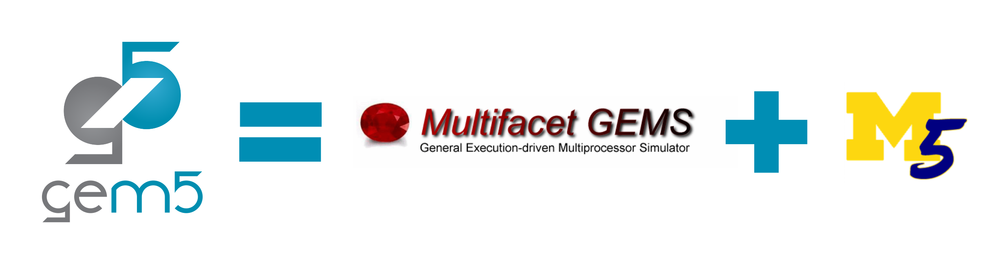

# Enter gem5

Simulation is cool, but what's the deal with gem5?
> By the end of this section, you will be able to:  
>
> - **Describe** the purpose and goals of the gem5 simulator.
> - **Explain** how gem5 differs from cycle-accurate RTL simulators.
> - **Describe** the roles of gem5’s C++ backend and Python frontend.
> - **Identify** the predecessor simulators to gem5.
>  

## What's gem5?

gem5 (yes, always in lowercase) is a computer architecture and microarchitecture simulator comprised of two other simulators: M5 (created at Michigan by students of Steve Reinhardt, principally Nate Binkert) and GEMS (created at Wisconsin by students of Mark Hill and David Wood). It combines the simulation framework of M5 with the detailed memory system of GEMS.

## What kind of simulator is gem5?

In the context of the simulation types we covered in the previous section, gem5 is an *execution-driven*, *full-system* simulator. It is also a *cycle-level* simulator: let's talk about what that means.

You may be familiar with Register Transfer Level (RTL) code written in Hardware Description Languages (HDLs) like Verilog (if not, that's ok!). In RTL, the programmer specifies, and the simulation simulates, every wire and register present in the system. This makes RTL very similar to the actual hardware being simulated. We call this kind of simulation *cycle-accurate*. Cycle-accurate simulation is very high-fidelity, but it's much harder to configure, and it's more difficult to combine functional and timing information.

*Cycle-level* simulators like gem5, on the other hand, do *not* simulate every wire and register in the system and don't concern themselves with what happens within a clock cycle. Cycle-level simulation only models which events occur *cycle-by-cycle*. This means that a gem5 simulation won't match up perfectly with hardware, but it'll have similar timing, which is often what we care about. Cycle-level simulation is also faster than cycle-accurate simulation: this is because cycle-level simulators can "cheat" and emulate some things instead of fully simulating them.

\

## How is gem5 organized?

Programmers interact with gem5 using C++ and Python. The backend of gem5, including all of its simulation models (hundreds of them), is written in C++, while Python provides the front-end interface. **C++ provides the models, and Python sets parameter values and controls the simulation.**

![A diagram showing what C++ and Python define in gem5. One side is labeled "C++: Models" and depicts a cache with parameter slots for size, associativity, etc., a core with parameter slots for LSQ, ROB, etc., and DRAM with slots for tRAS, tRCD, etc. The other side is labeled "Python: Standard Library and Simulation Control" and has two sections. The first section is captioned "the standard library specifies the values of parameters in Python" and contains a processor containing two i7 cores; a cache hierarchy containing an L1 i-cache, an L1 d-cache, and an L2 cache; and a memory system containing two DDR4s. The cores/caches/memory units look the same as the C++ cores/caches/memory, but the parameter slots are filled in. The second section is captioned "Configuration scripts control the simulation and develop experiments with the key parameters" and depicts 3 lines of code, sim.start(), sim.dump_stats(), and sim.stop_at_inst(...).](img/gem5-architecture.png)

Programmers write Python *configuration scripts* that define the components of the simulation, then provide them as arguments to the gem5 binary, which runs the simulation.

> This means that gem5 is effectively a **Python interpreter**.

## Who is gem5 for?

***Anyone, including non-architects, can download and use gem5***. gem5 aims to meet the needs of academic research, industry research, and classroom use. The community would love to have you! Take a look at the [gem5 repository](https://github.com/gem5/gem5) for the code of conduct (we'll also visit the repository in the next section!).

<link href = "../style.css" rel="stylesheet"></link>