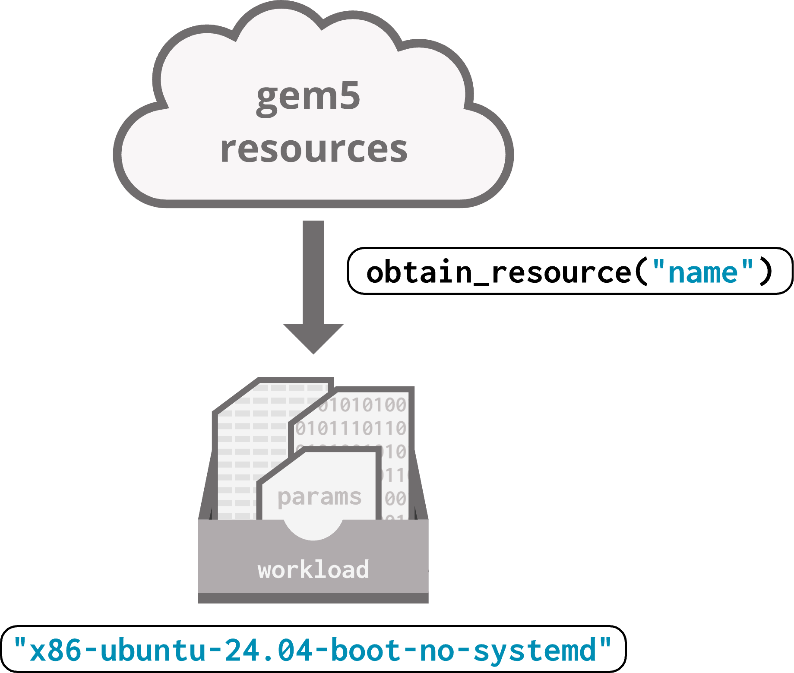

# Introduction to the gem5 standard library and resources

gem5 provides a lot of pre-made components for you to use! We'll be using standard library components and resources a lot in the coming sections, so this section is all about getting you acquainted. There is a lot we won't discuss in detail; don't worry! We'll come back to what we didn't cover as we dive deeper into gem5.

> By the end of this section, you will be able to:
>
> - **Construct** a board for simulation by “plugging in” standard library components and setting a workload.
> - **Set** parameters of standard library components to achieve desired behavior.
> - **Use** the `obtain_resource` function to acquire pre-existing gem5 workloads.

## What's the standard library?

gem5 is a complicated simulator! When configuring a simulation, every component of the system must be specified in *great detail*: every object, every port, every part. As you might imagine, this leads to even the most simple simulations requiring hundreds of lines of code.

*Wait*, you might ask yourself, *didn't we just run a configuration script that was about 10 lines?* **That's the magic of the standard library!** The standard library provides a large set of predefined components that do the majority of the work for you. You can then use these components to build your desired simulation! The standard library greatly reduces the amount of duplicated code, lowers the chance of errors in scripts, and increases portability between configurations.

The standard library aims to cover the **common needs** of gem5 users. Should you find that your needs are not completely met by existing components, APIs are provided that make it easy to extend the library for your own use. We'll talk about how to do that in future sections.

## Models vs. components

You may remember that we said the following in our introduction to gem5:

> *The backend of gem5, including all of its simulation models (hundreds of them), is written in C++, while Python provides the front-end interface.*

The standard library is part of this front-end interface! Standard library **components** (written in Python) wrap around gem5 **models** (written in C++) to provide a standard, easy-to-use interface. The standard library components instantiate and configure the parameters of models under the hood.


This section focuses on how we can use these standard library components; future sections will discuss how we can use gem5's models directly.

## Modularity

You can think of the gem5 standard library as a **set of components that can be plugged together**.

![A board, represented as a purple rectangle, has a blue slot for an AbstractProcessor, a green slot for an AbstractCacheHierarchy, and a yellow slot for an AbstractMemory. A board can be either an X86Board or an ArmBoard. A SimpleProcessor or a SwitchableProcessor can be plugged into the AbstractProcessor slot. A PrivateL1PrivateL2 or a MESITwoLevel can be plugged into the AbstractCacheHierarchy slot. A SingleChannelDDR5_2400 or a SingleChannel DDR3_1600 can be plugged into the AbstractMemory slot.](img/plugging_metaphor.png)

These components largely fall into one of four categories:

- **Boards**, which serve as the backbone of the system. You plug other components into a board. The board also contains system-level things like devices, the workload (the code the simulation will run), and more. It's the board's job to negotiate the connections between the other components.
- **Processors**, which connect to boards and contain one or more *cores*.
  - Many different core types are also provided in the standard library.
- **Cache hierarchies**, which are sets of caches that can be connected to a processor and a memory system. A cache hierarchy plugs into the board, and the board handles connecting it to the processor and memory system.
- **Memory systems**, which are sets of memory controllers and memory devices that can be connected to a cache hierarchy. A memory system plugs into the board, and the board handles connecting it to the cache hierarchy.

For the most part, you can mix and match these components to create your desired system! Take a board; plug in a processor, a cache hierarchy, and a memory system; and simulate.

## Hello, world! (again)

Let's complicate our `hello_world.py` example a bit by doing away with the `X86DemoBoard`.

> `X86DemoBoard` is is a *prebuilt component* from the standard library. It works the same way as all other standard library boards; it just comes with a processor, cache hierarchy, and memory system pre-plugged in.

Open `stdlib_hello_world.py` (which is currently just a copy of `hello_world.py`) to get started.

First, let's pick a new board to use. Let's stick with x86 as our ISA and use an `X86Board`. Replace the import statement for the `X86DemoBoard` with the following:

```python
from gem5.components.boards.x86_board import X86Board
```

Then, replace the `board` initialization with:

```python
board = X86Board(
  clk_freq="3GHz",
  processor =
  cache_hierarchy =
  memory =
)
```

We chose to set the clock frequency for the board at 3 GHz here. We'll add values for the `processor`, `cache_hierarchy`, and `memory` in just a moment. This is how the components plug together in gem5!

Now we need to pick a processor to use. The standard library has quite a few options, but let's use `SimpleProcessor` for now. Add the following import statements and initialization code:

```python
from gem5.components.processors.simple_processor import SimpleProcessor
from gem5.components.processors.cpu_types import CPUTypes
from gem5.isas import ISA
```

```python
processor = SimpleProcessor(
  cpu_type = CPUTypes.TIMING,
  isa = ISA.X86,
  num_cores = 1
)
```

The parameters for `SimpleProcessor` define important qualities of the processor like which ISA it'll use and how many cores it should have. Don't worry about what `cpu_type` means for now; we'll talk about that in the next section. We can now plug in our processor to our board:

```python
board = X86Board(
  clk_freq="3GHz",
  processor = processor,
  cache_hierarchy =
  memory =
)
```

Now, let's create and plug in a cache hierarchy. gem5 has a *lot* of cache hierarchy flexibility; for now, let's use a private L1/shared L2 hierarchy:

```python
from gem5.components.cachehierarchies.classic.private_l1_shared_l2_cache_hierarchy import PrivateL1SharedL2CacheHierarchy
```

```python
cache = PrivateL1SharedL2CacheHierarchy(
  l1d_size = "16KiB",
  l1i_size = "16KiB",
  l2_size = "256KiB",
  l1d_assoc = 8,
  li_assoc = 8,
  l2_assoc = 16
)
```

> This is a *classic cache* model. We'll talk more about what classic caches are, and how they differ from *Ruby* caches, later.

This cache hierarchy's parameters allow us to choose the size and associativity of the L1 i-cache and d-cache, as well as the L2 cache. Let's plug it into the board:

```python
board = X86Board(
  clk_freq="3GHz",
  processor = processor,
  cache_hierarchy = cache,
  memory =
)
```

Lastly, memory. Let's use a single-channel DDR4 system, aptly named `SingleChannelDDR4_2400`:

```python
from gem5.components.memory.single_channel import SingleChannelDDR4_2400
```

```python
memory = SingleChannelDDR4_2400(
    size = "3GiB"
)
```

This component has an optional parameter, `size`, which specifies the size of the memory system. Here, we choose 3 GiB to align with the requirements of the board we're using. Let's plug it in!

```python
board = X86Board(
  clk_freq="3GHz",
  processor = processor,
  cache_hierarchy = cache,
  memory = memory
)
```

We've now successfully replaced `X86DemoBoard` with our own custom board. You can run this script using:

```bash
gem5 stdlib_hello_world.py
```

When you do, you should get output that resembles that of the original `hello_world.py` script:

```txt
gem5 Simulator System.  https://www.gem5.org
gem5 is copyrighted software; use the --copyright option for details.

gem5 version 25.0.0.1
gem5 compiled <COMPILATION TIME>
gem5 started <START TIME>
gem5 executing on <ENVIRONMENT>, pid <PROCESS ID>
command line: ./gem5/build/ALL/gem5.opt workspace/workspace/02-beginning-simulation/01-stdlib-resources/stdlib_hello_world.py

info: Using default config
warn: Max ticks has already been set prior to setting it through the run call. In these cases the max ticks set through the `run` function is used
Global frequency set at 1000000000000 ticks per second
warn: board.workload.acpi_description_table_pointer.rsdt adopting orphan SimObject param 'entries'
warn: No dot file generated. Please install pydot to generate the dot file and pdf.
src/mem/dram_interface.cc:690: warn: DRAM device capacity (16384 Mbytes) does not match the address range assigned (4096 Mbytes)
src/sim/kernel_workload.cc:46: info: kernel located at: /homes/iws/namiel/.cache/gem5/x86-linux-kernel-6.8.0-52-generic
      0: board.pc.south_bridge.cmos.rtc: Real-time clock set to Sun Jan  1 00:00:00 2012
board.pc.com_1.device: Listening for connections on port 3456
src/base/statistics.hh:279: warn: One of the stats is a legacy stat. Legacy stat is a stat that does not belong to any statistics::Group. Legacy stat is deprecated.
src/dev/intel_8254_timer.cc:128: warn: Reading current count from inactive timer.
board.remote_gdb: Listening for connections on port 7000
```

> You'll notice that the simulation no longer warns us about using a demo-only board.

Checking the `m5out` directory just like before, we can look at some simulation information. For example, this system uses an L2 cache; we can find its overall miss rate in `stats.txt`:

```txt
board.cache_hierarchy.l2cache.overallMissRate::total     0.675398
```

Due to the modular setup of the gem5 standard library, we can choose to replace any of the components on this board to try out different configurations (for example, what if we used a dual-channel memory system instead?).

Here is our updated `hello_world.py` showing our custom board:


## gem5 resources preview

One thing we haven't talked about yet is the bottom half of `stdlib_hello_world.py`, where we use the `obtain_resource()` function to set the board's workload:

```python
board.set_workload(
    obtain_resource("x86-ubuntu-24.04-boot-no-systemd")
)
```

The `obtain_resource()` function interacts with [gem5 resources](https://resources.gem5.org/), a repository of prebuilt artifacts that are helpful for gem5 simulations. There are many different kinds of gem5 resources, but the most common resource type we'll use in the bootcamp are binaries (programs we can run on our simulated hardware) and workloads (bundles of a binary and input parameters that are run together).

We use `obtain_resource()` to download a resource from gem5 resources by its name. Here is the [gem5 resources page for the resource we're currently using](https://resources.gem5.org/resources/x86-ubuntu-24.04-boot-no-systemd?version=4.0.0)! This resource, `x86-ubuntu-24.04-boot-no-systemd`, is a workload: it's a bundle of the kernel code, the disk image, and the parameters needed to boot Ubuntu.



> You'll see the `obtain_resource` function often! We'll discuss gem5 resources in depth in a future section.

## A flyover tour of the standard library files

All standard library components are located in `gem/src/python/gem5`:

```txt
gem5/src/python/gem5/components
----/boards
----/cachehierarchies
----/memory
----/processors

gem5/src/python/gem5/prebuilt
----/demo/x86_demo_board
----/riscvmatched
```

At the top level, they're separated into two categories:

- **Components**: individual components to build systems, like `X86Board`, `SimpleProcessor`, `PrivateL1SharedL2CacheHierarchy`, and `SingleChannelDDR4_2400`.
- **Prebuilt**: full systems with set parameters, like `X86DemoBoard`.
  - We won't be using prebuilt components much, but you might find them useful!

Let's look into all of the component categories now.

### Boards

```txt
gem5/src/python/gem5/components
----/boards
    ----/simple
    ----/arm_board
    ----/riscv_board
    ----/x86_board
```

There are two main types of boards in the standard library: the simple board, which is ISA-configurable and can only run in SE mode (one of the two simulations modes available in gem5; we'll discuss simulation modes in a future section), and full boards, which can run in either simulation mode and are separated by ISA.

### Processors

```txt
gem5/src/python/gem5/components
----/processors
    ----/generators
    ----/simple
    ----/switchable
```

There are two main processor types: simple processors, which can represent any single processor (most processors are simple processors in gem5); and switchable processors, which allow for switching between processor types mid-simulation. There are also generators, which generate synthetic memory traffic using predefined patterns (as opposed to normal processors, which make memory requests when the executing instructions require them).

### Cache hierarchies

```txt
gem5/src/python/gem5/components
----/cachehierarchies
    ----/chi
    ----/classic
    ----/ruby
```

There are two cache systems in gem5: classic and Ruby. We'll explain more about the differences between cache types in the caches section. For now, know that Ruby is more flexible, but classic caches are simpler. CHI (pronounced "chai", [ARM description of CHI](https://developer.arm.com/documentation/102407/0102/Introduction-to-CHI)) caches are an example of Ruby caches!

### Memory systems

```txt
gem5/src/python/gem5/components
----/memory
    ----/single_channel
    ----/multi_channel
    ----/dramsim
    ----/dramsys
    ----/hbm
```

The standard library includes pre-configured single and multi-channel DDR3/4/5 DIMMs (dual in-line memory modules). It also has integration with DRAMSim and DramSys (both DRAM simulators); you don't have to use these integrations, but they might be useful and more accurate depending on your needs. There are also high-bandwidth memory (HBM) options.
