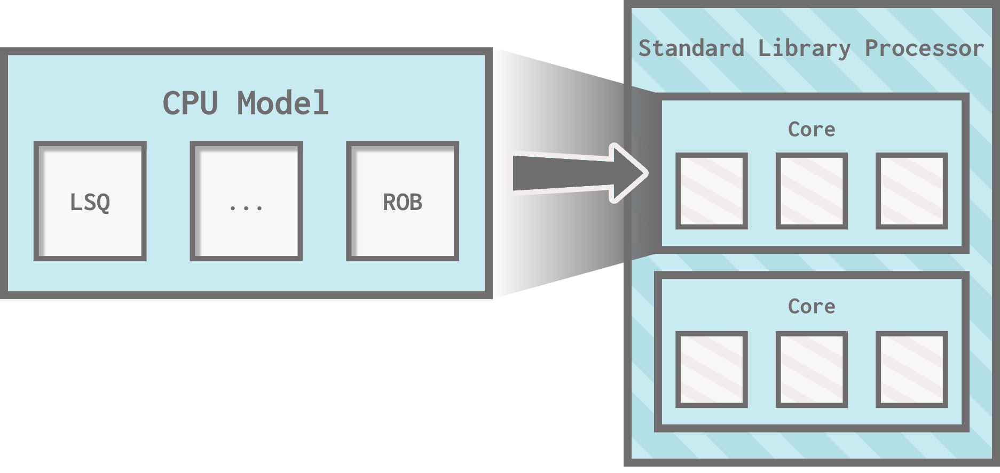
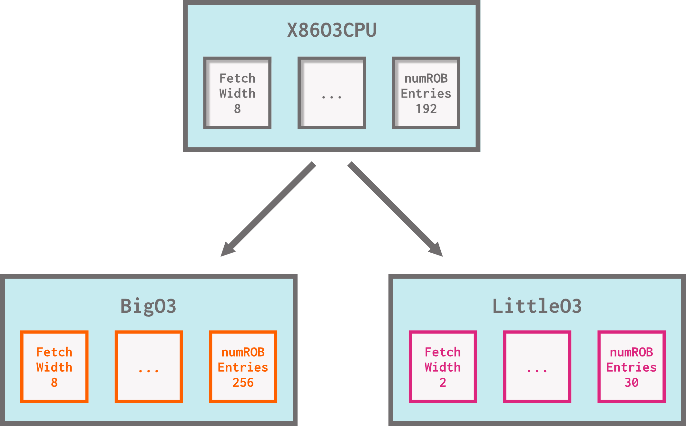
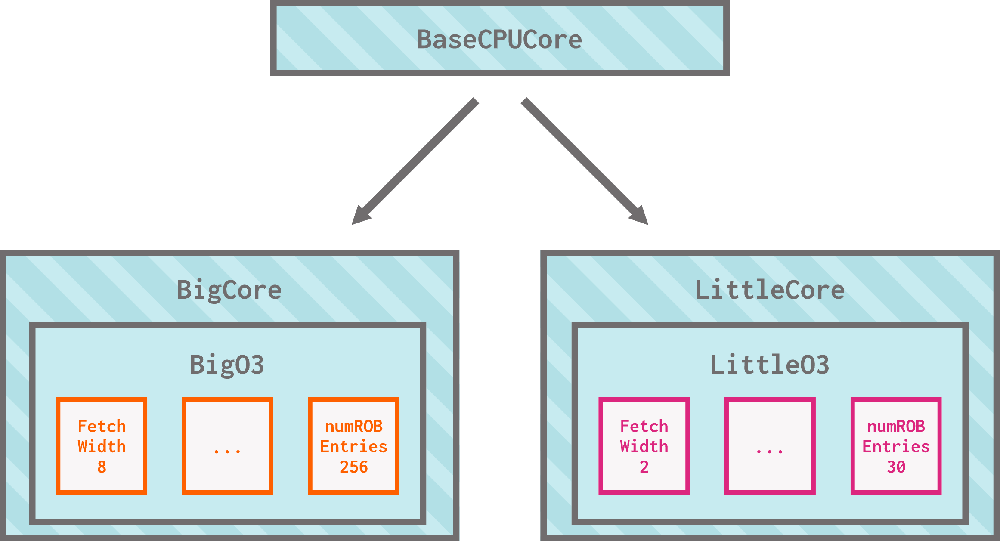
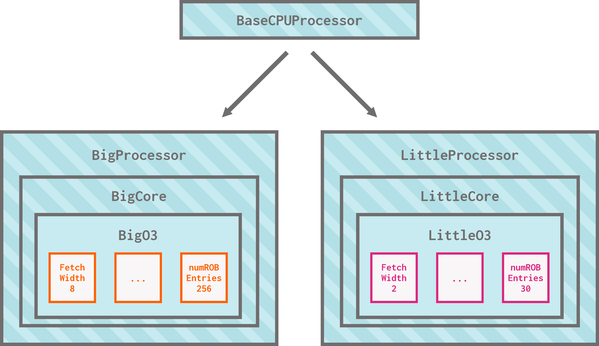

# Modeling processors in gem5

Let's start digging into the first of the three main categories of gem5 components: processors.

> By the end of this section, you will be able to:
>
> - **Compare** the features and advantages of simple, KVM, O3, and minor CPUs.
> - **Modify** a processor by changing the CPU type.
> - **Change** a CPU’s parameters by extending an existing CPU model in Python.
> - **Contrast** the simulation behavior of atomic, functional, and timing memory accesses.
> - **Compare** the simulation performance of different gem5 CPU types.

## Processors in the standard library

### Processors

In the previous section on the standard library, we mentioned that two types of processors exist: `SimpleProcessor` and `SwitchableProcessor`. Traffic generators, which pretend to be processors, can be used in their place.

- A `SimpleProcessor` is the general-purpose processor in the standard library, which lets you define its ISA, number of cores, and type (more on this in a minute!)
- A `SwitchableProcessor` is similar to a `SimpleProcessor`, but it allows switching between multiple types of processors during a simulation instead of using just one `SimpleProcessor`.
  - We'll use a switchable processor during our advanced section on KVM fast-forwarding!
- Traffic generators are not really processors; they take the spot of a processor on a board, but they don't execute instructions. Instead, they use traffic patterns (linear, random, etc.) to synthetically generate memory accesses. They're ideal for testing cache hierarchies/memory systems.
  - We'll use traffic generators in the intermediate features unit's section on traffic generation!

### Cores

Within every processor, there are one or more *cores*. The gem5 standard library provides core components that its processors (and, eventually, your own processors) can use! The cores follow a similar pattern to the processors:

- `SimpleCore` is the core used in all "regular" processors (`SimpleProcessor` and `SwitchableProcessor`).
- There are many types of generator cores, all of which extend from `AbstractGeneratorCore`. These are used in traffic generators.
  - Some examples include `ComplexGeneratorCore`, `RandomGeneratorCore`, etc.


> If you're curious, the class diagram for every processor and core in the standard library is below.
>
> <details>
> <summary markdown="span"> <b>src/python/gem5/components/processors</b> </summary>
>
> ![A tree-like class diagram of cores and processors in the gem5 standard library. The subsystem class is at the very top. AbstractCore and AbstractGenerator inherit from SubSystem. AbstractGeneratorCore and BaseCPUCore inherit from AbstractCore. ComplexGeneratorCore, LinearGeneratorCore, GUPSGeneratorCore, RandomGeneratorCore, StridedGeneratorCore, and TrafficGeneratorCore inherit from AbstractGeneratorCore. SimpleCore inherits from BaseCPUCore. AbstractGenerator, BaseCPUProcessor, and SwitchableProcessor inherit from AbstractProcessor. ComplexGenerator, LinearGenerator, GUPSGenerator, GUPSGeneratorEP, GUPSGeneratorPAR, RandomGenerator, StridedGenerator, and TrafficGenerator inherit from AbstractGenerator. SimpleProcessor inherits from BaseCPUProcessor. SimpleSwitchableProcessor inherits from SwitchableProcessor.](img/stdlib_processors_cores.png)
> </details>

<br>

### Using standard library processors

As we've discussed already, we can use standard library processors in the same way that we use all other standard library components: by instantiating them with our desired parameters and plugging them into our board. For example, in the previous section, we used a `SimpleProcessor` for our board like this:

```python
# instantiate and set parameters
processor = SimpleProcessor(
  cpu_type = CPUTypes.TIMING,
  isa = ISA.X86,
  num_cores = 1
)

# plug into board
board = X86Board(
  ...
  processor = processor
)
```

You might notice, however, that we have yet to explain what `cpu_type` refers to. This is how we configure what **CPU model** the processor's cores use.

## CPU models in gem5

The standard library gives us an easy interface for processors and cores through **components** like `SimpleProcessor`, `SwitchableProcessor`, `SimpleCore`, and the array of available synthetic traffic generators/cores. Under the hood, these standard library components utilize gem5's CPU **models** for their cores.

> Remember that a *component* refers to a pre-defined standard library object written in Python. A *model* is a simulated object written in C++. gem5 has hundreds of models!



gem5 has five major CPU models:

- `AtomicSimpleCPU` (`CPUTypes.ATOMIC`)
- `TimingSimpleCPU` (`CPUTypes.TIMING`)
- `KvmCPU` (`CPUTypes.KVM`)
- `MinorCPU` (`CPUTypes.MINOR`)
- `O3CPU` (`CPUTypes.O3`)

Let's discuss these CPU types in more detail.

### Atomic and Timing Simple CPUs

A `SimpleCPU` (not to be confused with `SimpleProcessor`, the standard library *processor* component) is quite fast to simulate and has limited branch prediction capabilities.

> As a reminder, branch prediction is a CPU's ability to execute instructions after a branch (AKA jump) instruction by guessing whether the branch will be taken or not.

A `SimpleCPU` interacts with the cache hierarchy when making memory accesses, and it can make memory accesses in three different ways:

- **Atomic** (performed by `BaseAtomicSimpleCPU`): atomic memory accesses don't simulate resource contention or queuing delay. They ignore memory access latency.
  - This makes atomic accesses ideal for fast-forwarding and for warming up caches.
- **Timing** (performed by `BaseTimingSimpleCPU`): timing accesses *do* model resource contention and queuing delay. Responses to memory requests are sent after the simulated memory latency.
  - This means that memory accesses on a `BaseTimingSimpleCPU` take multiple cycles, while all other non-memory operations take one cycle.
- **Functional** (used for loading binaries): these are "back door" accesses to memory that have no effect on the cache/memory system's coherency state.

<br>


A `SimpleCPU` is a good choice for when you aren't paying too much attention to the processor's performance, such as when primarily observing memory latency. If you want to simulate more advanced processor features like out-of-order execution or advanced branch prediction, you'll want a different CPU type.

### KVM

KVM stands for "**K**ernel-based **V**irtual **M**achine". This CPU model allows for *native execution* on x86 and ARM hosts; basically, using your machine's actual CPU to execute instructions instead of a simulated CPU model. As you might imagine, this is *really fast* compared to simulating a CPU. However, it means that the ISA of your host machine has to match the ISA of the simulation. Otherwise, your CPU would have no idea what to do!

We use KVM for fast-forwarding and functional tests, and it's great for this purpose. That being said, you wouldn't want to use KVM if you're trying to collect any meaningful statistics about performance.

### Minor CPU

gem5's minor CPU is an in-order pipelined CPU with the following four stages:

- **Fetch1**: Handles ITLB (Instruction Translation Lookaside Buffer) accesses and instruction fetch from main memory.
- **Fetch2**: Decodes instructions.
- **Decode**: Performs related bookkeeping tasks.
- **Execute**: Manages instruction issue, execution, memory access, writeback, and commit.

![An illustration of the stages and communication buffers of gem5's minor CPU. The stages are represented as a row of four rectangles labeled: fetch1, fetch2, decode, execute. Between each pair of rectangles, there is an additional, thinner rectangle representing a time buffer. Arrows go between each neighboring stage/time buffer such that all arrows point in the same direction (from fetch1 to fetch2 to decod to execute). Above the fetch1 and fetch2 stages, there is one long rectangle labeled "backward communication". The fetch1 stage has one arrow pointing down from the backward communication buffer to it, and the fetch2 stage has one arrow pointing from it to the backward communication buffer.](img/minor_cpu.png)

`MinorCPU` is designed to make the interactions between the pipelined stages of the CPU easier to understand; this means that while its implementation provides a good amount of detail, it is somewhat simplified compared to gem5's O3 model (which we'll discuss in a moment).

The minor CPU model makes *timing* memory accesses and interacts with the cache hierarchy (like `BaseTimingSimpleCPU` does). It has more robust branch prediction capabilities than the simple CPUs. However, because of its extra simulation detail, it is slower to simulate.

### O3 CPU

O3 is shorthand for "**o**ut-**o**f-**o**rder". gem5's O3 processor has five stages:

![An illustration of the stages and communication buffers of gem5's O3 CPU. The stages are represented as a row of five rectangles labeled: fetch, decode, rename, issue/execute/writeback, commit. Between each pair of rectangles, there is an additional, thinner rectangle representing a time buffer. Arrows go between each neighboring stage/time buffer such that all arrows point in the same direction (from fetch to decode to rename to issue/execute/writeback to commit). Above the stages, there is one long rectangle labeled "backward communication". The fetch stage has one arrow pointing down from the backward communication buffer to it, and the commit stage has one arrow pointing from it to the backward communication buffer. The remaining three stages have bidirectional arrows between them and the buffer.](img/o3_cpu.png)

gem5 is an "*execute-in-execute*" simulator, meaning that instructions executed by gem5's O3 CPU are executed in the "execute" stage of the pipeline.

> Many other simulators (and old gem5 models not discussed here) are **not** execute-in-execute. This means that they execute instructions either at the beginning or at the end of the pipeline instead, passing the results to a timing backend.
>
> This is an issue for two main reasons: first, if there is an error in the aforementioned timing backend, it won't show up in the program results; second, instructions cannot be executed out-of-order.
>
> *This means that being execute-in-execute uniquely allows us to simulate out-of-order interactions!*

Much like the minor CPU, the O3 CPU makes timing memory accesses, interacts with the cache hierarchy, and has detailed branch prediction capabilities. It, too, is slower to simulate. The O3 CPU model is the closest thing to a real CPU provided by gem5 (it's loosely based on the [Alpha 21264](https://acg.cis.upenn.edu/milom/cis501-Fall09/papers/Alpha21264.pdf)!).

## Using gem5's CPU models

To recap, these are the CPU models that exist in gem5:

- `BaseAtomicSimpleCPU`: A simple CPU model with some branch prediction that makes atomic memory accesses (does not take memory latency into account).
- `BaseTimingSimpleCPU`: A simple CPU model with some branch prediction that makes timing memory accesses (takes memory latency into account).
- `BaseKvmCPU`: A KVM (Kernel Virtual Machine) CPU that uses the host's actual CPU to execute instructions, resulting in *really fast* execution but unhelpful performance data.
- `MinorCPU`: An in-order four-stage pipelined CPU with branch prediction capabilities. Slower to simulate.
- `O3CPU`: An out-of-order five-stage pipelined CPU with branch prediction capabilities. Slower to simulate.

To use any of these CPU models in the cores within gem5's standard library processor models, set `core_type` to the appropriate value of the `CPUType` enum when instantiating a standard library processor:

- `CPUTypes.ATOMIC`
- `CPUTypes.TIMING`
- `CPUTypes.KVM`
- `CPUTypes.MINOR`
- `CPUTypes.O3`

We've used `TIMING` CPUs so far in our examples.

### Comparing performance

Let's explore how we can use different CPU core types using standard library components. We'll be doing the following:

1) Create a system with a cache hierarchy and an `ATOMIC` CPU.
2) Replace the cache hierarchy with a smaller one and re-simulate.
3) Try both caches with a `TIMING` CPU instead.

This way, we'll be able to see how changing our memory access type affects the simulation statistics. Open `atomic_vs_timing.py` to start.

Currently, this file contains the following:
- A cache hierarchy consisting of a 32-KiB L1 i-cache and d-cache for each core (`PrivateL1CacheHierarchy`):

```python
cache_hierarchy = PrivateL1CacheHierarchy(
  l1d_size="32KiB", 
  l1i_size="32KiB"
)
```

- A 1-GiB single-channel DDR3-1600 memory system (`SingleChannelDDR3_1600`):

```python
memory = SingleChannelDDR3_1600("1GiB")
```

- A `SimpleProcessor` with an `ATOMIC` core type:

```python
cpu_type = CPUTypes.ATOMIC

processor = SimpleProcessor(
  cpu_type=cpu_type,
  isa=ISA.RISCV,
  num_cores=1
)
```

- A `SimpleBoard` running a RISC-V matrix multiplication workload:

```python
board = SimpleBoard(
    clk_freq="3GHz",
    processor=processor,
    memory=memory,
    cache_hierarchy=cache_hierarchy
)

workload = obtain_resource("riscv-matrix-multiply-run")
board.set_workload(workload)
```

The first thing we want to do is run this simulation and save the output in a directory named `atomic-normal-cache`. We can do that with the following command:

```bash
gem5 --outdir=atomic-normal-cache atomic_vs_timing.py
```

> The `--outdir` flag changes the name of the output directory from the default output directory name (`m5out`) to a name of your choosing.

Now, let's shrink the cache and try again:

> **Your turn:** Change the size of the i-cache and d-cache to 1 KiB and rerun the simulation. Save the results in a directory called `atomic-small-cache`.
>
> <details>
> <summary markdown="span"> <b>Answer</b> </summary>
>
> ```python
> cache_hierarchy = PrivateL1CacheHierarchy(
>   l1d_size="1KiB",
>   l1i_size="1KiB"
>  )
> ```
>
> ```bash
> gem5 --outdir=atomic-small-cache atomic_vs_timing.py
> ```
>
> </details>

<br>

Let's keep the cache how it is but change the CPU type from `ATOMIC` to `TIMING`.

> **Your turn:** Change the CPU type to `TIMING` and rerun the simulation. Save the results in a directory named `timing-small-cache`.
>
> <details>
> <summary markdown="span"> <b>Answer</b> </summary>
>
> ```python
> cpu_type = CPUTypes.TIMING
> ```
>
> ```bash
> gem5 --outdir=timing-small-cache atomic_vs_timing.py
> ```
>
> </details>

<br>

Lastly, let's put the cache back at 32 KiB.

> **Your turn:** Change the size of the i-cache and d-cache back to 32 KiB and rerun the simulation. Save the results in a directory called `timing-normal-cache`.
>
> <details>
> <summary markdown="span"> <b>Answer</b> </summary>
>
> ```python
> cache_hierarchy = PrivateL1CacheHierarchy(
>  l1d_size="32KiB",
>  l1i_size="32KiB"
> )
> ```
>
> ```bash
> gem5 --outdir=timing-normal-cache atomic_vs_timing.py
> ```
>
> </details>

<br>

Now, let's compare the results! We'll find everything we need in `stats.txt` within the output directories. First, let's prove that all four of these simulations simulated the same number of ops. We can do this by checking the `simOps` statistic at the top of `stats.txt`, either by searching the file by hand or by using the `grep` command in the terminal:

```bash
grep -r 'simOps' <path-to-output-directories>
```

> If you have not seen it before, `grep` is a command-line utility that searches for text within files. It's useful for navigating large directories, including the gem5 directory! The `-r` flag (for "recursive") specifies that `grep` should look inside directories, which allows it to find the `stat.txt` files inside each of output directories we created. We tell it to look for the text string `simOps`, which conveniently only shows up as the statistic we're looking for.

Here are the results:

`atomic-normal-cache`:

```txt
simOps                                       33954687
```

`atomic-small-cache`:

```txt
simOps                                       33954687
```

`timing-normal-cache`:

```txt
simOps                                       33954687
```

`timing-small-cache`:

```txt
simOps                                       33954687
```

Running the same workload on the same configuration yields the same number of ops, which makes sense; we kept the workload, which determines the instructions being executed, exactly the same, and the cores only changed their memory access mode. Note that the number of ops may not be the exact same as the number of instructions, since gem5 breaks down some instructions into micro-ops.

Now for our experiment: how many CPU cycles were required to multiply these matrices? We can find this out using the `numCycles` statistic, which is collected for each core and tracks the total number of CPU cycles simulated.

> **Your turn:** Write a `grep` command to search for the `numCycles` statistic in the output directories for our cache simulations.
>
> <details>
> <summary markdown="span"> <b>Answer</b> </summary>
>
> ```bash
> grep -r 'numCycles' <path-to-output-directories>
> ```
>
> </details>

<br>

`atomic-normal-cache`:

```txt
board.processor.cores.core.numCycles        38157732 
```

`atomic-small-cache`:

```txt
board.processor.cores.core.numCycles        38157732 
```

`timing-normal-cache`:

```txt
board.processor.cores.core.numCycles        62830921 
```

`timing-small-cache`:

```txt
board.processor.cores.core.numCycles        112602851
```

You may notice that the timing CPU executed for more simulated cycles than the atomic CPU on the same cache size. This is because any memory accesses we make take longer on a timing CPU compared to an atomic CPU. More interestingly, you'll notice that for the atomic CPU, the number of CPU cycles didn't change when we switched our cache models! Since atomic memory accesses don't take memory latency into account, the fact that our cache was smaller (and thus that we accessed memory more often) made no difference. The difference is clear for the timing CPU, however, where the smaller cache significantly increased the number of simulated cycles.

> If you'd like, you can change the CPU type again to `O3` and take a look at the results!

Keep these results in mind when selecting which CPU type is approriate for your gem5 simulations. Some kind of timing CPU is the right choice if memory access latency matters to your work.

## Creating custom processor components

We can do better than just *using* CPU models in standard library components. We can *create* our own components!

### Changing model parameters with extension

gem5 models have a lot of parameters. For example, here are just a few of the parameters for `BaseO3CPU`:

```python
decodeToFetchDelay = Param.Cycles(1, "Decode to fetch delay")
renameToFetchDelay = Param.Cycles(1, "Rename to fetch delay")
iewToFetchDelay = Param.Cycles(1, "Issue/Execute/Writeback to fetch delay")
commitToFetchDelay = Param.Cycles(1, "Commit to fetch delay")
fetchWidth = Param.Unsigned(8, "Fetch width")
fetchBufferSize = Param.Unsigned(64, "Fetch buffer size in bytes")
```

> These parameters (and many more) can be found in `src/cpu/o3/BaseO3CPU.py`. Don't worry too much about this syntax for now! We'll talk about what this means when we cover how to create gem5 models in the next unit.

In this snippet, we can see the following:

- The decode-to-fetch delay with a value of 1 cycle,
- The rename-to-fetch delay with a value of 1 cycle,
- The issue/execute/writeback-to-fetch delay with a value of 1 cycle,
- The commit-to-fetch delay with a value of 1 cycle,
- The fetch width with a value of 8 instructions,
- The fetch buffer size with a value of 64 bytes.

The way we change these parameters' values in our code is not by changing this file, or even by directly creating an instance of this component in our code. ***We customize parameter values of gem5 components by extending their classes in Python.***

Let's see this in action by starting to create our very own processor. For this example, we'll be extending one of gem5's out-of-order CPU models, `X86O3CPU`. Open `my_processors.py` to get started. Currently, this file is mostly empty! We'll be defining our O3 CPUs with custom parameters here.

First, let's create `BigO3`, an O3 CPU with... big parameters! We'll specifically be doing the following:

- Setting the fetch, decode, rename, dispatch, issue, writeback, and commit widths to 8 bytes,
- Setting the number of ROB (re-order buffer) entries to 256,
- Setting the number of physical int and float registers to 512.

> O3 CPUs in gem5 are ISA-specific. Therefore, we'll we extending `X86O3CPU` instead of just `BaseO3CPU`.

Let's create the `BigO3` class and set all of these parameters:

```python
class BigO3(RiscvO3CPU):
    def __init__(self):
        super().__init__()
        self.fetchWidth = 8
        self.decodeWidth = 8
        self.renameWidth = 8
        self.dispatchWidth = 8
        self.issueWidth = 8
        self.wbWidth = 8
        self.commitWidth = 8

        self.numROBEntries = 256
        self.numPhysIntRegs = 512
        self.numPhysFloatRegs = 512
```

We also want another core type with little parameters to compare `BigO3` to. We want a CPU that has the following:

- Fetch, decode, rename, dispatch, issue, writeback, and commit widths set to 2 bytes,
- Number of ROB (re-order buffer) entries set to 30,
- The number of physical int and float registers set to 80.

> **Your turn:** Write the `LittleO3` class to set the parameters above to our desired values.
>
> <details>
> <summary markdown="span"> <b>Answer</b> </summary>
>
> ```python
> class LittleO3(X86O3CPU):
>     def __init__(self):
>         super().__init__()
>         self.fetchWidth = 2
>         self.decodeWidth = 2
>         self.renameWidth = 2
>         self.dispatchWidth = 2
>         self.issueWidth = 2
>         self.wbWidth = 2
>         self.commitWidth = 2
>
>         self.numROBEntries = 30
>         self.numPhysIntRegs = 80
>         self.numPhysFloatRegs = 80
> ```
>
> </details>

<br>

We've now created our custom CPU models to use in the cores of our processor!



### Wrapping models with components

Great, now we have some customized parameters for our CPU models... but how do we use them? In order for these models to be useful, we need to wrap them in a standard library core component.

The best standard library component to inherit from to make our wrapper component is `BaseCPUCore`. This is the parent class of `SimpleCore`, which you may remember as the core used by `SimpleProcessor` and `SwitchableProcessor`. `BaseCPUCore` provides the standard interface for CPU cores. Thankfully, it's super straightforward to extend `BaseCPUCore`!

In the same `my_processors.py` file, we can now add two new classes, `BigCore` and `LittleCore`. As the names suggest, `BigCore` will wrap around `BigO3` and `LittleCore` will wrap around `LittleO3`. All we need to add these classes is:

1) Extend `BaseCPUCore`,
2) Create a core of our custom type,
3) Call our parent's `__init__` with the core and the appropriate ISA.

```python
class BigCore(BaseCPUCore):
    def __init__(self):
        core = BigO3()
        super().__init__(core, ISA.X86)
```

> **Your turn:** Write the `LittleCore` class to wrap `LittleO3` in a standard library core.
>
> <details>
> <summary markdown="span"> <b>Answer</b> </summary>
>
> ```python
> class LittleCore(BaseCPUCore):
>     def __init__(self):
>         core = LittleO3()
>         super().__init__(core, ISA.X86)
> ```
>
> </details>

<br>

Sweet! Now we have some standard library cores. Next, a processor.



### Building the processor

To use our shiny new standard library cores, we need to put them inside of a standard library processor (which can plug into a board!).

The best class to inherit from to create our standard library processor is `BaseCPUProcessor`, which is the parallel to `BaseCPUCore` in processor land. This is the parent class to `SimpleProcessor`. Once again, it's very straightforward to extend `BaseCPUProcessor`.

In the same `my_processors.py` file, we can add our final two classes: `BigProcessor` and `LittleProcessor`. For each class, we need to:

1) Extend from `BaseCPUProcessor`,
2) Create a list of cores of the appropriate type,
3) Pass the list to the parent's `__init__`.

```python
class BigProcessor(BaseCPUProcessor):
    def __init__(self):
        core_list = [BigCore()]
        super().__init__(
            cores = core_list
        )
```

> **Your turn:** Write the `LittleProcessor` class to pass a single `LittleCore` into a standard library processor.
>
> <details>
> <summary markdown="span"> <b>Answer</b> </summary>
>
> ```python
> class LittleProcessor(BaseCPUProcessor):
>     def __init__(self):
>         core_list = [LittleCore()]
>         super().__init__(
>             cores = core_list
>         )
> ```
>
> </details>

<br>

And that, finally, is it!



### Let's run this thing!

Let's recap everything we just did:

1) **From base CPU model to specialized CPU models:** We extended the `X86O3CPU` class to change its parameter values, creating `BigO3` and `LittleO3`.
2) **From CPU models to cores:** We wrapped the `BigO3` and `LittleO3` **models** with matching standard library **components**, `BigCore` and `LittleCore`, which extend `BaseCPUCore`.
3) **From cores to processors:** We passed our newly-created standard library **cores** into newly-created standard library **processors**, `BigProcessor` and `LittleProcessor`, which extend `BaseCPUProcessor`.

What we're left with are two new **standard library processors** containing cores with our chosen custom parameters.

> There are quite a few more parameters available in `BaseO3CPU` that we didn't touch, so the customization options are even more expansive than what this example shows!

We can now take `BigProcessor` and `LittleProcessor` and plug them into a standard library board just like we did with `SimpleProcessor` in our previous example. In fact, let's put them in our hello world example! A copy of `stdlib_hello_world.py` (with the modifications made in the last section) named `hello_processors.py` is provided for convenience.

> The `workspace` directory is organized such that the configuration script is able to find our new components in its search path. If this is not the case in your future work, note that the Python search path must be expanded to include the location of the file(s) definining new components, which can be done with `import sys` and `sys.path.append(<path>)`.

Remove the `ISA` and `CPUTypes` imports and replace the import statement for `SimpleProcessor` with the following:

```python
from my_processors import BigProcessor, LittleProcessor
```

Next, we can swap out the processor for our new processors! Let's use `LittleProcessor` first:

```python
processor = LittleProcessor()
```

Let's compare these CPUs on a more interesting workload than the first 20 milliseconds of booting Ubuntu. Swap out `"x86-ubuntu-24.04-boot-no-systemd"` in the call to `obtain_resource` with `x86-matrix-multiply-run`:

```python
board.set_workload(
    obtain_resource("x86-matrix-multiply-run")
)
```

Additionally, remove the 20 millisecond restriction on simulation time by removing the parameter to `sim.run(20_000_000_000)`:

```python
sim.run()
```

That's it! We can now run this script. Let's redicrect its output to a directory named `little-o3` so we can compare our results later:

```bash
gem5 --outdir=little-o3 hello_processors.py 
```

> **Your turn:** Switch out `LittleProcessor` for `BigProcessor` and run the simulation again, redirecting the output to a directory named `big-o3`.
>
> <details>
> <summary markdown="span"> <b>Answer</b> </summary>
>
> ```python
> processor = BigProcessor()
> ```
>
> ```bash
> gem5 --outdir=big-o3 hello_processors.py 
> ```
>
> </details>

<br>

You should see some changes in the simulation statistics. Let's look at how long the simulation took, as well as how many CPU cycles were simulated.

> **Your turn:** Search for the `simSeconds` and `numCycles` statistics in the `little-o3` and `big-o3` output directories.
>
> <details>
> <summary markdown="span"> <b>Answer</b> </summary>
>
> ```bash
> grep -r 'simSeconds' <path-to-output-directories>
> ```
>
> ```bash
> grep -r 'numCycles' <path-to-output-directories>
> ```
>
> </details>

<br>

You should see the following:

`little-o3`:

```txt
simSeconds                                   0.010227 
board.processor.cores.core.numCycles         30713015  
```

`big-o3`:

```txt
simSeconds                                   0.009471 
board.processor.cores.core.numCycles         28440669
```

As we might expect, `BigProcessor` is able to execute the workload in fewer simulated cycles and thus in fewer simulation seconds.

There are a lot more things to explore when it comes to processors in gem5! If you're looking to learn about more advanced features in the context of processors, take the processor track in Unit IV!
