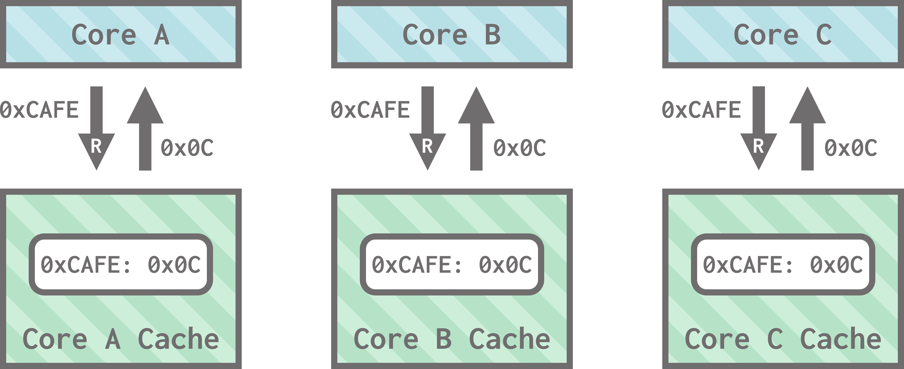
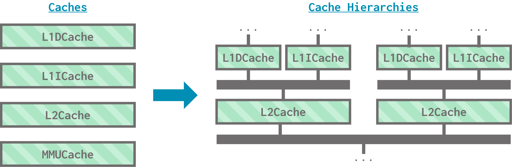
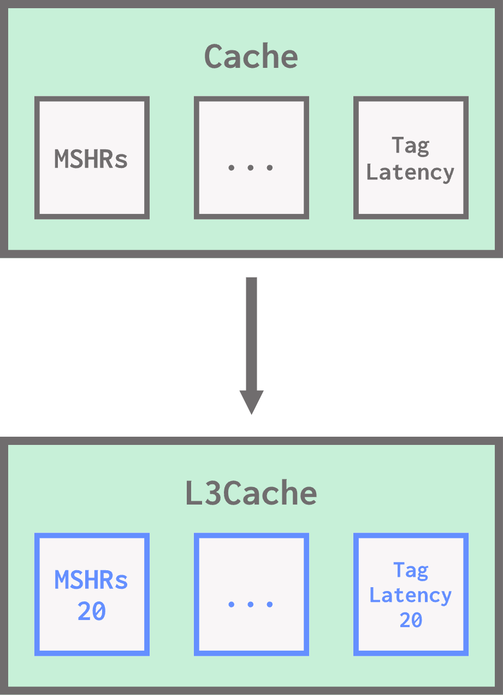
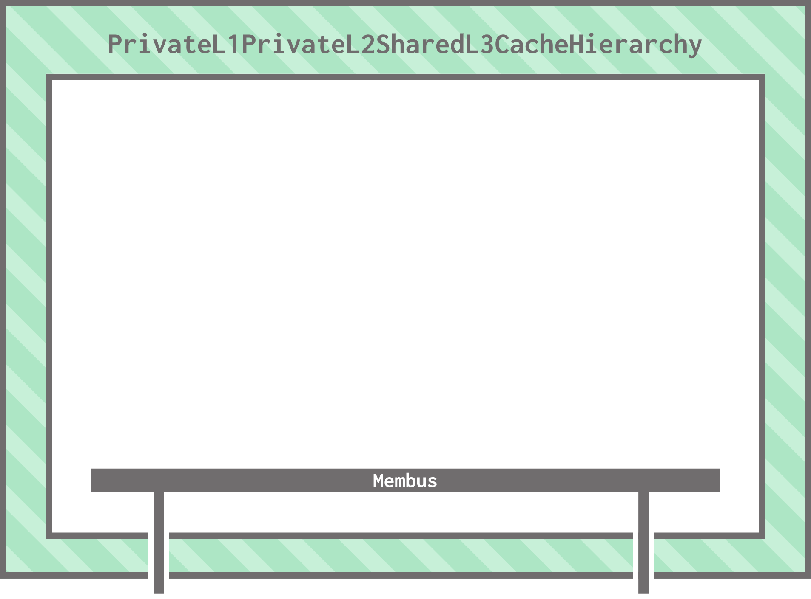
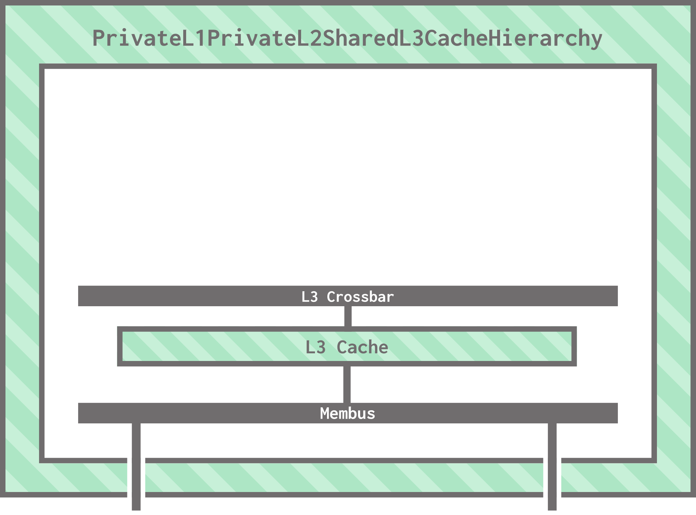
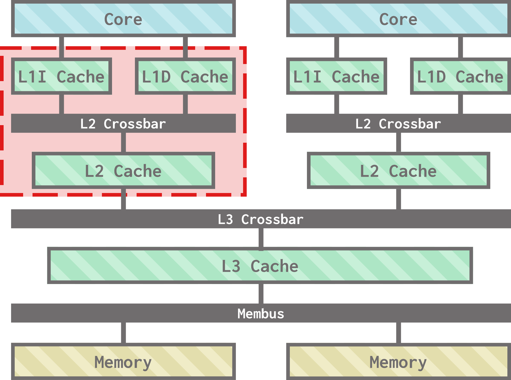
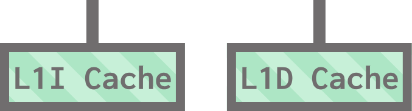
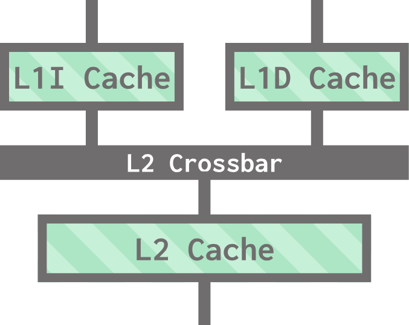
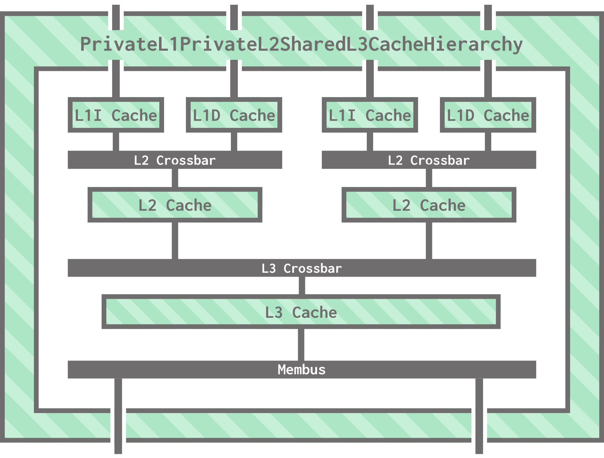

# Modeling caches in gem5

Processors down! Let's make our way closer to memory and talk about how caches work in gem5.

> By the end of this section, you will be able to:  
>
> - **Construct** a classic cache hierarchy in gem5 using caches and crossbars.
> - **Contrast** the advantages and disadvantages of using classic and Ruby caches in gem5.
>

## Cache coherence primer

Before we get started, let's take a moment to discuss **cache coherence**, an important concept in memory system design. If you're comfortable with cache coherence and don't need the refresher, feel free to skip to the next heading ("Classic and Ruby caches")! Otherwise, this is what you need to know in order to understand this lesson.

<details open>
<summary markdown="span"><b> Collapse this header to hide the cache coherence explanation! </b></summary>

### What's cache coherence?

Cache coherence refers to the problem that arises when multiple cores work with the same piece of data, but that data is cached in multiple locations.

Everything is fine as long as all of the cores treat the data as *read only*...



...but problems arise when we throw writes into the mix:


Thus, the problem we're trying to solve is: **how do we make sure that writes to the data become visible to all cores and stop any core from accessing outdated information?**

### Achieving cache coherence

One way to solve this problem is to use **snooping**, where caches broadcast their reads and writes across their shared bus for the other caches to "snoop" on. If a cache spots a an operation done on another cache, it updates itself to ensure coherence.

In the simplest version of this protocol, when a cache spots a write to memory location, it just marks its cached data for that memory location as invalid.


This means that data in the cache can either be **valid** or **invalid**. A cache line is valid if the cache contains a clean, up-to-date copy of the data and invalid otherwise. This basic protocol, called the VI protocol (for **V**alid and **I**nvalid) allows us to achieve coherence for **write-through** caches (since we don't have any way to mark data as modified/dirty in our caches under this protocol).

However, we can go beyond this simplest version of coherence! Many other, more complex, protocols exist that store more bookkeeping information about cache lines and allow for more sophisticated behavior. We won't go into detail here, but here are some letters you should keep in mind:

- [MSI](https://en.wikipedia.org/wiki/MSI_protocol) (**M**odified, **S**hared, **I**nvalid), which is an extension of VI for write-back caches,
- [MESI](https://en.wikipedia.org/wiki/MESI_protocol) (**M**odified, **E**xclusive, **S**hared, **I**nvalid), where data can be clean and "exclusive" to a single cache,
- [MOESI](https://en.wikipedia.org/wiki/MOESI_protocol) (**M**odified, **O**wned, **E**xclusive, **S**hared, **I**nvalid), which allows dirty data to be "owned" by a cache with respect to main memory.

Protocols are often expressed using **state diagrams** to dictate what the cache should do upon performing an operation or snooping an operation from another cache. The cache stores enough management bits to encode the state of each of its lines. Here is an example of a state machine for the MSI protocol:


There is a lot more to cache coherence than what we discussed here, but knowing these basics will help you make sense of this lesson and future lessons on caching.

</details>

## Classic and Ruby caches

gem5 has two kinds of cache models: **classic caches** and **Ruby caches**. This is a historical quirk of gem5 being made up of two simulators: M5 had what we now call classic caches, and GEMS had Ruby. While a bit odd at first, these two models give us some more flexibility with how much detail we want in our cache simulations.

### Classic caches

Classic caches are simpler and faster to simulate, but they're less flexible and detailed. The coherence protocol is not parameterized, so it cannot be changed. The cache hierarchies themselves are fixed, and the network topologies (how caches communicate with each other and with processors) are also fixed. This means that classic caches are a good option when you need a cache hierarchy for your board, but you are not investigating the specific details of a new coherence protocol or topology.

> If you're curious, the coherence protocol that classic caches in gem5 use is a MOESI snooping protocol.

### Ruby caches

Ruby caches are *highly detailed*. You can specify everything from the cache hierarchy to the topology to the coherence protocol! Coherence protocols are specified in a domain-specific language called SLICC. As you can imagine, this additional detail comes at the cost of simulation speed and implementation complexity. Ruby caches are a great choice for researching novel cache hierarchies, but the learning curve for using them is much steeper.

> We'll talk more about Ruby caches in the caches track in Unit IV!

## Caches in the standard library

The gem5 standard library provides both classic and Ruby cache hierarchy components:

### Classic caches

The standard library provides the following full hierarchies:

- `NoCache`: As the name suggests, this "cache hierarchy" allows you to simulate not having a cache on the board.
- `PrivateL1CacheHierarchy`: Each core has its own L1 i-cache and d-cache.
- `PrivateL1PrivateL2CacheHierarchy`: Each core has its own L1 i-cache, L1 d-cache, and L2 cache.
- `PrivateL1PrivateL2WalkCacheHierarchy`: Same as `PrivateL1PrivateL2CacheHierarchy`, but also has a walk cache for the page table walker.
- `PrivateL1SharedL2CacheHierarchy`: Each core has its own L1 i-cache and d-cache, and they all share one L2 cache.

> Again, all of these hierarchies use a MOESI snooping protocol for cache coherence.

The standard library also provides pre-configured gem5 models for an L1 i-cache and d-cache, an L2 cache, and a walk cache, appropriately named `L1ICache`, `L1DCache`, `L2Cache`, and `MMUCache`. The above hierarchies use these components!



To use a standard library classic cache hierarchy in your simulations, just plug it into your board and run gem5 as usual! For example, in `stdlib_hello_world.py` in the standard library section, we used a `PrivateL1SharedL2CacheHierarchy` like this:

```python
# instantiate and set parameters
cache = PrivateL1SharedL2CacheHierarchy(
  l1d_size = "16kB",
  l1i_size = "16kB",
  l2_size = "256kB",
  l1d_assoc = 8,
  l1i_assoc = 8,
  l2_assoc = 16
)

# plug into board 
board = X86Board(
  ...
  cache_hierarchy = cache,
  ...
)
```

### Ruby caches

The standard library provides the following Ruby cache hierarchies:

- `MESIThreeLevelCacheHierarchy`: A private L1, private L2, shared L3 cache hierarchy using the MESI protocol for coherence.
- `MESITwoLevelCacheHierarchy`: A private L1, shared L2 MESI hierarchy.

Each of these caches have their own cache controllers, DMA (direct memory access) controllers, and directories; we won't go into too much detail about these here, but know that the standard library Ruby hierarchies use inner standard library components, much like classic caches.

To use a standard library Ruby cache hierarchy in your simulations, plug it into the board just like you would a classic cache hierarchy. However, you must *also* ensure that **the coherence protocol gem5 was built with matches the coherence protocol you are using**.

> When we build gem5, we can specify **build options**, including the cache coherence protocol to use. We'll talk about this more in depth when we discuss the build system in detail; for now, know that you might have to build gem5 differently in order to use a Ruby cache hierarchy.

<!--TODO (Naama): Example?-->

The rest of this section will focus on using classic caches. We'll return to the intricacies of Ruby caches in the caches track!

> If you're curious, the class diagram for cache hierarchies in the standard library is below.
>
> <details>
> <summary markdown="span"> <b>src/python/gem5/components/cachehierarchies</b> </summary>
>
> <br>
>
> ![A tree-like class diagram of standard library caches. SubSystem is at the very top. AbstractClassHierarchy inherits from SubSystem. AbstractRubyCacheHierarchy and AbstractClassicCacheHierarchy inherit from AbstractCacheHierarchy. NoCache, PrivateL1CacheHierarchy, PrivateL1SharedL2CacheHierarchy, and PrivateL1PrivateL2CacheHierarchy inherit from AbstractClassicCacheHierarchy. PrivateL1SharedL2CacheHierarchy and PrivateL1PrivateL2CacheHierarchy also inherit from AbstractTwoLevelCacheHierarchy. PrivateL1PrivateL2WalkCacheHierarchy inherits from PrivateL1PrivateL2CacheHierarchy. MESIThreeLevelCacheHierarchy and MESITwoLevelCacheHierarchy inherit from AbstractRubyCacheHierarchy. They also inherit from the corresponding class of AbstractTwoLevelCacheHierarchy and AbstractThreeLevelCacheHierarchy.](img/stdlib_caches.png)
> </details>

<br>

## Classic cache models in gem5

gem5 provides one main model for classic caches, aptly named `Cache`. This model defines the parameters that can be adjusted for classic caches:

- Capacity and associativity,
- Latency for tag lookup, data access, and the miss return path,
- Clusivity (gem5 supports mostly inclusive and mostly exclusive),
- Replacement policy,
- Prefetcher,
- Details of the cache's MSHRs (miss status handler registers),
- ...and more!

> gem5 also contains many supporting models for classic caches; for example, a prefetcher model, a model representing a cache's replacement policy, and a model for a cache's tags.

Just like the CPU models from the previous section, we can extend `Cache` in Python to set its parameters. The existing `L1ICache`, `L1DCache`, `L2Cache`, and `MMUCache` from the standard library all extend the `Cache` class and set its parameters appropriately.

## Creating custom classic cache components

Following similar steps to the processors section, we can create our own standard library classic cache components using the standard library interface and gem5 models. Let's go through the process of creating a 3-level classic cache hierarchy!

### Crossbars

If you haven't heard the term before, crossbars are a type of interconnect that allows components (like caches) to talk to one another.
We will be using gem5's implementation of crossbars as our buses to connect the caches in our hierarchy to each other and to main memory.

gem5 has two kinds of crossbars: coherent crossbars and non-coherent crossbars. Coherent crossbars are generally used for cache hierarchies and other coherent I/O; non-coherent crossbars are used for other on-chip I/O. Of the coherent crossbars, we will be using `L2XBar` and `SystemXBar`.

- `L2XBar`: designed to be a crossbar for L2 caches in a hierarchy.
- `SystemXBar`: the system interconnect, which ties together the CPU(s), GPU(s), DRAM controllers, and any coherent I/O.

### Our hierarchy

We'll be building the following cache hierarchy, with private L1 and L2 caches and a shared L3 cache. We'll connect our cache hierarchy to multiple memory channels.


<br>

Remember that the L1 i- and d- caches, along with the L2 cache, already exist as standard library components (`L1ICache`, `L1DCache`, and `L2Cache`). As we mentioned above, the crossbars also exist as gem5 models. We'll use `L2XBar` for all of our cache-to-cache interconnects and `SystemXBar` for our membus. The only component we'll have to make is the L3 cache!

### Creating the L3 cache

Much like in the previous section on processors, we must set the parameters of an existing gem5 **model** (the `Cache` model) to fit our needs for an L3 cache.

Open `my_cache_hierarchy.py` to get started. Right now, this file contains some skeleton code for our cache hierarchy that we'll revisit later. For now, we need to make a new class that sets `Cache`'s parameters to our liking. We'll also expose the size and associativity as parameters:

```python
class L3Cache(Cache):
    def __init__(self, size, assoc):
        super().__init__()
        self.size = size
        self.assoc = assoc
        self.tag_latency = 20
        self.data_latency = 20
        self.response_latency = 1
        self.mshrs = 20
        self.tgts_per_mshr = 12
        self.writeback_clean = False
        self.clusivity = "mostly_incl"
```

This way, we can instantiate an `L3Cache` and pick its size and associativity!



Note that *unlike* the previous section (where we set the parameters of a CPU model then wrapped it in a core component), we do **not** need to wrap this cache model with a standard library component. The cache interface is a bit different from the processor interface, and standard library components use these models directly!

### Creating a new cache hierarchy

Our next step is to make a new class for our custom cache hierarchy. To match the existing naming convention, let's call our new hierarchy `PrivateL1PrivateL2SharedL3CacheHierarchy` (which is a bit of a mouthful, but at least's it's consistent!):

```python
class PrivateL1PrivateL2SharedL3CacheHierarchy(AbstractClassicCacheHierarchy):
    def __init__(self, l1d_size, l1i_size, l2_size, l3_size, l1d_assoc=8, l1i_assoc=8, l2_assoc=16, l3_assoc=32):
        AbstractClassicCacheHierarchy.__init__(self)
        self._l1d_size = l1d_size
        self._l1i_size = l1i_size
        self._l2_size = l2_size
        self._l3_size = l3_size
        self._l1d_assoc = l1d_assoc
        self._l1i_assoc = l1i_assoc
        self._l2_assoc = l2_assoc
        self._l3_assoc = l3_assoc
```

Two things to notice here:

1) This class extends `AbstractClassicCacheHierarchy`, the parent class of all standard library cache hierarchies.
2) The constructor of the class exposes the sizes and associativities of all of the caches in the hierarchy as parameters, which is consistent with other standard library classic caches.

You'll notice, however, that this constructor only saves the values of the passed-in parameters and doesn't actually instantiate any of our caches. In gem5, this happens in a separate function called `incorporate_cache`, which is defined in `AbstractCacheHierarchy` (the parent of `AbstractClassicCacheHierarchy`) and subsequently overridden in each cache hierarchy. The reason for this is that parts of our cache hierarchy (for example, the private caches) depend on the number of processor cores in the system, which we don't know yet!

> We'll implement `incorporate_cache` soon!

### Creating the membus

Just because the caches aren't instantiated in the constructor doesn't mean we're done with it quite yet. We can start connecting our cache hierarchy to our memory system by instantiating our membus:

```python
self.membus = SystemXBar(width=64)
```

We also need to add the following lines, which further initialize our membus. You shouldn't worry about them for now.

```python
self.membus.badaddr_responder = BadAddr()
self.membus.default = self.membus.badaddr_responder.pio
```

> These lines are used for **full-system mode**, which we'll discuss later. For now, they're magic!

Ok, now we're really done with the constructor!

### Connecting ports

gem5 uses a **port** interface to connect models in the simulated system together, including connecting the processor, cache hierarchy, and memory system to one another.

> We'll discuss ports in-depth in Unit IV!

Every one of the models within our cache hierarchy has ports we'll need to connect. These ports face one of two ways: the CPU-side ports face towards the CPU and connect to components higher up in the memory hierarchy (closer to the CPU), and the memory-side ports face towards main memory and connect to components lower down in the memory hierarchy (closer to main memory). Our hierarchy will have CPU-side ports that connect to the processor's cores and memory-side ports that connect to the memory channels.

We define the hierarchy's memory-side port to be the membus' memory-side ports:

```python
def get_mem_side_port(self):
        return self.membus.mem_side_ports
```

We also define the hierarchy's CPU-side port to be the membus' CPU-side ports. This may seem strange! As it turns out, these ports will *not* be used for standard memory requests from the processor's cores, but for I/O accesses from the board.

```python
def get_cpu_side_port(self):
    return self.membus.cpu_side_ports
```

> `get_mem_side_port` and `get_cpu_side_port` are defined in `AbstractClassicCacheHierarchy`, and we override them here.

### Incorporating caches

Now that we've initialized our membus, the next thing we need to do is implement `incorporate_cache`:

```python
def incorporate_cache(self, board):
```

The board calls this function when the processor and memory are ready to be connected.

We need to connect the board's system port to the membus so that the board can perform **functional** memory accesses:

```python
board.connect_system_port(self.membus.cpu_side_ports)
```

> Remember that functional memory accesses are "backdoor" memory accesses--it makes sense that they don't go through the entire cache hierarchy!

Next, let's connect the membus to memory! The board gives us all of the memory system's ports, and we can connect them to our membus:

```python
for _, port in board.get_memory().get_mem_ports():
    self.membus.mem_side_ports = port
```

You'll notice that the way we connect ports is using the `=` operator. This is **not** being used as an assignment operator here. For ports, `=` means connection!

> `get_mem_ports` returns a tuple of an an address range for the port followed by the port itself. We don't really care about the address ranges here.

We've now fully connected our membus, and our hierarchy looks like this:



Let's build upwards! Time to instantiate and connect our L3 cache. Still in `incorporate_cache`, let's make an instance of the custom L3 cache model we created:

```python
self.l3_cache = L3Cache(size=self._l3_size, assoc=self._l3_assoc)
```

Next, we create an L3 crossbar:

```python
self.l3_bus = L2XBar()
```

> Even though this is the L3 crossbar in our hierarchy, we are using the `L2XBar` model to build it. Other than the confusing name, this gets the job done!

Now we can connect the cache to the L3 crossbar and the membus, again using the `=` operator for connection:

```python
self.l3_cache.mem_side = self.membus.cpu_side_ports
self.l3_cache.cpu_side = self.l3_bus.mem_side_ports
```

Our hierarchy now looks like this:



### Interlude: core clusters

The next thing we'll work on is creating our **core cluster**: the cluster of caches and crossbars that is private to each core in the processor. For us, this includes the L1 and L2 caches and the L2 crossbar that connects them.



To keep our code clean, let's factor this out into a helper function:

```python
def _create_core_cluster(self, core, l3_bus, isa):
```

The function takes the core and the L3 bus that the cluster connects to (on the CPU and memory side, respectively), as well as the ISA of the core.

> The ISA is needed for some more full-system mode things you don't need to worry about.

We define our core cluster as a **subsystem**. If you've been looking at the standard library class diagrams, you've seen the `Subsystem` class as the superclass of all processors, cores, and cache hierarchies. The gem5 `Subsystem` class doesn't do much in itself, but it helps designate subsystems for the configuration system.

Let's create the cluster and add its L1I and L1D caches:

```python
cluster = SubSystem()
cluster.l1dcache = L1DCache(
  size=self._l1d_size, 
  assoc=self._l1d_assoc
)
cluster.l1icache = L1ICache(
    size=self._l1i_size, 
    assoc=self._l1i_assoc,
    writeback_clean=False
)
```

The L1I and L1D caches need to connect to the core, which we can do like this using the CPU-side ports of both:

```python
core.connect_icache(cluster.l1icache.cpu_side)
core.connect_dcache(cluster.l1dcache.cpu_side)
```

This means we've now built this:



Next, we need to create our L2 cache (`L2Cache`) and L2 crossbar (`L2XBar`).

> **Your turn:** In the same way we created the L3 cache and L3 crossbar, create the L2 cache and L2 crossbar as members of the cluster:
>
> - Instantiate the `l2_cache` and `l2_bus` variables,
> - Connect the L2 cache and L2 crossbar to each other, 
> - Connect the L2 crossbar to the L1I and L1D caches, 
> - Connect the L2 cache to the L3 crossbar passed in as the `l3_bus` parameter. 
> 
> Remember to use the correct side ports!
>
> 
> <details>
> <summary markdown="span"> <b>Answer</b> </summary>
>
> ```python
> # create the cache and crossbar
> cluster.l2cache = L2Cache (
>     size=self._l2_size, 
>     assoc=self._l2_assoc
> )
> cluster.l2_bus = L2XBar()
>
> # connect the L1I and L1D caches to the L2 crossbar
> cluster.l1dcache.mem_side = cluster.l2_bus.cpu_side_ports
> cluster.l1icache.mem_side = cluster.l2_bus.cpu_side_ports
>
> # connect the L2 cache to the L2 and L3 crossbars 
> cluster.l2cache.cpu_side = cluster.l2_bus.mem_side_ports
> cluster.l2cache.mem_side = l3_bus.cpu_side_ports
> ```
>
> </details>

<br>

You'll notice there's some other code in the `_get_core_cluster` function, which is used for full-system mode. Much like the other snippets of full-system mode-related code, you can ignore this for now. We've officially written our core cluster creator!



### Back to incorporating caches

Now that we can create a cluster for a given core, we can create the clusters for our hierarchy by passing in the processor's cores from the board:

```python
self.clusters = [
    self._create_core_cluster(
        core, self.l3_bus, board.get_processor().get_isa()
    )
    for core in board.get_processor().get_cores()
]
```

> We use some list comprehension to make the code more compact.

...and that's it! Aside from some more I/O code you can ignore for now, we've created a full cache hierarchy.



### Let's run this thing!

Let's recap everything we just did:

1) We extended the `Cache` model to change its parameters, creating our L3 cache (`L3Cache`).
2) We created a new class for our cache hierarchy that extends `AbstractClassicCacheHierarchy` with a constructor that exposes relevant parameters.
3) We created a membus for our cache hierarchy using a `SystemXBar` and exposed its CPU-side and memory-side ports to the board.
4) We wrote the `incorporate_cache` function, which is responsible for instantiating all of the caches in the hierarchy. In this function, we made sure that all of our caches' ports connected to each other correctly.
5) We wrote the `_create_core_cluster` helper function, which is responsible for creating the per-core cache clusters in our hierarchy. We called this function for each core in `incorporate_cache`.

What we're left with is a new **standard library classic cache hierarchy** that we can use in our simulations.

As is tradition, let's plug this shiny new cache hierarchy into our `hello_world` example! A copy of the file (with the modifications we made in the processors section along with the python file defining our custom processors), named `hello_caches.py`, is provided for convenience.

First, we need to import our new components. Replace the import statement for `PrivateL1SharedL2CacheHierarchy` with the following:

```python
from my_cache_hierarchy import PrivateL1PrivateL2SharedL3CacheHierarchy
```

Next, let's swap the existing cache hierarchy for our own, keeping the parameters the same:

```python
cache = PrivateL1PrivateL2SharedL3CacheHierarchy(
    l1d_size = "16KiB",
    l1i_size = "16KiB",
    l2_size = "256KiB",
    l1d_assoc = 8,
    l1i_assoc = 8,
    l2_assoc = 16,
)
```

However, you'll notice we're missing parameters for our L3 cache! Let's make it 8 MiB in size and 16-way set associative:

```python
cache = PrivateL1PrivateL2SharedL3CacheHierarchy(
    l1d_size = "16KiB",
    l1i_size = "16KiB",
    l2_size = "256KiB",
    l3_size = "8MiB",
    l1d_assoc = 8,
    l1i_assoc = 8,
    l2_assoc = 16,
    l3_assoc = 16
)
```

> Keeping the same parameter naming conventions as the standard library caches has certainly paid off!

...and there we go! We can now run the script and see our cache in action:

```bash
gem5 --outdir=hello_caches hello_caches.py
```

We can now take a look at statistics from all 3 level of cache. Let's take a look at overall miss rates in `stats.txt`:

```bash
grep 'overallMissRate::total' hello_caches/stats.txt
```

You should see the following:

```txt
board.cache_hierarchy.clusters.l1dcache.overallMissRate::total     0.005160
board.cache_hierarchy.clusters.l1icache.overallMissRate::total     0.000284
board.cache_hierarchy.clusters.l2cache.overallMissRate::total      0.016785
board.cache_hierarchy.l3_cache.overallMissRate::total              1
```

Looks like the L3 cache was not helpful for this workload. Let's go back to our original workload: booting Ubuntu for 20 in-simulation milliseconds.

```python
board.set_workload(
    obtain_resource("x86-ubuntu-24.04-boot-no-systemd")
)
```
```python
sim.run(20_000_000_000)
```

```bash
gem5 --outdir=hello_caches_ubuntu hello_caches.py
```

```bash
grep 'overallMissRate::total' hello_caches_ubuntu/stats.txt
```

This time, you should get:

```txt
board.cache_hierarchy.clusters.l1dcache.overallMissRate::total     0.040113
board.cache_hierarchy.clusters.l1icache.overallMissRate::total     0.001155
board.cache_hierarchy.clusters.l2cache.overallMissRate::total     0.852924
board.cache_hierarchy.l3_cache.overallMissRate::total     0.986653
```

This time, the L3 cache helped some, but still missed 98% of the time.

> You'll also notice this simulation took a lot longer than previous iterations. The more advanced features we include, the more needs to be simulated per tick!

Caches can get a lot more complex than this, but this section covers the basics of classic caches and how to use them. If you want to model cache coherence and network topology with Ruby, take the caches track in Unit IV!
