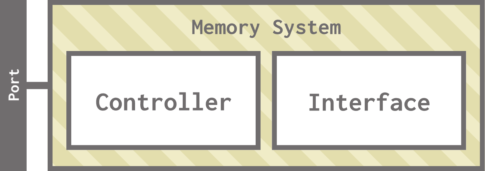
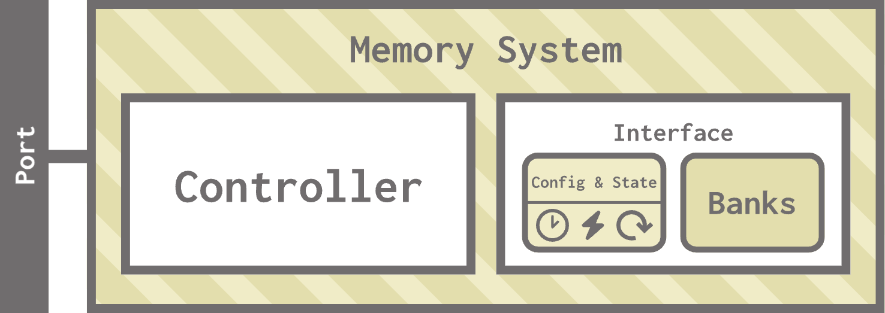
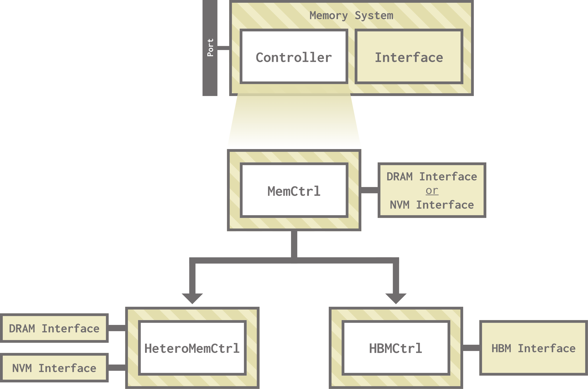
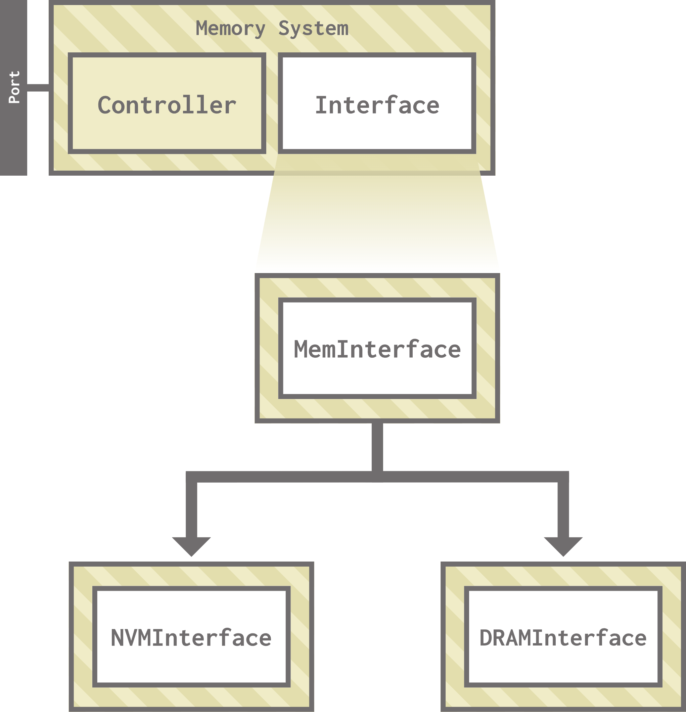
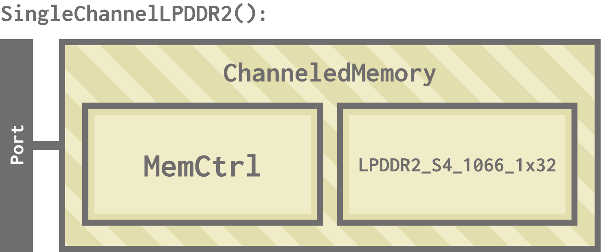

# Memory in gem5

Rounding out our tour of the big three gem5 subsystems, we have memory.

> By the end of this section, you will be able to:
>
> - **Explain** what memory controllers and memory interfaces do in gem5.
> - **Modify** a memory system by instantiating an instance of ChanneledMemory with custom parameters.
> - **Compare** the performance of the SimpleMemory and ChanneledMemory standard library components.
>

## Memory primer (AKA what do the letters mean?)

Much like the caches unit, this unit assumes knowledge of some memory details that you may not have encountered before. If you feel good about your knowledge of DRAM/HBM/NVM, please continue to the next header ("Memory controllers and interfaces")! Otherwise, keep reading.

<details open>
<summary><b> Collapse this header to hide the memory explanation! </b></summary>

### So what's DRAM?

Most modern computers use DRAM as their main memory interface, including the device you're using right now! DRAM differs from disk and other permanent storage devices in its volatility: unlike these storage devices, DRAM requires power to keep its data. In exchange, it has much lower latency.

DRAM stands for **D**ynamic **R**andom-**A**ccess **M**emory. It's **d**ynamic because it stores its data in capacitors, which gradually lose their charge and need to be refreshed. It's **r**andom **a**ccess because its data can be read or written in any order (unlike something like a hard disk, which may take longer to fetch some data depending on whether the access pattern is sequential or not). It's **m**emory because it stores the program's data!

### DRAM terminology

You may have heard DRAM referred to in terms of "sticks". Those are DIMMs! A DIMM (**D**ual **I**nline **M**emory **M**odule) is a circuit board containing DRAM devices. A group of DRAM devices that operate in unison make up a **rank**, which a DIMM can have multiple of. Within a single rank, there are one or more **banks**, which are smaller units that operate independently. Within each bank are one or more **arrays**, which are (finally) what store the individual bits of data.

To recap, we have:

- **DIMM**: A stick of DRAM.
- **Rank**: A group of DRAM devices on a DIMM. A DIMM can have one or more ranks.
- **Bank**: A smaller unit of memory storage within a rank. A rank can have multiple banks.
- **Array**: Where the bits of memory are stored within a bank. A bank can have multiple arrays.

We divide up our DIMMs like this to allow for parallelism and concurrency, which provides us with more bandwidth.

DIMMs connect to the board's **memory controller**, which might be integrated to the CPU or independent. The connection points between the memory controller and the DIMMs are called **channels**.

### DRAM technology

One modern DRAM technology is **double data rate**, or DDR. In DDR, the data rate is doubled by transferring data on the rising *and* falling edge of the clock, which increases bandwidth without needing to speed up the clock. There have been multiple versions of DDR since the first, the most recent being [DDR5](https://en.wikipedia.org/wiki/DDR5_SDRAM).

A different (but related) technology is **low-power double data rate**, or LPDDR. As the name suggests, LPDDR prioritizes low power consumption, which sees it used in mobile devices like phones and laptops. Despite the name similarity to DDR, the two use different development standards.

### What's HBM?

HBM stands for **H**igh **B**andwidth **M**emory. It still uses DRAM technology, but its architecture is designed for (as the name suggests) maximum bandwidth, achieved by stacking dies of DRAM on top of one another. HBM is often used for accelerators like graphics processing units (GPUs) and other high-performance hardware.

### What's NVM?

NVM stands for **N**on **V**olatile **M**emory. Unlike DRAM, which loses its data when the power goes out (volatile), NVM can keep its data even without power. NVM technologies tend to be slower than DRAM, but still faster than permanent storage devices like flash or disk. These technologies are still in active development!

> You should now be all caught up and ready for this section!

</details>

## Memory controllers and interfaces

Memory systems in gem5 consist of two main components: memory controllers and memory interfaces.



### Memory controllers

The memory controller's job is to schedule and issue read and write requests. It **receives** requests from other systems, **queues** them into read and/or write queues, and applies a scheduling algorithm to **issue** them to the interface.


### Memory interfaces

The memory interface implements the architecture and parameters of its memory type (DRAM, HBM, NVM, etc.). It also manages memory activation, pre-charge, low-power modes, and other media-specific operations.



## Memory in the standard library

The gem5 standard library contains two kinds of components to model memory: `SingleChannelSimpleMemory` and `ChanneledMemory`.

> If you're curious, the class diagram for memory in the standard library is below.
>
> <details>
> <summary> <b>src/python/gem5/components/memory</b> </summary>
>
> <br>
>
> 
> 
> `SingleChannel` and `DRAMSysMem` are used for DRAMSim and DRAMSys, which are other DRAM simulators we won't discuss in this section.
> </details>

<br>

### `SingleChannelSimpleMemory`

As the name suggests, `SingleChannelSimpleMemory` is a simpler model that allows you to only specify your desired latency, latency variation, and bandwidth without worrying about the specific memory technology being used.

> You can find `SingleChannelSimpleMemory` in `src/python/gem5/components/memory/simple.py`.

Let's see `SingleChannelSimpleMemory` in action. Open `simple_vs_channeled.py` to get started. Currently, this is a simple configuration script running a matrix multiply workload.

Let's create a `SingleChannelSimpleMemory`:

```python
from gem5.components.memory.simple import SingleChannelSimpleMemory
```

```python
memory = SingleChannelSimpleMemory(
    latency = "50ns",
    latency_var = "10ns",
    bandwidth = "32 GiB/s",
    size = "3GiB"
)
```
This instantiates a 3GiB memory with a latency of 50 nanoseconds (with a variation of 10 nanoseconds) and a bandwidth of 32 GiB per second. You'll notice that we never specified a memory technology like DDR4.

Let's run this simulation and see what we get:

```bash
gem5 --outdir=simple simple_vs_channeled.py
```

In `stats.txt`, you'll notice statistics from `board.memory.module`:

```txt
board.memory.module.bytesRead::cache_hierarchy.l1dcaches.prefetcher         6912                       # Number of bytes read from this memory (Byte)
board.memory.module.bytesRead::cache_hierarchy.l2cache.prefetcher       112576                       # Number of bytes read from this memory (Byte)
board.memory.module.bytesRead::processor.cores.core.inst        35904                       # Number of bytes read from this memory (Byte)
board.memory.module.bytesRead::processor.cores.core.data        17216                       # Number of bytes read from this memory (Byte)
board.memory.module.bytesRead::total           172608                       # Number of bytes read from this memory (Byte)
board.memory.module.bytesInstRead::processor.cores.core.inst        35904                       # Number of instructions bytes read from this memory (Byte)
board.memory.module.bytesInstRead::total        35904                       # Number of instructions bytes read from this memory (Byte)
board.memory.module.numReads::cache_hierarchy.l1dcaches.prefetcher          108                       # Number of read requests responded to by this memory (Count)
board.memory.module.numReads::cache_hierarchy.l2cache.prefetcher         1759                       # Number of read requests responded to by this memory (Count)
board.memory.module.numReads::processor.cores.core.inst          561                       # Number of read requests responded to by this memory (Count)
board.memory.module.numReads::processor.cores.core.data          269                       # Number of read requests responded to by this memory (Count)
board.memory.module.numReads::total              2697                       # Number of read requests responded to by this memory (Count)
board.memory.module.bwRead::cache_hierarchy.l1dcaches.prefetcher       388243                       # Total read bandwidth from this memory ((Byte/Second))
board.memory.module.bwRead::cache_hierarchy.l2cache.prefetcher      6323331                       # Total read bandwidth from this memory ((Byte/Second))
board.memory.module.bwRead::processor.cores.core.inst      2016708                       # Total read bandwidth from this memory ((Byte/Second))
board.memory.module.bwRead::processor.cores.core.data       967013                       # Total read bandwidth from this memory ((Byte/Second))
board.memory.module.bwRead::total             9695295                       # Total read bandwidth from this memory ((Byte/Second))
board.memory.module.bwInstRead::processor.cores.core.inst      2016708                       # Instruction read bandwidth from this memory ((Byte/Second))
board.memory.module.bwInstRead::total         2016708                       # Instruction read bandwidth from this memory ((Byte/Second))
board.memory.module.bwTotal::cache_hierarchy.l1dcaches.prefetcher       388243                       # Total bandwidth to/from this memory ((Byte/Second))
board.memory.module.bwTotal::cache_hierarchy.l2cache.prefetcher      6323331                       # Total bandwidth to/from this memory ((Byte/Second))
board.memory.module.bwTotal::processor.cores.core.inst      2016708                       # Total bandwidth to/from this memory ((Byte/Second))
board.memory.module.bwTotal::processor.cores.core.data       967013                       # Total bandwidth to/from this memory ((Byte/Second))
board.memory.module.bwTotal::total            9695295                       # Total bandwidth to/from this memory ((Byte/Second))
board.memory.module.power_state.pwrStateResidencyTicks::UNDEFINED  17803273905
```

These are the statistics collected by `SingleChannelSimpleMemory`; you'll notice they track the number of bytes read (instruction and data) by various other components of the system, the bandwidth for those reads, the overall bandwidth, and some power state information.

> You don't need to worry about these statistics in detail for now! We'll be comparing them to the statistics collected by `ChanneledMemory` components.

### `ChanneledMemory`

`ChanneledMemory` is a component that encompasses the memory controller and the memory interface. It provides an easy way to simulate multiple memory channels by handling things like scheduling and interleaving behind the scenes.

> You can find the `ChanneledMemory` class in `src/python/gem5/components/memory/memory.py`. 
>
> For convenience, the standard library also provides helper functions named in the `NumChannelsDDRX_Frequency()` format (for example, the `SingleChannelDDR4_2400()` function) for generating different memory systems. They can be found in `src/python/gem5/components/memory/single_channel.py` and `src/python/gem5/components/memory/multi_channel.py`. All of these instantiate a corresponding `ChanneledMemory` instance by selecting appropriate constructor parameters.

Let's swap out our `SingleChannelSimpleMemory` with a `ChanneledMemory`, specifically a `DualChannelDDR4_2400`.

```python
from gem5.components.memory.multi_channel import DualChannelDDR4_2400
```

```python
memory = DualChannelDDR4_2400 (
  size = "3GiB"
)
```

You'll notice that this function only takes one parameter (`size`). 

> Behind the scenes, this function actually instantiates:
>
> ```python
> ChanneledMemory(DDR4_2400_8x8, 2, 64, size=size)
> ```

Let's run this again and see what we get!

```bash
gem5 --outdir=channeled simple_vs_channeled.py
```

In `stats.txt`, you'll notice a *lot* more memory-related stats, this time coming from `board.memory.mem_ctrl0.dram` and `board.memory.mem_ctrl1.dram`. These are the controllers for the two channels in our memory system! 

Here is an (abridged) collection of stats:

```
[...]
board.memory.mem_ctrl0.avgPriority_processor.cores.core.inst::samples       284.00                       # Average QoS priority value for accepted requests (Count)
[...]
board.memory.mem_ctrl0.priorityMinLatency 0.000000017492                       # per QoS priority minimum request to response latency (Second)
board.memory.mem_ctrl0.priorityMaxLatency 0.000000749520                       # per QoS priority maximum request to response latency (Second)
[...]
board.memory.mem_ctrl0.readReqs                  1352                       # Number of read requests accepted (Count)
board.memory.mem_ctrl0.writeReqs                    0                       # Number of write requests accepted (Count)
[...]
board.memory.mem_ctrl0.readPktSize::6            1352                       # Read request sizes (log2) (Count)
[...]
board.memory.mem_ctrl0.bytesReadWrQ                 0                       # Total number of bytes read from write queue (Byte)
board.memory.mem_ctrl0.bytesReadSys             86528                       # Total read bytes from the system interface side (Byte)
board.memory.mem_ctrl0.bytesWrittenSys              0                       # Total written bytes from the system interface side (Byte)
board.memory.mem_ctrl0.avgRdBWSys        4862477.12829769                       # Average system read bandwidth in Byte/s ((Byte/Second))
board.memory.mem_ctrl0.avgWrBWSys          0.00000000                       # Average system write bandwidth in Byte/s ((Byte/Second))
[...]
board.memory.mem_ctrl0.dram.bytesPerActivate::mean   200.301887                       # Bytes accessed per row activation (Byte)
[...]
board.memory.mem_ctrl0.dram.rank1.actEnergy 576969.120000                       # Energy for activate commands per rank (pJ) (Joule)
board.memory.mem_ctrl0.dram.rank1.preEnergy 1013066.611200                       # Energy for precharge commands per rank (pJ) (Joule)
board.memory.mem_ctrl0.dram.rank1.readEnergy 3063821.980800                       # Energy for read commands per rank (pJ) (Joule)
board.memory.mem_ctrl0.dram.rank1.writeEnergy            0                       # Energy for write commands per rank (pJ) (Joule)
board.memory.mem_ctrl0.dram.rank1.refreshEnergy 1544329930.835928                       # Energy for refresh commands per rank (pJ) (Joule)
[...]
board.memory.mem_ctrl1.dram.rank1.totalEnergy 7668007075.797734                       # Total energy per rank (pJ) (Joule)
board.memory.mem_ctrl1.dram.rank1.averagePower   430.906863                       # Core power per rank (mW) (Watt)
board.memory.mem_ctrl1.dram.rank1.totalIdleTime            0                       # Total Idle time Per DRAM Rank (Tick)
board.memory.mem_ctrl1.dram.rank1.pwrStateTime::IDLE  15637797036                       # Time in different power states (Tick)
board.memory.mem_ctrl1.dram.rank1.pwrStateTime::REF    799750000                       # Time in different power states (Tick)
board.memory.mem_ctrl1.dram.rank1.pwrStateTime::SREF            0                       # Time in different power states (Tick)
board.memory.mem_ctrl1.dram.rank1.pwrStateTime::PRE_PDN            0                       # Time in different power states (Tick)
board.memory.mem_ctrl1.dram.rank1.pwrStateTime::ACT   1357498106                       # Time in different power states (Tick)
board.memory.mem_ctrl1.dram.rank1.pwrStateTime::ACT_PDN            0                       # Time in different power states (Tick)
board.memory.mem_ctrl1.power_state.pwrStateResidencyTicks::UNDEFINED  17795045142                       # Cumulative time (in ticks) in various power states (Tick)
```

These statistics are *much* more detailed, providing per-bank information, detailed power modeling statistics, and more.

> The goal of looking at these statistics is to compare the level of simulation detail that `SingleChannelSimpleMemory` and `ChanneledMemory` provide. Don't get caught up in the details for now!

When choosing between `SingleChannelSimpleMemory` and `ChanneledMemory`, consider the level of simulation detail that your work requires compared to the additional simulation time that `ChanneledMemory` requires compared to `SingleChannelSimpleMemory`. Clearly, there's no objectively correct choice, but there are tradeoffs!

## Memory models in gem5

Now that we've explored the existing standard library options, let's look at the memory models available in gem5 and use them to make our own `ChanneledMemory` component.

### Memory Controllers

gem5 has three main memory controllers:
- `MemCtrl`: The main memory controller in gem5. This controller can interact with a DRAM interface or an NVM interface. 
- `HeteroMemCtrl`: Inherits from `MemCtrl` and interacts with **both** a DRAM interface and an NVM interface (making it *heterogenous*).
- `HBMCtrl`: Inherits from `MemCtrl` and interacts with an HBM interface.



> If you're curious, you can find all three of these models in `src/mem/MemCtrl.py`, `src/mem/HeteroMemCtrl.py`, and `src/mem/HBMCtrl.py`, respectively.

### Memory Interfaces

gem5 has two types of memory interfaces, both of which inherit from the `MemInterface` class: 

- `DRAMInterface`: Models all DRAM-based memory interfaces, including DDR (3 and 4), LPDDR (2, 3, and 5), HBM, [HMC](https://en.wikipedia.org/wiki/Hybrid_Memory_Cube), and [WideIO](https://semiengineering.com/knowledge_centers/standards-laws/standards/wide-io-2/).
- `NVMInterface`: Models the NVM interface.



> If you're curious, you can find these two interfaces at `src/mem/DRAMInterface` and `src/mem/NVMInterface`, respectively.

### Creating a custom `ChanneledMemory`

Let's put these two pieces together by creating a custom `ChanneledMemory` representing a single-channel LPDDR2. Open `my_lpddr2.py` to get started. Currently, this file is basically empty! We'll be defining a function that creates a `ChanneledMemory` just like the functions in `single_channel.py` and `multi_channel.py`.

First, we should import the memory interface of our choosing, in this case `LPDDR2_S4_1066_1x32`:

```python
from gem5.components.memory.dram_interfaces.lpddr2 import LPDDR2_S4_1066_1x32
```

Let's also import `AbstractMemorySystem` (the parent class of `ChanneledMemory` and `SimpleSingleChannelMemory`) and `ChanneledMemory` itself:

```python
from gem5.components.memory.abstract_memory_system import AbstractMemorySystem
from gem5.components.memory.memory import ChanneledMemory
```

Lastly, since we want this function to have an optional `size` parameter, we need to import `Optional`:

```python
from typing import Optional
```

The `ChanneledMemory` constructor takes the following parameters:

```python
def __init__(
        self,
        dram_interface_class: Type[DRAMInterface],
        num_channels: Union[int, str],
        interleaving_size: Union[int, str],
        size: Optional[str] = None,
        addr_mapping: Optional[str] = None,
    )
```

We know we want our new memory system to have the LPDDR2 interface we imported and be single-channel. The interleaving size refers to the size of memory requests that will be interleaved between banks, which we'll set to 64. We'll expose `size` as a function parameter and let the other parameters take their default values:

```python
def SingleChannelLPDDR2(
    size: Optional[str] = None,
) -> AbstractMemorySystem:
    return ChanneledMemory(
      dram_interface_class = LPDDR2_S4_1066_1x32, num_channels = 1,
      interleaving_size = 64,
      size=size
    )
```

...and that's it! You'll notice we didn't explicitly choose a memory controller. `ChanneledMemory` instantiates a `MemCtrl` for us, so we don't need to do it here.



We are now ready to use our custom memory system in our hello world example! Open `hello_memory.py` to get started. Right now, this file looks exactly how we left it in the last section after adding our custom cache hierarchy. The supporting files required to run the simulation are also provided.

First, we need to import our new memory system. Replace the `SingleChannelDDR4_2400` import with:

```python
from my_lpddr2 import SingleChannelLPDDR2
```

Then, replace the memory instantiation with:

```python
memory = SingleChannelLPDDR2(
    size = "3GiB"
)
```

We don't even have to replace the arguments to the function, just the name!

We are now ready to run:

```python
gem5 --outdir=hello_memory hello_memory.py
```

Let's take a look at how many reads were made to our memory system. Enter the `hello_memory` directory and run:

```bash
grep 'board.memory.mem_ctrl.dram.numReads' stats.txt
```

You should see:

```txt
board.memory.mem_ctrl.dram.numReads::cache_hierarchy.clusters.l1dcache.prefetcher         8494
board.memory.mem_ctrl.dram.numReads::cache_hierarchy.clusters.l2cache.prefetcher       276020
board.memory.mem_ctrl.dram.numReads::processor.cores.core.mmu.dtb.walker            5
board.memory.mem_ctrl.dram.numReads::processor.cores.core.mmu.itb.walker            4
board.memory.mem_ctrl.dram.numReads::processor.cores.core.inst         2899
board.memory.mem_ctrl.dram.numReads::processor.cores.core.data        11898
board.memory.mem_ctrl.dram.numReads::total       299320
```

You'll notice these are organized by source then summed up for a total of 299320 read requests that made it to DRAM. 

> As we saw before, there are a lot of other stats to explore here!

We've now officially replaced every standard library component in our hello world example with a custom made component! Only the workload remains: we'll discuss how to customize that in the next unit.

<link href="../style.css" rel="stylesheet"></link>
