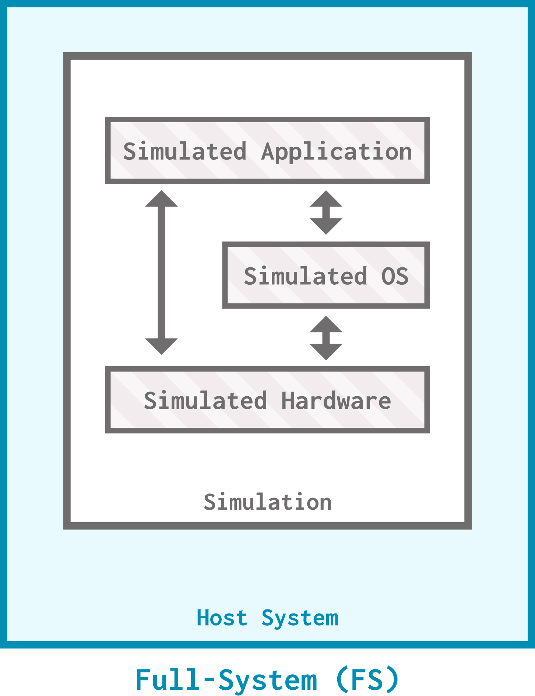

# Simulation modes

You might have noticed us using "SE mode" functions like `set_se_binary_workload` in previous sections; what's that about?

> By the end of this section, you will be able to:
>
> - **Assess** whether SE or FS mode is more appropriate for a particular simulation goal.
> - **Contrast** the benefits and drawbacks of Syscall Emulation (SE) and Full-System (FS) simulation modes.
> - **Change** whether a simulation uses SE or FS mode.

## What's SE mode?

**Syscall emulation (SE)** mode is a simulation mode in gem5 that *emulates* the operating system as opposed to *simulating* it. Only user-level code is simulated, and any system calls made within that code trap into the host. SE mode supports most common Linux system calls.


### The good news

SE mode is great if you really only care about the processor and the cache/memory system: it makes it easy for you to set up simulations by not requiring instantiation of every device in the system. Since it simulates less, SE mode also gives faster simulation speeds.

> SE mode is **simpler**, **easier to set up**, and **simulates faster**.

### The bad news

Since SE mode does not simulate the OS, you shouldn't use it if you care about *any* OS features or interactions (for example, page table walks). Think of the syscall emulation SE mode provides as the bare minimum needed to get user-level code to work. SE mode also has lower simulation fidelity, so if you require a high-fidelity simulation of your system, SE mode is not the right choice. Binaries that require elevated permissions also don't work in SE mode.

> SE mode is **lower-fidelity**, **does not simulate the OS**, and **does not support elevated permissions**.

### Example

Let's take a look at how SE mode handles user-level code with system calls. Open `SE_hello_world.py` to get started! This file sets up a simple system with a `PrivateL1CacheHierarchy`, a `SingleChannelDDR4_2400`, and a `TIMING` `SimpleProcessor`. We then use `set_se_binary_workload` to set an SE mode workload for the board. This is all we need to do to simulate using SE mode!

> The `Simulator` object in gem5 has an optional parameter called `full_system`, which can be used to specify the simulation mode. However, this is usually inferred from the board, as you can see here.

The workload we choose to use is `arm-hello64-static`, a simple program that prints "Hello world!" to the console. Recall that printing to the console requires a **system call**.

Let's run this thing! Use the following command:

```bash
gem5 --outdir=SE_mode -re --debug-flags=SyscallAll SE_hello_world.py
```

> You'll notice two new flags in this command: `-re` redirects simulation output (`stdout` and `stderr`) to files (`simout.txt` and `simerr.txt`) in the output directory instead of outputting to the console, making things more readable if there's a lot of output. `--debug-flags=SyscallAll` enables a set of debug flags to log system calls in `stdout`.

When the simulation wraps up, you should see a few logging statements in `simout.txt` (the redirected output of `stdout`). All of these represent various system calls (mainly `brk`) being called and returning. Let's focus on the ones surrounding the "Hello world!" print:

```bash
28305000: board.processor.cores.core: T0 : syscall Calling write(1, 4798048, 13)...
Hello world!
28305000: board.processor.cores.core: T0 : syscall Returned 13.
```

One thing to know about gem5 output is that the *simulation's* `stdout` and the *simulator's* `stdout` are both printed to the same `stdout` (and thus redirected to the same `simout.txt` file). These two lines were printed to the *simulator's*  `stdout`:

```bash
28305000: board.processor.cores.core: T0 : syscall Calling write(1, 4798048, 13)...
28305000: board.processor.cores.core: T0 : syscall Returned 13.
```

...and this one line was printed to the *simulation's* `stdout`:

```bash
Hello world!
```

For debugging messages, the number at the beginning of a line corresponds to the tick that the line was printed at. The two lines in the simulator's `stdout` show the `write` syscall being called at tick 28305000, then that same `write` syscall returning at 28305000: the same tick! As you can see, **SE mode does NOT record timing information for system calls**, but, as the line of simulation in `stdout` shows, the *behavior* of the system call still functions.

## What's FS mode?

**Full-system (FS) mode** is a simulation mode in gem5 that *simulates the entire system*. It simulates the CPU and the memory system (like SE mode does), but it also simulates I/O devices like disk and network interfaces along with the entire software stack including the OS, drivers, and applications.



### The good news

Full-system mode is the go-to simulation mode if you need to simulate an entire system in high fidelity. It allows for detailed analysis and debugging of hardware and software interactions. If you care about I/O or the operating system, FS mode is the right move.

> FS mode **simulates the entire system** (including the OS) and **allows for detailed system analysis**.

### The bad news

All of that extra simulating comes at the price of simulation speed. If you don't care about the OS boot process, but need the OS to be fully simulated, you'll have to wait through that boot process every time (that is, unless you accelerate the simulation... we'll discuss this in the advanced topics section). You'll also need to provide extra resources other than just a binary (like the kernel and disk image) to run an FS mode simulation.

> FS mode is **slower** and **requires extra gem5 resources**.

### Example

Let's try to run a simulation in full-system mode. Running a custom binary in full-system mode is a bit involved, so for now, let's just boot Ubuntu. Since full-system mode simulates the entire system, we're going to need more than a binary to get this simulation off the ground. Open `FS_hello_world.py` to get started. This configuration script is similar to its SE mode cousin, with two main differences. First, we're using an `ArmBoard` instead of a a `SimpleBoard`, since `SimpleBoard` does not support full-system mode:

```python
board = ArmBoard(
    clk_freq="1GHz",
    processor=processor,
    memory=memory,
    cache_hierarchy=cache_hierarchy,
)
```

Second, we're using `set_kernel_disk_workload` instead of `set_se_binary_workload` to set our workload. This function requires a kernel, a disk image, and a bootloader, which we obtain individually using `obtain_resource`:

```python
board.set_kernel_disk_workload(
  kernel = obtain_resource("arm64-linux-kernel-6.8.12"),
  disk_image = obtain_resource("arm-ubuntu-24.04-img"),
  bootloader = obtain_resource("arm64-bootloader-foundation")
)
```

We can now run this script:

```bash
gem5 --outdir=FS_mode -re FS_hello_world.py
```

You'll notice we didn't turn on any debug flags this time, mostly because this workload doesn't make any system calls from user-mode code (it only boots the kernel). Still, you may notice some new files in the output directory (`FS_mode`) that weren't there in the SE mode simulation:

```txt
FS_mode
  |---board.realview.uart1.device
  |---board.realview.uart2.device
  |---board.realview.uart3.device
  |---board.terminal
  |---device.dtb
```

These files (and potentially others, depending on the simulation parameters) are auto-generated for FS mode simulations. The `.device` files will record any output on the corresponding simulated devices, the `.terminal` file shows `stdout`, and the `.dtb` file reflects the contents of disk in a binary format.

> After this example, you may have some questions about how we've been able to avoid listing the kernel, disk image, and bootloader individually in previous full-system simulations (like the first configuration script from Unit I), or what the deal is with the `set_workload` function. All will be answered in the next section on gem5 resources!

## Which should I choose?

One way to quickly know that you need to use FS mode is if your simulation requires a feature that SE mode does not support. For example, you may need to simulate system calls or any other aspect of the operating system in detail. Your binary may require elevated privileges to work, or you may rely on a more esoteric system call that is not implemented in SE mode, even if you don't care about its timing.

It's important not to treat SE mode as just "FS mode but faster". As we just looked at, SE mode doesn't simulate everything that FS mode does, and if you're not 100% sure that SE mode simulates everything you need, you should use FS mode instead. **FS mode simulates everything that SE mode does**, so it's a safe option.

> ***When in doubt, use FS mode***.

That being said, if you're certain that SE mode meets your needs, it is a quicker option! You'll notice that we've used SE mode quite a bit in this bootcamp to look at simpler simulations and examine processors, caches, and memory components. SE mode is another useful tool in your toolbox!
