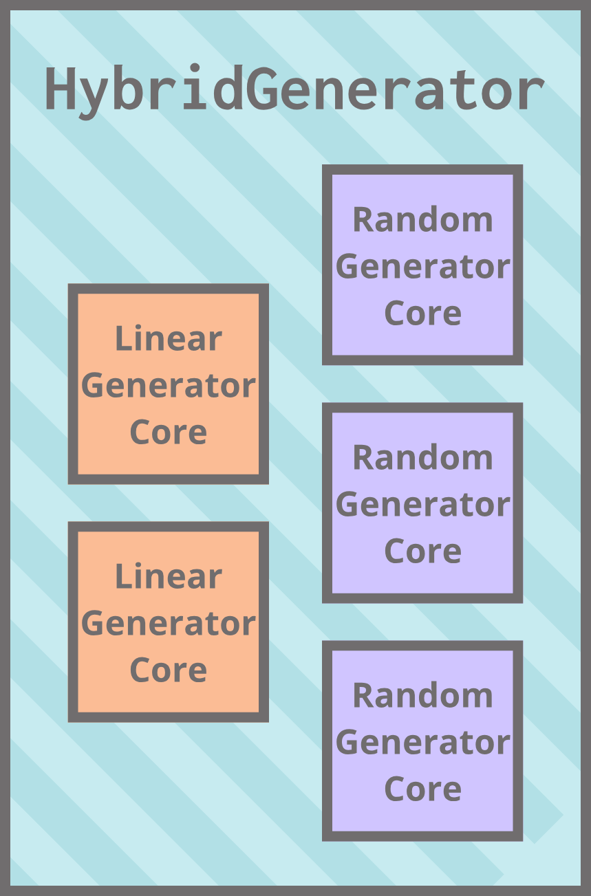
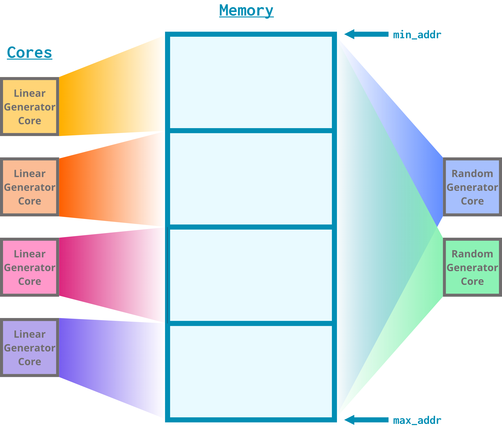

# Traffic generation in gem5

Sometimes, you just don't need to model a processor.

> By the end of this section, you will be able to:  
>
> - **Test** the performance of a memory system in-simulation using standard library traffic generators.
> - **Create** a new traffic generator by extending the AbstractGenerator class.
> - **Interpret** statistics for simulations that use traffic generators.

## What's synthetic traffic generation?

Synthetic traffic generation is a technique that allows us to simulate a pattern of memory accesses without needing to simulate a processor or a workload.


It's useful for measuring the performance of memory systems; for example, assessing the maximum theoretical bandwidth of a system or testing the correctness of a new cache coherency protocol. It's *not* useful for situations where the presence of a processor makes a difference; for example, measuring the execution time of workloads.

## Traffic generators in the standard library

The gem5 standard library includes a collection of components for synthetic traffic generation, which includes generators (which replace processors on a gem5 simulation board) and generator cores (the cores that generators have).

![A tree-like class diagram of cores and processors in the gem5 standard library. The subsystem class is at the very top. AbstractCore and AbstractGenerator inherit from SubSystem. AbstractGeneratorCore and BaseCPUCore inherit from AbstractCore. ComplexGeneratorCore, LinearGeneratorCore, GUPSGeneratorCore, RandomGeneratorCore, StridedGeneratorCore, and TrafficGeneratorCore inherit from AbstractGeneratorCore. SimpleCore inherits from BaseCPUCore. AbstractGenerator, BaseCPUProcessor, and SwitchableProcessor inherit from AbstractProcessor. ComplexGenerator, LinearGenerator, GUPSGenerator, GUPSGeneratorEP, GUPSGeneratorPAR, RandomGenerator, StridedGenerator, and TrafficGenerator inherit from AbstractGenerator. SimpleProcessor inherits from BaseCPUProcessor. SimpleSwitchableProcessor inherits from SwitchableProcessor. The branches of the tree diagram that include AbstractGeneratorCore and its children and AbstractGenerator and its children are highlighted with red boxes.](img/stdlib-gens.png)

These components simulate memory accesses (both reads and writes!). 

> If you're curious, you can find the definitions for all of these standard library components in `src/python/gem5/components/processors`.

### Linear and random generators

Two common generator types are linear generators (`LinearGenerator`) and random generators (`RandomGenerator`). A linear generator accesses memory in a linear fashion starting from a given minimum address and increasing up to a maximum address. A random generator accesses addresses within a range randomly.

Here are the parameters you can control for linear and random generators:

- `num_cores`: How many cores should the generator have?
- `duration`: How long (number of ticks) should traffic be generated?
- `rate`: How frequently (bytes/second) should the generator send out requests to memory?
  - Note that this is *not* the rate at which memory will respond! The generator might be forced to slow down if memory cannot respond fast enough. This means that `rate` indicates the maximum outgoing request rate.
- `block_size`: how many bytes should the generator request to access with each read/write request?
- `min_addr`: What's the lowest memory address this generator should access?
- `max_addr`: What's the highest memory address this generator should access?
- `rd_perc`: What percent of the generated accesses should be reads?
- `data_limit`: What is the maximum cumulative number of bytes that the generator can access? Once this number is reached, the generator will stop.
  - If you don't want such a limit, you can set `data_limit` to 0.

This means that the access patterns of linear and random generators look something like this:

![A memory block diagram demonstrating the access pattern of linear and random generators. The diagram consists of numbered blocks (0-7) laid in ascending order in an array. The array is labeled "block size = 1". An arrow labeled "min_addr = 0" points to the beginning of the block numbered "0". An arrow labeled "max_addr = 4" points to the beginning of the block numbered "4". The linear generator starts accessing at address 0, then accesses 1, 2, and 3 in that order. The random generator starts accessing at 1, then accesses 3 and 2, in that order.](img/linear_random_gen.png)

## Using standard library generators

Let's explore the performance of gem5's memory models using different traffic generators! We'll be:

1) Setting up a system with a `SingleChannelSimpleMemory` unit and a `PrivateL1CacheHierarchy`,
2) Testing the system with a `LinearGenerator`,
3) Swapping out the `LinearGenerator` for a `RandomGenerator`.

Open `traffic_gen.py` to get started. Our first step is to pick a system to evaluate.

> **Your turn:** Fill in `TODO (1)` in `traffic_gen.py` to fill in the details of our system:
>
> 1) A `SingleChannelSimpleMemory` with a latency of 20 ns, a bandwidth of 32 GiB/second, latency variance of 0 s, and a size of 1 GiB,
> 2) A `PrivateL1CacheHierarchy` with an L1 i-cache size of 16 KiB and an L1 d-cache size of 16 KiB.
>
> <details>
> <summary> <b>Answer</b> </summary>
>
> ```python
> cache_hierarchy = PrivateL1CacheHierarchy (
>   l1i_size = "16KiB",
>   l1d_size = "16KiB"
> )
>
> memory = SingleChannelSimpleMemory (
>   latency = "20ns",
>   bandwidth = "32GiB/s",
>   latency_var = "0s",
>   size = "1GiB"
> )
> ```
>
> </details>

<br>

> You'll notice that instead of using a `SimpleBoard` like we've been using, we're using a `TestBoard`. This is because `TestBoard` is more suitable for using traffic generators (for example, it does not require a cache hierarchy). You can look at more details if you're curious at the `TestBoard` definition at `gem5/src/python/gem5/components/boards/TestBoard`.

### Linear generator

Now that we have our cache/memory system, we need to configure a linear generator to test it. By default, a `LinearGenerator` has the following parameters:

- `num_cores`: 1
- `duration`: 1 ms
- `rate`: 100 GB/s
- `block_size`: 64
- `min_addr`: 0
- `max_addr`: 32768 ($2^{15}$)
- `rd_perc`: 100
- `data_limit`: 0 (AKA no data limit)

We can see this in `__init__` function in the Python definition for `LinearGenerator`:

```python
class LinearGenerator(AbstractGenerator):
    def __init__(
        self,
        num_cores: int = 1,
        duration: str = "1ms",
        rate: str = "100GB/s",
        block_size: int = 64,
        min_addr: int = 0,
        max_addr: int = 32768,
        rd_perc: int = 100,
        data_limit: int = 0,
    ) -> None:
```

Let's make our `LinearGenerator` access data a bit slower than the default: how about 1 GB/s?

> **Your turn:** Fill in `TODO (2)` in `traffic_gen.py` to add a `LinearGenerator` with all default parameters other than `rate`, which should be `"1GB/s"`.
>
> <details>
> <summary> <b>Answer</b> </summary>
>
> ```python
> generator = LinearGenerator(rate="1GB/s")
> ```
>
> </details>

<br>

Let's run this thing! Run the following the command line:

```bash
gem5 --debug-flags=TrafficGen --debug-end=1000000 \
traffic_gen.py
```

> You might notice the new options we're using, `--debug-flags` and `--debug-end`. We'll talk more about these options later in the bootcamp, but right now, all you need to know is that they add some debug prints for traffic generators.

You should see output messages like this:

```bash
 59605: system.processor.cores.generator: LinearGen::getNextPacket: r to addr 0, size 64
 59605: system.processor.cores.generator: Next event scheduled at 119210
119210: system.processor.cores.generator: LinearGen::getNextPacket: r to addr 40, size 64
119210: system.processor.cores.generator: Next event scheduled at 178815
178815: system.processor.cores.generator: LinearGen::getNextPacket: r to addr 80, size 64
178815: system.processor.cores.generator: Next event scheduled at 238420
```

Let's break these messages down. They all start with a number: this is the current tick. These memory accesses happen at intervals of 59605 ticks, which, remembering that 1 tick corresponds to 1 picosecond ($10^{-12}$ seconds) by default, this means that we're making accesses every 59605 picoseconds. This makes sense! Remember that the default block size for `LinearGenerator` is 64 bytes, meaning that each of these messages signifies a 64-byte access:

$$\frac{64 ~bytes}{59605 ~ps} * \frac{10^{12} ~ps}{s}\approx \frac{1.07 * 10^{9} ~bytes}{s}$$

$$\frac{1.07 * 10^{9} ~bytes}{s} * \frac{1 ~GB}{10^9 ~bytes} \approx \frac{1.07 ~GB}{1 ~s}$$

Hey, that's very close to the 1 GB/s rate we set!

The next part of the messages looks like `r to addr <X>, size 64`. This means that the generator is simulating a 64-byte read (`r`) to address `<X>`. You'll notice the addresses linearly increase:

$$0 \rightarrow 40 \rightarrow 80$$

These addresses are printed in *hex*, meaning that the generator is accessing addresses 0x0000, 0x0040, and 0x0080. These addresses are 0x40 = 64 bytes apart! A linear generator will access contiguous and increasing addresses in this format.

<!--TODO (Naama): Experiment with simulation stats and add something about it here-->

### Random generator

Let's follow the same procedure to replace our linear generator with a random generator! Thankfully, `RandomGenerator` has the same default parameters as `LinearGenerator`:

```python
class RandomGenerator(AbstractGenerator):
    def __init__(
        self,
        num_cores: int = 1,
        duration: str = "1ms",
        rate: str = "100GB/s",
        block_size: int = 64,
        min_addr: int = 0,
        max_addr: int = 32768,
        rd_perc: int = 100,
        data_limit: int = 0,
    ) -> None:
```
Let's keep everything the same as our `LinearGenerator` to have a nice, clean comparison.

> **Your turn:** Fill in `TODO (3)` in `traffic_gen.py` to replace the `LinearGenerator` with a `RandomGenerator` with all default parameters other than `rate`, which should be `"1GB/s"`.
>
> <details>
> <summary> <b>Answer</b> </summary>
>
> ```python
> generator = RandomGenerator(rate="1GB/s")
> ```
>
> </details>

<br>

Let's rerun the script with our new generator!

```bash
gem5 --debug-flags=TrafficGen --debug-end=1000000 \
traffic_gen.py
```

> This is the same command as before, just duplicated here for your convenience.

You should see the following messages in your terminal:

```bash
 59605: system.processor.cores.generator: RandomGen::getNextPacket: r to addr 2000, size 64
 59605: system.processor.cores.generator: Next event scheduled at 119210
119210: system.processor.cores.generator: RandomGen::getNextPacket: r to addr 7900, size 64
119210: system.processor.cores.generator: Next event scheduled at 178815
178815: system.processor.cores.generator: RandomGen::getNextPacket: r to addr 33c0, size 64
178815: system.processor.cores.generator: Next event scheduled at 238420
```

You'll notice that a few things are the same:

- Accesses are still of size 64,
- Accesses still occur on the same ticks (so at the same 1GB/s rate),
- Accesses are still all reads.

One thing is different, though: the addresses are all over the place. A `RandomGenerator` will access aligned addresses (you'll notice 0x2000, 0x7900, and 0x33c0 are all multiples of 64), but the addresses will be chosen randomly.

> If you're curious about how addresses are actually generated for `LinearGenerator` and `RandomGenerator`, take a look at `src/cpu/testers/traffic_gen`. Heads up: these are C++ files!

## Creating a custom traffic generator

Remember that the standard library components `LinearGenerator` and `RandomGenerator` both extend a parent class called `AbstractGenerator`. We can also extend `AbstractGenerator` to create our own generator with custom behavior! Extending existing Python classes to create custom behavior is something we'll do a lot in this bootcamp, and it's a useful tool you might need to use in your research.

> `LinearGeneratorCore` and `RandomGeneratorCore` also extend from the same parent, `AbstractGeneratorCore`. You can create your own generator cores, too, but this requires some C++ programming to get interesting behavior. We leave this as an exercise for the reader :)

Let's create a `HybridTrafficGenerator` that simultaneously generates linear and random traffic.



We can achieve this by doing the following:

1) Creating a `HybridTrafficGenerator` Python class that extends `AbstractTrafficGenerator`,
2) Partitioning the memory ranges for our cores appropriately,
3) Instantiating an appropriate number of `LinearGeneratorCore`s and `RandomGeneratorCore`s.

### The `HybridTrafficGenerator` class

Open the `hybrid_gen.py` file to get started. This file will be home to our new `HybridTrafficGenerator` class. You'll notice this class extends `AbstractGenerator`:

```python
class HybridGenerator(AbstractGenerator):
```

By extending `AbstractGenerator`, `HybridGenerator` must implement the `start_traffic` function. As the name suggests, this function does whatever setup is needed to start generating synthetic traffic for the system. We've already filled in the implementation for this function, which simply calls `start_traffic` on all of the cores:

```python
@overrides(AbstractGenerator)
    def start_traffic(self) -> None:
        for core in self.cores:
            core.start_traffic()
```

We can now point our attention to the constructor:

```python
def __init__(
        self,
        num_cores: int = 2,
        duration: str = "1ms",
        rate: str = "1GB/s",
        block_size: int = 8,
        min_addr: int = 0,
        max_addr: int = 131072,
        rd_perc: int = 100,
        data_limit: int = 0,
    ) -> None:
        if num_cores < 2:
            raise ValueError("num_cores should be >= 2!")
        super().__init__(
            cores=self._create_cores(
                num_cores=num_cores,
                duration=duration,
                rate=rate,
                block_size=block_size,
                min_addr=min_addr,
                max_addr=max_addr,
                rd_perc=rd_perc,
                data_limit=data_limit,
            )
        )
```

The default parameters we chose to use should look familiar: they're mostly the same as the ones from `LinearGenerator` and `RandomGenerator`. The only difference is `num_cores`, which we set to 2 instead of 1. It really isn't much of a hybrid generator if it only has 1 core!

The `AbstractGenerator`'s `__init__` function requires a list of cores to instantiate, so we need to create that list. We do this with a helper function called `_create_cores`, which you'll also see declared in other children of `AbstractGenerator` (including `LinearGenerator` and `RandomGenerator`): this is a convention in gem5. We'll fill in the implementation of this function soon; for now, we can treat it as a black box that takes all of our parameters and returns a list of cores.

### Partitioning memory

Our `HybridGenerator` class might have multiple `LinearCore`s. If we instantiate these cores with the same `min_addr` and `max_addr` values, they'll just access the same addresses at the same time! What we need to do instead is give them equal spans of the range defined by `min_addr` and `max_addr`.


You might ask yourself: do we need to do this same partitioning for our random cores? As it turns out, **no we don't!** Since our random cores will access addresses randomly, it's completely fine that their range overlaps, as the chances that any two cores will randomly pick the same address at the same time are pretty slim. Here's how we'll end up splitting memory:



We can do this in our code using the `partition_range` function, defined in `src/python/gem5/components/processors/abstract_generator.py`. This function takes the following parameters:

- `min_addr`: what's the minimum address to partition from?
- `max_addr`: what's the maximum address to partition to?
- `num_partitions`: how many partitions should we create?

The function returns a list of tuples representing the start and end of each partition.

> For example, if we call `partition_range(0, 9, 3)`, we'll get back `[<0, 3>, <3, 6>, <6, 9>]`.

### Implementing `_create_cores`

Let's add this functionality to `_create_cores`! The first thing we need to do here is decide how many linear and random cores we'll have based on `num_cores`. A natural choice for the number of linear cores is some power of 2; this way, we can easily divide memory (the size of which is a power of 2) into equally-sized spans for each core. We still want to leave some room for random cores, though, so let's pick a number that is always strictly smaller than `num_cores`. 

We implement this using the `get_num_linear_cores` function, which is already written for you. This function returns the largest power of 2 that is smaller than `num_cores`:

```python
def get_num_linear_cores(num_cores: int):
            if num_cores & (num_cores - 1) == 0:
                return num_cores // 2
            else:
                return 2 ** int(log(num_cores, 2))
```

This way, we have a nice power of 2 for our linear cores and at least 1 random core.

Let's initialize some variables! You'll notice we've already created a `core_list` variable that will store all of our cores. We return this variable at the end of the function.

> **Your turn:** Fill in `TODO (1)` in `hybrid_generator.py` to initialize variables for `num_linear_cores` and `num_random_cores`.
>
> <details>
> <summary> <b>Answer</b> </summary>
>
> ```python
> num_linear_cores = get_num_linear_cores(num_cores
> num_random_cores = num_cores - num_linear_cores
> ```
>
> </details>

<br>

Next, we should figure out the address ranges for all of our linear generator cores.

> **Your turn:** Fill in `TODO (2)` in `hybrid_generator.py` to create an `address_ranges` variable that stores the ranges for our linear cores. Remember `partition_range`!
>
> <details>
> <summary> <b>Answer</b> </summary>
>
> ```python
> addr_ranges = partition_range(min_addr, max_addr, num_linear_cores)
> ```
>
> </details>

<br>

Great, now we can assign these partitions to each one of our linear cores! What we need to do is loop through every linear core we want to create. For each of these cores, we should:

1) Figure out what its `min_addr` and `max_addr` values are using our `address_ranges` variable,
2) Instantiate a `LinearGeneratorCore` with all of the parameters passed into the `_create_cores` function.

We can do this with the following loop (you can try this yourself or look at the code in the dropdown for the answer):

<details>
<summary><b> The following loop: </b></summary>

```python
for i in range(num_linear_cores):
    core_list.append(
        LinearGeneratorCore(
            duration=duration,
            rate=rate,
            block_size=block_size,
            min_addr=addr_ranges[i][0],
            max_addr=addr_ranges[i][1],
            rd_perc=rd_perc,
            data_limit=data_limit,
        )
    )
```

</details>
<br>

Now that we have all of our linear core set up, we only need to append random cores to our core list. Remember that these are not partitioned in the same way as the linear cores!

> **Your turn:** Fill in `TODO (4)` in `hybrid_generator.py` to add all of our random cores.
>
> <details>
> <summary> <b>Answer</b> </summary>
>
> ```python
> for i in range(num_random_cores):
>     core_list.append(
>         RandomGeneratorCore(
>             duration=duration,
>             rate=rate,
>             block_size=block_size,
>             min_addr=min_addr,
>             max_addr=max_addr,
>             rd_perc=rd_perc,
>             data_limit=data_limit,
>         )
>     )
> ```
>
> </details>

<br>

Congratulations! You've now created a hybrid generator that generates traffic using both linear and random cores. Let's try it out!

## Using our custom traffic generator

We can now go back to `traffic_gen.py` and use our `HybridGenerator` instead of `LinearGenerator` or `RandomGenerator`!

The first thing we need to do is import our new component:

```python
from hybrid_generator import HybridGenerator
```

Now we can assign our `generator` a `HybridGenerator`.

> **Your turn:** Fill in `TODO (4)` in `traffic_gen.py` to assign the `generator` variable a `HybridGenerator` with all default parameters except for the number of cores: let's give it 6 cores instead.
>
> <details>
> <summary> <b>Answer</b> </summary>
>
> ```python
> generator = HybridGenerator(num_cores=6)
> ```
>
> </details>

<br>

You can now run this with the following command:

```bash
gem5 --debug-flags=TrafficGen --debug-end=1000000 \
traffic_gen.py
```

When you do, you should see the following output:

```bash
7451: system.processor.cores5.generator: RandomGen::getNextPacket: r to addr 80a8, size 8
7451: system.processor.cores5.generator: Next event scheduled at 14902
7451: system.processor.cores4.generator: RandomGen::getNextPacket: r to addr 10a90, size 8
7451: system.processor.cores4.generator: Next event scheduled at 14902
7451: system.processor.cores3.generator: LinearGen::getNextPacket: r to addr 18000, size 8
7451: system.processor.cores3.generator: Next event scheduled at 14902
7451: system.processor.cores2.generator: LinearGen::getNextPacket: r to addr 10000, size 8
7451: system.processor.cores2.generator: Next event scheduled at 14902
7451: system.processor.cores1.generator: LinearGen::getNextPacket: r to addr 8000, size 8
7451: system.processor.cores1.generator: Next event scheduled at 14902
7451: system.processor.cores0.generator: LinearGen::getNextPacket: r to addr 0, size 8
7451: system.processor.cores0.generator: Next event scheduled at 14902
```

As you can see, we have 6 memory requests happening on the same tick! `system.processor.cores0.generator` through `system.processor.cores3.generator` are our linear cores (you can tell by the nice addresses), and `system.processor.cores4.generator` and `system.processor.cores5.generator` are our random cores.

### Comparing statistics

<!--TODO (Naama): Generate and discuss statistics differences between the linear and random cores-->
