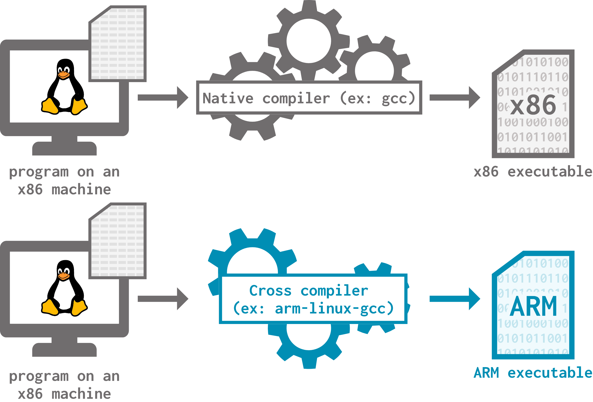

# Communicating from the simulation to the simulator

How can we let the simulator know that something interesting is going on in-simulation?

> By the end of this section, you will be able to:
>
> - **Explain** what an exit event is in gem5.
> - **Change** exit event behavior by writing a custom event handler and adding it to a Simulation object.
> - **Modify** C++ workloads by adding m5ops annotations.
> - **Build** the m5ops library and link it to a workload.

## Exit events

An **exit event** is a simulation event that passes control back to the simulator. It *exits* the simulation (hence the name) and gives the simulator an opportunity to do something. What the simulator does is dictated either by the default behavior of the exit event or by a custom **exit event handler**.

Here are some of the exit events defined in gem5:

- `ExitEvent.EXIT`
- `ExitEvent.CHECKPOINT`
- `ExitEvent.RESETSTATS`
- `ExitEvent.SWITCHCPU`
- `ExitEvent.WORKBEGIN`
- `ExitEvent.WORKEND`
- `ExitEvent.MAX_INSTS`
- `ExitEvent.MAX_TICK`

The default behavior for almost all of these exit events is to just exit the simulation. Most of the time, you'll want to overwrite this behavior to do more interesting things, including *falling back into simulation* after handling.

![An illustration of exit events. A large rectangle represents the simulator. Within the simulator runs the simulation, which contains two exit events: exit event X and exit event Y. Also within the simulator rectangle is the simulation's configuration script, which contains the exit event X handler and the exit event Y handler. Exit event X points to its handler, which does something then falls back into simulation. Exit event Y points to its handler, which does something then ends the simulation.](img/exit-events.png)

The utility of having this many different exit events is not necessarily to use their default behavior; it's to be able to differentiate between many simulation events and tailor your handling accordingly. Exit events are useful for:

- Configuring when the simulation should end,
- Resetting and printing statistics during specific simulation points,
- Accelerating simulation (if you're curious about this, check out the advanced topics unit),
- Taking checkpoints (also covered in the advanced topics unit),
- Using sampling tools like SimPoint and LoopPoint (also in the advanced topics unit),
- ...and more!

## Scheduling exit events

There are multiple ways to add exit events to a simulation:

1) Using the `Simulator` object in the configuration script,
2) Annotating workloads with m5ops (more on this later),
3) Using pre-annotated workloads.

For now, let's focus on the first method. The `Simulator` object has ways to schedule exit events, which you can use in your configuration scripts:

- The `schedule_simpoint()` function schedules a `SIMPOINT_BEGIN` exit event at a specific instruction number,
- The `schedule_max_insts()` function schedules a `MAX_INSTS` exit event once a certain number of instructions has executed in any thread on any core,
- The `set_max_ticks()` function (or the `max_ticks` parameter when instantiating the `Simulator`) sets the number of simulation ticks that can occur before the simulation exits with a `MAX_TICKS` exit event.

> When we run `simulator.run(1_000_000_000)`, we're setting the simulator's `max_ticks` parameter to 1,000,000,000! The default behavior of the `MAX_TICKS` exit event is to exit the simulation, which is why the simulation runs for 1,000,000,000 ticks then exits when we do this.

## Handling exit events

Exit event handlers are often *generators*; this way, we can use a single handler to dictate the behavior for multiple instances of the same exit event.

> As a reminder, a Python generator is a special function that returns an iterator you can call `next` on. You can usually identify generators by their use of `yield` instead of `return`.

We can register an exit event handler by setting the `Simulator` object's `on_exit_event` parameter. `on_exit_event` is a dictionary that maps exit event types (ex: `ExitEvent.MAX_TICKS`) to their handlers.

Let's write some exit events and handlers! Our goal for this exercise is to detect when the simulation hits 1,000,000 instructions executed, execute for another 1,000 ticks, then finally exit the simulation 1,000 ticks later. Open `exit_event.py` to get started.

### Our first exit event

Let's first schedule an exit event at the 1,000,000th instruction. We can do this using the `schedule_max_insts()` function as follows:

```
simulator.schedule_max_insts(1_000_000)
```

If we ran the simulation now without any further modifications, the simulation will simply end after 1,000,000 instructions have executed. If we want to achieve the behavior we want, we need to write a custom event handler. This handler should do 3 things:

1) Print that we've reached 1,000,000 instructions, which will help us know that our exit event has been reached,

2) Schedule a `MAX_TICKS` exit event 1,000 ticks from now,

3) Fall back into simulation.

```python
handle_max_insts():
  # print that we've reached 1,000,000 instructions
  print("1,000,000 instructions reached!")

  # schedule MAX_TICKS exit event
  curr_tick = simulator.get_current_tick()
  print(f"Tick at 1,000,000th instruction is {curr_tick}")
  simulator.set_max_ticks(curr_tick + 1_000)

  # fall back into simulation
  yield False
```

`set_max_ticks()` takes an absolute, not relative, number of ticks. Therefore, we use `Simulator`'s `get_current_tick()` function to learn what tick the simulation is currently on, then schedule the `MAX_TICK` event 1,000 ticks in the future.

You can think of the return value of the handler as the answer to the question "should we exit the simulation?". Therefore, we use `yield False` to fall back into simulation.

Our handler now exists, but we need to let the simulator know to invoke it when it encounters a `MAX_INSTS` event. We do this in our instantiation of the simulator:

```python
simulator = Simulator(
  board=board,
  on_exit_event={
    ExitEvent.MAX_INSTS: handle_max_insts(),
  }
)
```

Remember that `on_exit_event` is just a dictionary, and we just decide the key-value pairs of exit event and handler. Remember to include the `()` in the handler name!

### Simple `MAX_TICKS` handler

Now we need to write an exit event handler for the `MAX_TICKS` exit event. For now, let's just exit after 1,000 more ticks have passed.

> **Your turn:** Fill in `TODO (1)` in `exit_events.py` to write and register an exit event handler for the `MAX_TICKS` exit event that does the following:
>
> 1) Prints out the current tick value,
> 2) Schedules another `MAX_TICKS` event 1,000 ticks from now,
> 3) Exits the simulation (we'll change this in a moment).
>
> <details>
> <summary> <b>Answer</b> </summary>
>
> Handler:
>
> ```python
> handle_max_ticks():
>   # print out the current tick value
>   curr_tick = simulator.get_current_tick()
>   print(f"First MAX_TICKS event at tick {curr_tick}")
>
>   # schedule a MAX_TICKS event 1,000 ticks from now
>   simulator.schedule_max_ticks(curr_tick + 1_000)
>
>   # exit the simulation
>   yield True
> ```
>
> Registering the handler:
>
> ```python
> simulator = Simulator(
>   board=board,
>   on_exit_event={
>     ExitEvent.MAX_INSTS: handle_max_insts(),
>     ExitEvent.MAX_TICKS: handle_max_ticks(),
>   }
> )
> ```
>
> </details>

<br>

### Complicating the `MAX_TICKS` handler

Now, our simulation will reach the 1,000,000th instruction, execute for 1,000 more ticks, then exit. However, this means we'll never hit the next `MAX_TICKS` event we scheduled in the handler in the previous part. Since this scheduled event is also a `MAX_TICKS` event, we need to use the *same handler* to address this future exit event.

The first thing we'll do is fall back into simulation rather than exiting:

```python
handle_max_ticks():
  # print out the current tick value
  curr_tick = simulator.get_current_tick()
  print(f"First MAX_TICKS event at tick {curr_tick}")

  # schedule a MAX_TICKS event 1,000 ticks from now
  simulator.schedule_max_ticks(curr_tick + 1_000)

  # FALL BACK INTO simulation!
  yield False
```

Now, we need to handle what happens the next time this handler is triggered. This is where generators come in handy! The handler will pick up where it left off after the call to `yield False`. Therefore, we can add the following:

```python
handle_max_ticks():

  # |--- First MAX_TICKS event: ---|

  # print out the current tick value
  curr_tick = simulator.get_current_tick()
  print(f"First MAX_TICKS event at tick {curr_tick}")

  # schedule a MAX_TICKS event 1,000 ticks from now
  simulator.schedule_max_ticks(curr_tick + 1_000)

  # FALL BACK INTO simulation!
  yield False

  # |--- Second MAX_TICKS event: ---|

  # print the current tick value again
  curr_tick = simulator.get_current_tick()
  print(f"Second MAX_TICKS event at tick {curr_tick}")

  # exit the simulation
  yield True
```

When we run this script using:

```bash
gem5 exit_events.py
```

We should see:

<!--TODO (Naama): Test this example once there's access to gem5-->

> ***UNDER CONSTRUCTION!***

## m5ops

Let's get back to that other way of creating exit events: annotating workloads with m5ops. You might've noticed that the `Simulator` way of scheduling events can only really interact with the number of instructions executed and the number of ticks that have passed. This is helpful, but what if you want to let the simulator know when the code being executed has finished a specific task?

m5ops (short for "m5 opcodes") allow us to make *annotations* in our workload that have unique behavior, including creating exit events. You can think of m5ops as *pseudo-instructions* that our simulated processor can recognize. When the processor finds an m5op, it triggers the corresponding simulation behavior. Here are some examples (the names may look familiar):

- `exit [delay]`: Create an `ExitEvent.EXIT` in `delay` nanoseconds
- `workbegin`: Create an `ExitEvent.WORKBEGIN`
- `workend`: Create an `ExitEvent.WORKEND`
- `resetstats [delay[period]]`: Reset simulation statistics in `delay` nanoseconds; repeat this every `period` nanoseconds
- `dumpstats [delay[period]]`: Save simulation statistics to a file in `delay` nanoseconds; repeat this every `period` nanoseconds
- `checkpoint`: Create an `ExitEvent.CHECKPOINT` in `delay` nanoseconds; repeat this every `period` nanoseconds
- `switchcpu`: Create an `ExitEvent.SWITCHCPU`

> You can check out all of the m5ops and their behavior in `gem5/src/sim/pseudo_inst.cc`!


The main benefit of m5ops that we'll be focusing on is the ability to place exit events in locations that make sense in the context of our specific workload.

## Using m5ops

We have three versions of m5ops:

1. **Instruction mode**: m5ops in this mode just show up as pseudo-assembly instructions (in fact, they take advantage of unmapped instructions from the ISA). As such, they only work on simulated (non-KVM) CPU models (your host CPU won't recognize them!).
2. **Address mode**: instead of unmapped instructions, these rely on memory accesses to a specific address range to trigger m5ops behavior. As such, a non-simulated CPU can recognize them, so you can use them with the KVM CPU model. However, address mode is only supported in x86 and ARM.
3. **Semihosting**: this mode was added for ARM's Fast Model CPUs. It extends ARM's semihosting support. Other simulated CPU models that use ARM can also use semihosting mode m5ops.

> We will be focusing on instruction- and address-mode m5ops in this section. If you need to set up semihosting m5ops, please refer to gem5 documentation.

<!--TODO (Naama): are there actually no good sources for semihosting m5ops? Ask someone PLEASE.-->
<!--FIXME (Ayrton): there are no good sources for semihosting m5ops... all that is left is the source code. We are trying to do some android stuff, but it doesn't look too promising for the moment. -->

## Building the m5ops library

Before we can use m5ops, we need to build the m5ops library and link it to our workload's source file(s). First, make sure you're in the correct directory:

```bash
cd gem5/util/m5
```

Next, we need to use `scons` to build. Depending on your host ISA and the ISA you want to use in simulation, you might have to *cross-compile*.

> **Cross-compilation** is the process of compiling to an ISA that is different from your host machine.
> 

<!--TODO (Ayrton): I wrote a really good piece on how to set up the cross compiler (specifically with clang). I should paste that here and maintain it. -->

Let's build the m5ops library in both x86 and ARM to get a sense for what it's like to compile natively and cross-compile. Assuming we're on an x86 host, building the m5ops library for x86 looks like this:

```bash
scons build/x86/out/m5
```

On the other hand, building the m5ops for ARM requires the cross-compiler:

```bash
scons arm64.CROSS_COMPILE=aarch64-linux-gnu- build/arm64/out/m5
```

No matter what, both processes only require one command!

> Note that although we're using `scons` to build this, this is **NOT** the same build environment we use to build gem5! There are different targets and options available.
>
> Don't expect things to be identical! For example, we specify `arm64` to indicate building m5ops for ARM, but use `ARM` to specify building ARM for gem5.
<!--TODO (Ayrton): We should fix this. It really should look the same with the same build conventions... I should open a PR -->

After running these commands, you should be able to see **!!!TBD!!!**

<!--TODO (Naama): verify this after getting access to gem5-->

## Annotating a workload

Our goal is to annotate the beginning and end of a **region of interest (ROI)** within a workload with `ExitEvent.WORKBEGIN` and `ExitEvent.WORKEND` events, respectively.

> The default behavior of the `WORKBEGIN` exit event is to reset the simulation statistics and continue, and the default behavior of the `WORKEND` exit event is to dump the simulation statistics and continue.

This way, we can reset our statistics when we've reached the ROI and print them out when the ROI has executed all the way through.

Open `annotated_workload.cc` to get started. This workload initializes the elements of two matrices then multiplies them together. We want to set our ROI around the matrix multiplication part.

We can link the m5ops library to this workload by adding:

```cpp
#include <gem5/m5ops.h>
```

at the top of the file.

Let's annotate this workload with instruction-mode m5ops! We can do this by calling `m5_work_begin()` and `m5_work_end()` in the appropriate places in the code:

```cpp
auto mm_start = std :: chrono :: high_resolution_clock :: now();

m5_work_begin(0, 0); // workbegin annotation

for(int i = 0 ; i < N ; i++)
    for(int j = 0 ; j < N ; j++)
        for(int k = 0 ; k < N ; k++)
            C[i][j] += A[i][k] * B[k][j];

m5_work_end(0, 0); // workend annotation

auto mm_end = std :: chrono :: high_resolution_clock :: now();
```

> The arguments to these functions are `work_id` and `thread_id`, which you don't need to worry about. `(0, 0)` are the appropriate arguments most of the time!

We now need to modify the makefile for this workload to:

1) Add `gem5/include` to the compiler's search path (this allows the `#include` at the top of the file to find `m5ops.h`),
2) Add `gem5/util/m5/build/x86/out` to the linker's search path (this allows the linker to find the actual m5ops library),
3) Link against `libm5.a` (this is the library we need to use).

Thus, we use the following command:

```bash
$(GXX) -o annotated_workload annotated_workload.cpp \
  -I$(GEM5_PATH)/include \
  -L$(GEM5_PATH)/util/m5/build/$(ISA)/out \
  -lm5
```

Let's compile the workload with `make`! If all goes well, we can try to run the workload with:

```bash
./annotated_workload
```

However, we'll see the following error:

```bash
Illegal instruction (core dumped)
```

This is expected! Remember that instruction-mode m5ops are not recognized by normal CPUs since they use unmapped instructions. Our simulated CPU will be able to handle these just fine, though.

The configuration script at `using_m5ops.py` already sources the workload's binary, so we can simply run the script now and see what happens:

```bash
gem5 -re using_m5ops.py
```

We redirect the output to a file to better see what's going on.

First, let's look at `simerr.txt`. You should see the following two lines:

```txt
warn: No behavior was set by the user for work begin. Default behavior is resetting the stats and continuing.

warn: No behavior was set by the user for work end. Default behavior is dumping the stats and continuing.
```

These lines let us know that we didn't overwrite the default behavior of the `WORKBEGIN` and `WORKEND` exit events. However, this default behavior is completely fine for our purposes, so we can safely ignore this warning.

<!--TODO (Naama): Output analysis-->

## Address-mode m5ops

Instruction-mode m5ops work very well for simulated CPU models, but if you need to use a KVM CPU (for example, for simulation acceleration, which we'll cover in the advanced topics section), address-mode m5ops are required. The process for setting these up is a tiny bit more involved, but it's not too different from how we set up instruction-mode m5ops.

We've already built the m5ops library, so we can go straight to modifying our workload. Open `address_annotated_workload.cc` to get started.

First, just like for instruction-mode m5ops, we need to include `m5ops.h`:

```cpp
#include <gem5/m5ops.h>
```

We also need to include one more library, called `m5_mmap.h`:

```cpp
#include <m5_mmap.h>
```

Remember that address-mode m5ops use **memory accesses** to a specific memory region to trigger m5ops behavior. We call the address of the base of this memory region our *magic address*. We use the `m5_mmap` library to map our magic address to `/dev/mem` so that it can be recognized.

Next, we need to actually define what our "magic address" is. The default values are:

- `0XFFFF0000` for x86
- `0x10010000` for ARM

> These default should work fine, but if you need to change them for any reason, you can do so by changing `m5ops_base` in the `System` SimObject in `gem5/src/sim/System.py`.

Since we're using x86, our magic address is `0XFFFF0000`. We can map it by passing it into the `m5op_addr` variable then calling `map_m5_mem()`.

```cpp
m5op_addr = 0XFFFF0000;
map_m5_mem();
```

We're now ready to add our annotations! The function names are very similar to their instruction-mode counterparts, just with a suffixed "`_addr`":

```cpp
auto mm_start = std :: chrono :: high_resolution_clock :: now();

m5_work_begin_addr(0, 0); // workbegin annotation

for(int i = 0 ; i < N ; i++)
    for(int j = 0 ; j < N ; j++)
        for(int k = 0 ; k < N ; k++)
            C[i][j] += A[i][k] * B[k][j];

m5_work_end_addr(0, 0); // workend annotation

auto mm_end = std :: chrono :: high_resolution_clock :: now();
```

The last thing we need to do is unmap the address range at the end of the file:

```cpp
unmap_m5_mem();
```

We are now ready to compile the workload! Aside from the options we needed for instruction-mode m5ops, we need a few more:

1) Add `gem5/util/m5/src` to the compiler's include search path,
2) Add the `-no-pie` flag so that our executable is **NOT** position-independent (remember, we're relying on specific addresses!)

Our final command looks like this:

```bash
$(GXX) -o address_annotated_workload address_annotated_workload.cpp -no-pie \
  -I$(GEM5_PATH)/include \
  -L$(GEM5_PATH)/util/m5/build/$(ISA)/out \
  -I$(GEM5_PATH)/util/m5/src
  -lm5
```

After running `make`, we can try to run this workload on our native CPU:

```
./address_annotated_workload
```

This time, we should see no errors!

Next up: the simulation! You know the drill:

```bash
gem5 -re using_m5ops.py
```

The output here should be the exact same as our instruction-mode m5ops workload. There is no difference in *behavior*, only in *trigger mechanism*!

<!--TODO (Naama): Output analysis (should be the same, but double-check)-->

<link href="../style.css" rel="stylesheet"></link>
