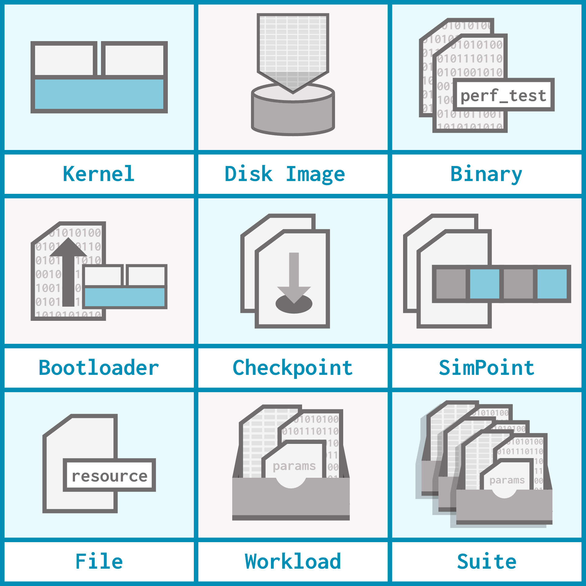

# Revisiting gem5 resources

Now that you've had the time to get familiar with gem5, let's talk in a bit more detail about gem5 resources and how you can use them.

> By the end of this section, you will be able to:
>
> - **Use** a variety of existing gem5 resources, including binaries, workloads, and suites.
> - **Create** a local gem5 resource and use it in a simulation.
> - **Explain** what gem5 resources are available and what categories they fall into.

## Beyond `obtain_resource()`

When we introduced the `obtain_resource()` function, we mentioned it was used to grab gem5 resources. Since then, we've used `obtain_resource()` to acquire workloads for our boards. As it turns out, gem5 resources are a lot more diverse than that!

As a reminder, gem5 resources are prebuilt artifacts that can be used to run gem5 simulations. Each gem5 resource supports one of 6 ISAs, and there are 15 categories of gem5 resources. Below are 9 important categories you should know about:



- **Kernel**: A computer program that acts as the core of an operating system by managing system resources.
  - An example of a kernel resource is [`x86-linux-kernel-5.15.180`](https://resources.gem5.org/resources/x86-linux-kernel-5.15.180?version=1.0.0), which is a Linux kernel.
- **Disk image**: An exact copy of the data stored on disk. We use disk images as part of simulating a full operating system.
  - An example of a disk image resource is [`x86-ubuntu-24.04-gapbs-img`](https://resources.gem5.org/resources/x86-ubuntu-24.04-gapbs-img?version=1.0.0), which is a disk image containing the [GAPBS](http://gap.cs.berkeley.edu/benchmark.html) benchmarks for Ubuntu 24.04 for x86.
- **Binary**: A compiled program that can run directly on a simulated system without arguments.
  - An example of a binary resource is [`x86-bubblesort`](https://resources.gem5.org/resources/x86-bubblesort?version=1.0.0), which is an implementation of BubbleSort compiled into x86.
- **Bootloader**: A small program responsible for loading the operating system into memory when a computer starts up.
  - An example of a bootloader is [`arm64-bootloader`](https://resources.gem5.org/resources/arm64-bootloader?version=1.0.0), which can be used for any arm64 Linux kernel resources.
- **Checkpoint**: A saved snapshot of a simulation (we'll talk more about using checkpoints in the advanced topics section).
  - An example of a checkpoint is [`x86-hello-test-checkpoint`](https://resources.gem5.org/resources/x86-hello-test-checkpoint?version=1.0.0), which is used for testing checkpoints on x86.
- **SimPoint**: Stores all information used to create and restore a SimPoint, which is a tool for simulation sampling (we'll also discuss SimPoints in the advanced topics section).
  - An example of a SimPoint is [`x86-print-this-1500-simpoints`](https://resources.gem5.org/resources/x86-print-this-1500-simpoints?version=1.0.0), which contains the set of all SimPoints for another resource (a binary) named `x86-print-this`.
- **File**: A single file.
  - An example of a file is [`llvm-minisat-cnf-input`](https://resources.gem5.org/resources/llvm-minisat-cnf-input/changelog?database=gem5-resources&version=1.0.0), which is used as input for another resource (a binary), named `x86-llvm-minisat`.
- **Workload**: A bundle of resources and input parameters that can be run directly in a simulated system.
  - An example of a workload is [`86-ubuntu-24.04-boot-no-systemd`](https://resources.gem5.org/resources/x86-ubuntu-24.04-boot-no-systemd?version=4.0.0) (you may recognize it from `hello_world.py`), which is used to boot Ubuntu 24.04. It contains the kernel, the disk image, and the needed parameters.
- **Suite**: A collection of workloads.
  - An example of a suite is [`gapbs-benchmark-suite`](https://resources.gem5.org/resources/gapbs-benchmark-suite?version=1.0.0), which contains a workload for each benchmark in the GAPBS suite.

## Resource versioning

As you've likely noticed, all gem5 resources have an `id` (this is the same as what we've referred to as the resource's name, for example, `x86-ubuntu-24.04-boot-no-systemd`). They also have a `resource_version`, which starts at `1.0.0`. Every time the resource is updated, the `resource_version` is updated, but the `id` stays the same.

![A screenshot of the "versions" tab of the gem5 resources page for the "x86-ubuntu-24.04-boot-no-systemd" resource. The tab consists of a table with four columns: "Version", "Size", "gem5 Versions", "Links". Version 1.0.0 is of size 0.0 B, is compatible with gem5 versions 23.1, 24.0, and 24.1, and has no links. Version 2.0.0 is of size 0.0 B, is compatible with gem5 versions 23.1, 24.0, and 24.1, and has no links. Version 3.0.0 is of size 0.0 B, is compatible with gem5 versions 23.1, 24.0, and 24.1, and has no links. Version 4.0.0 is of size 0.0 B, is compatible with gem5 versions 25.0, and has no links.](img/resource_versions.png)

A resource also maintains a `gem5_versions` field, which dictates which releases of gem5 the resource is compatible with. The compatible gem5 versions might change with new resource versions!

By default, `obtain_resource` will acquire the most recent (and compatible!) version of the resource with the provided `resource_id`. If you want a different version, you can pass it into the `resource_version` parameter like this:

```python
obtain_resource(
  resource_id="x86-ubuntu-24.04-boot-no-systemd",
  resource_version="2.0.0"
)
```

## Setting workloads

It's important to differentiate between the more general use of the word "workload" as "the code the simulated hardware is tasked with running" and the more specific definition of the workload *resource* as "a bundle of resources and parameters that sets up a simulated system to run code". We can have *workloads* that do **not** originate from a *workload resource*!

Let's go over all the ways in which we can set *workloads* (not workload resources) on boards in gem5:

- `set_se_binary_workload()`: this function takes a **binary resource** and sets it as the board's workload in *SE mode*.
  - Since binary resources on their own don't include all of the details necessary to boot up a full operating system, they can only be set as a board's workload in SE mode.
- `set_kernel_disk_workload()`: this function takes a **kernel resource** and a **disk image resource** and sets up a *full-system mode* simulation.
- `set_se_simpoint_workload()`, `set_se_looppoint_workload()` and `set_se_elfie_workload()` all work with sampling techniques within gem5.
  - We'll discuss these sampling techniques in more detail in the advanced topics unit!
  - For now, all you need to know is that these functions set a board's workload using SimPoint-, LoopPoint-, and ELFie-related gem5 resources.

### Using a binary resource

All of the functions above are member functions of boards in gem5.

> The SE mode functions are supported on `SimpleBoard` (and any other boards you might create that extend the `SEBinaryWorkload` class).

> `set_kernel_disk_workload()` is supported on `X86Board`, `RiscvBoard`, and `ArmBoard` (and any other boards you might create that extend the `KernelDiskWorkload` class).

Let's look at how we can use `set_se_binary_workload()` with a binary resource in gem5. Open `binary_example.py` to get started. Currently, this configuration script just defines a board. Our goal is to:

1) Use the `riscv-gapbs-bfs` binary resource as the workload for this board. This resource is the GAPBS BFS (Breadth-First Search) benchmark compiled to RISC-V.
2) Pass in the arguments `-g 10` and `-n 10` to the binary. `-g 10` generates the benchmark's graph with $2^{10}$ nodes, and `-n 10` runs the benchmark for 10 iterations.

First, let's grab the binary resource with our trusty `obtain_resource()`:

```python
binary_resource = obtain_resource("riscv-gapbs-bfs")
```

Next, let's set the board's workload:

```python
board.set_se_binary_workload(
  binary=binary_resource,
  arguments=["-g", 10, "-n", 10]
)
```

We pass in arguments to the binary using the `arguments` optional parameter in `set_se_binary_workload()`.

We can now run the simulation with:

```bash
gem5 binary_example.py
```

<!--TODO (Naama): Output discussion-->

## What about `set_workload()`?

The `set_workload()` function, which we've used many times already throughout the bootcamp, can (clearly) also be used to set a board's workload. `set_workload()` requires a **workload resource**.

Each workload resource specifies a **function** to call on the board, which will be one of the workload-setting functions we discussed above. Workload resources also specify the arguments to call this function with in the form of other gem5 resources; they can also specify optional non-resource parameters. The `set_workload()` function then calls the specified function with the specified arguments.

### Using a workload resource

Let's see this in action with the `riscv-gapbs-bfs-run` workload, which just so happens to run the `riscv-gapbs-bfs` we just used in the previous example. Open `workload_example.py`, which is currently just a copy of the same system from `binary_example.py`. Our goals for this example are the same as the goals from before:

1) Use the `riscv-gapbs-bfs` binary resource as the workload for this board,
2) Pass in the arguments `-g 10` and `-n 10` to the binary.

Let's read the description of `riscv-gapbs-bfs-run` from [its gem5 resources page](https://resources.gem5.org/resources/riscv-gapbs-bfs-run?database=gem5-resources&version=1.0.0):

> This workload is used to tun the gapbs-bfs binary in SE mode. The arguments are -g 10 means that the graph is generated with 2^10 nodes and -n 10 that there are 10 iterations.

*Hey, that's exactly what we want!* This means we can use this workload to achieve the same behavior that we did for `binary_example.py`.

![An illustration of how a workload corresponds to a board function. A workload has a function, resources, and additional_parameters. The function is defined as "set_se_binary_workload", the resources are defined as "binary: riscv-gapbs-bfs, version 1.0.0", and the additional_parameters are defined as "arguments: ["-g", 10, "-n", 10]. That workload corresponds to "board.set_se_binary_workload(binary=obtain_resource("riscv-gapbs-bfs"), arguments=["-g", 10, "-n", 10]).](img/workload_anatomy.png)

First, we obtain the workload resource:

```python
workload_resource = obtain_resource("riscv-gapbs-bfs-run")
```

Then, we set it on our board:

```python
board.set_workload(workload_resource)
```

...and that's it! The workload handles grabbing the appropriate binary resource and passing in the appropriate arguments. Let's prove it by running the thing:

```bash
gem5 workload_example.py
```

<!--TODO (Naama): Output discussion-->

In essence, workload resources are wrappers around other kinds of resources to make them easier to run. This means that we can set resources (for example, binaries) directly using their corresponding function (for example, `set_se_binary_workload()`), or we can use workloads that bundle these resources for us and use `set_workload()`. Either way is completely fine!

## Anatomy of a workload

All resources pages on gem5 resources include the "Raw" tab, which shows how the resource is made in JSON format. Let's look at how a workload is defined using this format. The JSON for `riscv-gapbs-bfs-run` looks like this:

```json
{
    "category": "workload",
    "id": "riscv-gapbs-bfs-run",
    "description": "This workload is used to tun the gapbs-bfs binary in SE mode. The arguments are -g 10 means that the graph is generated with 2^10 nodes and -n 10 that there are 10 iterations.",
    "function": "set_se_binary_workload",
    "resources": {
        "binary": {
            "id": "riscv-gapbs-bfs",
            "resource_version": "1.0.0"
        }
    },
    "additional_params": {
        "arguments": [
            "-g",
            10,
            "-n",
            10
        ]
    },
    "architecture": "RISCV",
    "size": 0,
    "tags": [
        "gapbs",
        "bfs",
        "se"
    ],
    "license": "BSD-3-Clause",
    "author": [
        "Scott Beamer",
        "David Patterson",
        "Krste Asanović"
    ],
    "source_url": "",
    "resource_version": "1.0.0",
    "gem5_versions": [
        "23.1",
        "24.0",
        "24.1"
    ],
    "example_usage": "obtain_resource(\"riscv-gapbs-bfs-run\")"
}
```

Let's go through some important fields:

- `category` and `id` are relatively straightforward: this resource is a workload (as opposed to a binary, a suite, a bootloader, etc.), and it has the id `riscv-gapbs-bfs-run`.
- `description` is a space to explain what the resource is used for and what it provides. The description here helps us identify how the GAPBS BFS benchmark will be run.
- `function` has the name of the function that this workload calls on the board; as we can see, the function being called behind the scenes is `set_se_binary_workload()`, which is exactly the function we used when we replicated this workload's behavior in `binary_example.py`.
- `resources` contains the gem5 resources this workload passes into its function. In this case, there is only one: `riscv-gapbs-bfs`.
  - Resources are referred to by their `id` and `resource_version`.
  - As we saw in `binary_example.py`, `set_se_binary_workload()` requires a binary resource named `binary`, so we provide it!
- `additional_params` are optional non-resource parameters we want to use for the function call. As we saw, this workload includes a value for the optional `arguments` parameter to `set_se_binary_workload()`.
- `architecture` specifies which ISA the workload is built for, in this case RISC-V.
- We discussed `resource_version` and `gem5_versions` above, and here they are in JSON form!

> A workload will _only_ work with a version of gem5 specified in the `gem5_versions` field, be conscious when updating!

## Using suites

While workloads are collections of resources and parameters required to run a single gem5 simulation, suites are *collections of workloads* that can be used to run *multiple simulations*.

> Suites are perfect for running simulations **in parallel** using multiprocessing! We'll discuss this in depth in our multisim section.

Let's look into how we can use suites in our gem5 configuration scripts. Open `suite_example.py`, which currently only sets up a board with no workload.

### The `SuiteResource` class

`SuiteResource` is a class that acts as a generator for the suite's workloads. When we use `obtain_resource()` to obtain a suite, the result is an instance of `SuiteResource`. We can iterate through a `SuiteResource` like any other generator!

Let's obtain `x86-getting-started-benchmark-suite`. This suite contains a series of common benchmarks compiled for x86:

```python
getting_started_suite = obtain_resource("x86-getting-started-benchmark-suite")
```

Let's print out all of the workloads in `x86-getting-started-benchmark-suite`. After obtaining the resource, add the following to print out every included workload:

```python
for workload in getting_started_suite:
  print(f"Workload ID: {workload.get_id()}")
  print(f"Workload version: {workload.get_resource_version()}")
  print("===================================")
```

When we run:

```bash
gem5 suite_workload_example.py
```

we should see:

> ***UNDER CONSTRUCTION*** <!--TODO (Naama): Output-->

### Suite `input_groups`

Each workload in a suite is a member of one or more `input_groups` that we can filter by. Let's print all of the `input_groups` for this suite using `SuiteResource`'s `get_input_groups()` function. We can also print which workloads are in each input group using `SuiteResource`'s `with_input_group()` function. `with_input_group()` returns a new `SuiteResource` object with only the workloads in that input group.

<!--TODO (Naama): Test this -->

```python
print("\nInput groups in the suite:")
input_groups = getting_started_suite.get_input_groups()
for group in input_groups:
  print(f"Group: {group}")
  workloads = getting_started_suite.with_input_group(group)
  for workload in workload:
    print(f"Workload ID: {workload.get_id()}, version {workload.get_resource_version()}")
  print("===================================")
```

Let's run it again and take a look:

> ***UNDER CONSTRUCTION*** <!--TODO (Naama): Output-->

### Running a workload from the suite

As we can see, the `is` input group only contains one workload, `x86-npb-is-size-s-run`. Let's run this workload out of the suite!

```python
npb_is_workload = list(getting_started_suite.with_input_group("is"))[0]
board.set_workload(npb_is_workload)

simulator = Simulator(board=board)
simulator.run(10_000_000)
```

We turn the `SuiteResource` returned from `with_input_group()` into a list of workload resources, then take its first (and only) element, the `x86-npb-is-size-s-run` workload.

One last time, let's run this:

> ***UNDER CONSTRUCTION*** <!--TODO (Naama): Output-->

## Local resources

If none of the available gem5 resources suit your needs, you can also make your own local resources! These can either be truly local or, with a bit more setup, more shareable. Let's create a local binary resource and use both methods to add it to our simulation.

Take a look at `pattern.c`, which prints out a simple triangle pattern. Let's compile this into a binary so that we can use it as our custom resource:

```bash
gcc -o pattern pattern.c
```

### Using local paths

First, let's use a simple method to directly link our custom resource to a configuration script using its local path. Open `local_path.py` to get started.

A `BinaryResource` (the same object we get when we use `obtain_resource()` to grab a binary resource) can be instantiated using a local path. Add the following to `local_path.py`:

```python
binary = BinaryResource(local_path="./pattern")
```

We can now run our simulation with this binary!

```bash
gem5 local_path.py
```

<!--TODO (Naama): Output-->

This method works well, but it's not very reproducible or consistent. If this resource is an important part of our code that will stick around for a while, we want to give it a permanent home and use `obtain_resource` to acquire it.

### Using JSON resources

We can circumvent this problem by creating a JSON file for our binary resource. We've already looked at the JSON format for binaries, so here is what the one for our `pattern` binary looks like:

```json
{
  "category": "binary",
  "id": "x86-pattern-print",
  "description": "A simple X86 binary that prints a pattern",
  "architecture": "X86",
  "size": 1,
  "tags": [],
  "is_zipped": false,
  "md5sum": "2a0689d8a0168b3d5613b01dac22b9ec",
  "source": "",
  "url": "file://./pattern",
  "code_examples": [],
  "license": "",
  "author": [
      "Harshil Patel"
  ],
  "source_url": "",
  "resource_version": "1.0.0",
  "gem5_versions": [
      "23.0",
      "23.1",
      "24.0"
  ],
  "example_usage": "obtain_resource(resource_id=\"x86-pattern-print\")"
}
```

Note the category (binary), the name we've given our resource (`x86-pattern-print`), and the URL of our resource (the local path).

> We can change this URL to reflect a more permanent hosting place for this resource if we choose to share it.

Create a JSON file with these contents named `local_resources.json`. Any other local resources we define can be added to this JSON file.

Now, open `json_resource.py`. Let's use `obtain_resource()` to grab this resource:

```python
binary = obtain_resource("x86-pattern-print")
```

Now, in order for gem5 to be able to find our local resource, we need to add the resource's JSON file to the gem5 command.  We do this by setting the `GEM5_RESOURCE_JSON_APPEND` environment variable. Modify its value and run the simulation with the following command:

```bash
GEM5_RESOURCE_JSON_APPEND=local_resources.json gem5 json_resource.py
```

> If we are only using local resources, we can set the `GEM5_RESOURCE_JSON` environment variable instead, but this will prevent gem5 from finding resources anywhere else!
>
> If we do want gem5 to search both our local resources and the gem5-resources database, we need to create a json file that points to both our local resources (our json file) and the remote resources (the gem5-resources database) and set the `GEM5_CONFIG` environment variable to that file path.
>
> ```json
> {
>   "sources": {
>     "my-workloads": {
>       "url": "/path/to/my/json.json",
>       "isMongo": false
>     },
>     "gem5_resources": {
>       "url": "https://api.gem5.org/api/resources",
>       "isMongo": true,
>       "dataSource": "gem5-vision",
>       "database": "gem5-vision",
>       "collection": "resources"
>     }
>   }
> }
> ```

<!--TODO (Naama): Output-->

<link href="../style.css" rel="stylesheet"></link>
