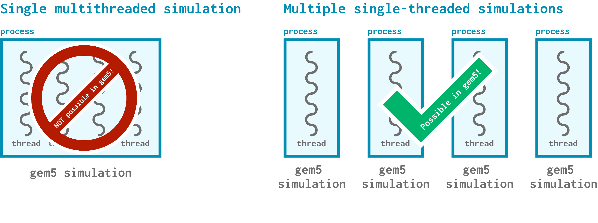

# MultiSim

We've talked a lot about how to make individual simulations run faster; what about running multiple simulations at the same time?

> By the end of this section, you will be able to:  
>
> - **Use** a MultiSim config file to run multiple simulations in parallel.
> - **Explain** why using MultiSim to create parallel instances of gem5 simulations is preferable over multiprocessing via script.
>

## gem5 is single-threaded

You might wonder whether you can use multiple cores and threads to speed up gem5 simulations. Unfortunately, gem5 is **single-threaded by design**. This is unlikely to change, as it would involve overhauling the entire codebase. This means that a **single simulation** cannot be sped up with parallelism.

It's not all bad news, though! As you may have noticed throughout this bootcamp, simulators like gem5 are used for experimentation. This means that you'll almost always want to run multiple simulation trials, modifying different variables and keeping others constant. You can run these **separate simulations** in parallel!

> We can't run a single, multi-threaded process, but we can run many single-threaded processes.

<br>



It turns out that this single-threaded approach simplifies the implementation of gem5 quite a bit, since it means gem5 doesn't have to deal with multithreading issues like memory consistency.

## Let there be scripts

The original way that gem5 users found to automate creating and running multiple gem5 simulations in parallel was using scripts.

> If you read through the SimPoint example in the sampled simulation section, you've seen one of these scripts! We used a script (`run_all_simpoint.sh`) to run all of our SimPoint checkpoints simultaneously.

A typical bash script for parallel simulation looks something like this:

```bash
gem5 -re -d experiment_1 experiment.py "8kB" "8kB" & \
gem5 -re -d experiment_2 experiment.py "16kB" "8kB" & \
gem5 -re -d experiment_3 experiment.py "8kB" "16kB" & \
gem5 -re -d experiment_4 experiment.py "16kB" "16kB"
```

We start all 4 of our experiments in the background and direct them to different output directories so that they don't overwrite each other's output.

> As a reminder, `-re` redirects `stdout` and `stderr` to their own files in the output directory. `-d` specifies an output directory name.

This is a very common approach (especially since no alternatives were supported by gem5 until somewhat recently), and it's pretty straightforward to get off the ground. However, it has a few major downsides. First, each user who wants to run parallel simulations has to write a script like this every time. This increases the barrier to entry (what if you're not familiar with scripting?), makes errors more likely, and requires you to manage all of the output files. Second, these scripts are non-standard; everyone has a different way of writing them. This makes it difficult to share your scripts with others or reproduce results. Finally, gem5 has no built-in support for scripts like these, nor does it plan to have support.

## There's a better way

While gem5 has no plans to support scripts for parallelism, it supports **MultiSim**! MultiSim is a gem5 feature that allows you to run multiple gem5 processes from a single configuration script. It takes advantage of Python's `multiprocessing` module to let a single gem5 process queue up multiple simulations for execution.

MultiSim works by using a **parent process** (this is the process that you create by running a gem5 executable) to create **child processes** that each run a simulation. We call these simulations "jobs" and call the child processes who execute them "workers".

## MultiSim configuration scripts

A MultiSim configuration script looks very similar to a standard gem5 configuration script. Let's prove it by converting a standard script into a MultiSim script. Open `multisim_experiment.py` to get started.

### What is this script?

The script in `multisim_experiment.py` currently sets up (but doesn't simulate) a simple system with a private L1 cache hierarchy. The parameters of interest for this simulation are the sizes of the L1 instruction and data caches; this script makes them both 8kB, but we want to see what happens if one or both of them are 16kB. We'll be using MultiSim to do this! 

To start, let's import MultiSim. Add the following line to the top of the script:

```python
import gem5.utils.multisim as multisim
```

### Setting a process maximum

The first thing we should make sure we do it set a process maximum for MultiSim to use. If we don't do this, the script will still run, but it will attempt to consume *all available threads* on your system. Assuming your system has a couple of other things going on, we want to restrict gem5 to a set number of processes.

We can use the `set_num_processes()` function to to appropriately restrict MultiSim:

```python
multisim.set_num_processes(2)
```

### Defining multiple simulations

We can define multiple simulations by creating multiple `Simulator` objects, one for each simulation. Let's do this in the simplest way possible using a nested for loop.

As a reminder, the parameters we want to explore in this experiment are:

- L1 d-cache: 8kB, 16kB
- L1 i-cache: 8kB, 16kB

We need a total of 4 simulations to explore all combinations of these parameters. Let's take *all* of the code we currently have and wrap it in this nested for loop:

```python
for data_cache_size in ["8kB","16kB"]:
    for instruction_cache_size in ["8kB","16kB"]:
        cache_hierarchy = PrivateL1CacheHierarchy(
            l1d_size=data_cache_size,
            l1i_size=instruction_cache_size,
        )

        memory = ...
```

You'll notice that this code stops after setting the board's workload. We still need to create a `Simulator` *inside the for loop* for each parameter combination:

```python
simulator = Simulator(
  board=board,
  id=f"process_{data_cache_size}_{instruction_cache_size}"
)
```

We give each simulator a **unique ID** using the `id` parameter so that we can tell apart our simulations once we run them all together.

### Adding simulations to MultiSim

We now have four simulators but no way to run their simulations. To do that, each simulator needs to be added to MultiSim!

Still inside the for loop, add the simulator object you just created to MultiSim using:

```python
multisim.add_simulator(simulator)
```

And that's it! Alarm bells might be going off in your head, though: didn't we forget to actually invoke the `run()` function (or the MultiSim equivalent)? As it turns out, the `multisim` module's execution will run the simulations for us, no extra function calls required.

### Running in parallel

If we want to run all 4 simulations, we can do that using the following command:

```bash
gem5 -m gem5.utils.multisim multisim-experiment.py
```

You'll notice our use of the `-m` flag to pass in the `multisim` module. Other than that, we just pass in the name of the configuration script like any other simulation.

Once this is done running, you can check `m5out` to see a separate output folder for each of our 4 simulations!

<!--TODO (Naama): Output verification/analysis-->

### Running individual simulations

If we want to, we can also run individual simulations from a MultiSim configuration script. To do this, we just pass the configuration script directly to a gem5 executable without using `-m gem5.utils.multisim`.

To list all simulation IDs in a MultiSim configuration script, we can use:

```bash
gem5 {config_script} --list
```

For example, we can look at all of our simulation IDs by running:

```bash
gem5 multisim_experiment.py --list
```

When we do, we should see the following output:

<!--TODO (Naama): Run this, paste output-->

Then, to execute a single simulation, we just pass gem5 the simulation ID:

```bash
gem5 {config} {id}
```

For example, if we wanted to only run the 8kB i-cache/8kB d-cache simulation, we can do so like this:

```bash
gem5 multisim_experiment.py process_8kB_8kB
```

And that's it! You're now ready to use MultiSim for your own simulations.

## Benefits of MultiSim

As you (hopefully) saw from this brief example, setting up MultiSim is not too difficult! All of the multiprocessing details are handled by gem5, meaning that you don't need to worry about knowing how to write and run scripts, and the chance that an error pops up somewhere is much lower. Additionally, these scripts are standardized and easy to share! If you want someone else to reproduce your results, you can simply send the script to them and they can run it. There are plans for continued support for MultiSim in gem5, too.

Overall, it's recommended that you use MultiSim over scripts to run gem5 simulations in parallel. Hopefully this section convinced you of why!