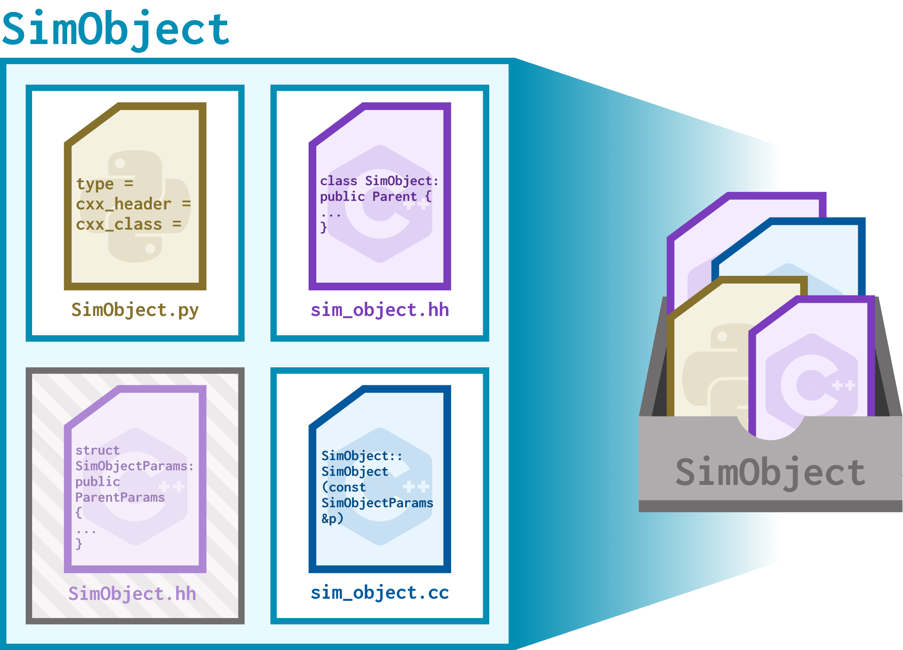

# SimObjects

Let's get specific about gem5 models.

> By the end of this section, you will be able to:
>
> - **Create** a simple SimObject (with a constructor and parameters) from scratch by creating the appropriate Python, C++, and SConscript files.
> - **Build** gem5 using SCons.
> - **Apply** gem5 code conventions such as naming conventions, include guards, and best practices when creating new SimObjects.
> - **Write** simple configuration scripts without the `Simulator` object using `m5`. 

## What's a SimObject?

We've talked about gem5 **simulation models**: C++ classes that make up gem5's backend. So far in the bootcamp, we've used models for processor cores (`O3CPU`), caches (`Cache`), and memory (`ChanneledMemory`) when creating our own standard library components. These models are the backbone of simulation, and in gem5, they are all `SimObject`s. 

The `SimObject` class is the parent C++ class for all gem5 SimObjects. It (and its children, such as `ClockedObject`) facilitates:

- Defining a model (ex: a CPU core),
- Parameterizing a model (ex: fetch width, number of reorder buffers),
- Gathering statistics (ex: number of instructions executed)

Many SimObjects work in concert to simulate an entire system. In this section, we'll create a basic SimObject and see it in simulation.

## Writing SimObjects

### SimObjects in code

Each SimObject is made up of 4 basic files:

- Declaration file (`.py`):
  - This file represents the model at the highest level. It allows for the instantiation of the model and for interfacing with the C++ backend. It defines the sets of parameters for the model.
  - This file determines the name of the model that will be used in Python files.
- Header file (`.hh`):
  - Like a traditional header file, this file declares the SimObject and all its functions, to be instantiated in the source file.
- Source file (`.cc`):
  - This file implements the SimObject's functionality!
- `Params` header file (`.hh`):
  - This file declares a C++ struct that stores all parameters for the SimObject.
  - This file is **auto-generated** based on the other three files, meaning you don't have to write it yourself!

> Overall, this means you need to write 3 files to create a new SimObject!



### Peek at a CPU SimObject

Let's look at an example of an existing CPU SimObject and all its files. `AtomicSimpleCPU` is a model for a simple core with atomic memory accesses, and it has 4 files.

> Don't worry too much about understanding every line of code in this example just yet. This is a sneak peek!

#### Declaration file: `gem5/src/cpu/simple/BaseAtomicSimpleCPU.py`

Looking into this file, we see it looks like this:

```python
class BaseAtomicSimpleCPU(BaseSimpleCPU):
    type = "BaseAtomicSimpleCPU"
    cxx_header = "cpu/simple/atomic.hh"
    cxx_class = "gem5::AtomicSimpleCPU"

    ...
```
This format is followed by other declaration files; they indicate the type of the SimObject (the name of its Python class that can be used in Python simulation files, also often the name of the .py file), the locations of the corresponding header and source file, and any parameters (omitted here).

> You might be wondering why we aren't looking at `AtomicSimpleCPU.py` instead. CPU models in gem5 work a bit differently due to them being ISA-specific.
> 
> The `AtomicSimpleCPU.py` file (`gem5/src/cpu/simple/AtomicSimpleCPU.py`) looks at the ISA being used and imports the appropriate version of `AtomicSimpleCPU`, all of which inherit from `BaseAtomicSimpleCPU`. The same pattern holds for all other CPUs in gem5.

#### Header file: `gem5/src/cpu/simple/atomic.hh`

Looking into this file, we see:

```C++
namespace gem5
{

class AtomicSimpleCPU : public BaseSimpleCPU
{
  public:

    AtomicSimpleCPU(const BaseAtomicSimpleCPUParams &params);
    virtual ~AtomicSimpleCPU();

    void init() override;

    ...
```
Header files declare the class name and include all method signatures for the C++ class, including the constructor (which you see here). The constructor always takes the corresponding `Params` struct (which we'll see in a moment!). We can see this class also has an `init()` function.

#### Source file: `gem5/src/cpu/simple/atomic.cc`

```C++
namespace gem5
{

void
AtomicSimpleCPU::init()
{
    BaseSimpleCPU::init();

    int cid = threadContexts[0]->contextId();
    ifetch_req->setContext(cid);
    data_read_req->setContext(cid);
    data_write_req->setContext(cid);
    data_amo_req->setContext(cid);
}

AtomicSimpleCPU::AtomicSimpleCPU(const BaseAtomicSimpleCPUParams &p)
    : BaseSimpleCPU(p),
      tickEvent([this]{ tick(); }, "AtomicSimpleCPU tick",
                false, Event::CPU_Tick_Pri),
      width(p.width), locked(false),

      ...
```

Source files contain the SimObject's functionality. We can see the implementation of the `init()` function we saw declared in the header file, followed by the beginning of the constructor (remember C++ initialization lists?).

#### `Params` header file: `gem5/build/ALL/params/BaseAtomicSimpleCPU.hh`

If we look in this file, we can see:

```C++
...

namespace gem5
{
struct BaseAtomicSimpleCPUParams
    : public BaseSimpleCPUParams
{
    gem5::AtomicSimpleCPU * create() const;
    bool simulate_data_stalls;
    bool simulate_inst_stalls;
    int width;
};

...
```

This is the auto-genrated `Params` struct! You'll notice its name matches the argument of `BaseAtomicSimpleCPU`'s constructor (declared in the header file and implemented in the source file). Looks like `BaseAtomicSimpleCPU` takes three parameters.

> Since the `Params` file is auto-generated, it lives in the `build` folder, and it will only be auto-generated as part of the build process (more on that in a second). Its name matches the type declared in the .py declaration file  with `Params` appended to the end.


## Let's make a SimObject!

Before we graduate to making helpful SimObjects, let's get a hang of how all of the files work together by making a simple SimObject called `HelloSimObject`. All this object will do is print out a "hello" message as it's being created!

To get this off the ground, we need to do the following:

1. Write the basic SimObject files:
    1. The declaration file, `HelloSimObject.py`
    2. The header file, `hello_sim_object.hh`
    3. The source file, `hello_sim_object.cc`
2. Re-build gem5, which will generate the 4th basic SimObject file, `HelloSimObject.hh`, containing the `HelloSimObjectParams` struct,
3. Write a configuration script that makes use of `HelloSimObject`,
4. Run the simulation!

### Basic SimObject files

So far, we put all of our files inside of the `workspace` directory. Since SimObject source files interact with gem5's build system, we'll be working in a new directory under `gem5/src` for this unit. Create a folder called `bootcamp` under `gem5/src` and copy over the `hello-sim-object` folder from the `workspace` directory into the newly-created `bootcamp` directory.

> This means that the path of your working directory should be `gem5/src/bootcamp/hello-sim-object`.

#### The declaration file

Open `HelloSimObject.py` to get started. Currently, this file is empty. We'll fill it in with the declaration for `HelloSimObject`.

The first thing we need to do is import the parent class of `HelloSimObject`. When making SimObjects for simulation, we'd select a relevant base class (for example, when creating a new branch predictor, we can use the existing `BranchPredictor` SimObject). Since `HelloSimObject` is very simple and doesn't need functionality from any other class, we'll just import the `SimObject` class:

```python
from m5.objects.SimObject import SimObject
```

Next, let's write the declaration as a Python class:

```python
class HelloSimObject(SimObject):
    type = "HelloSimObject"
    cxx_header = "bootcamp/hello-sim-object/hello_sim_object.hh"
    cxx_class = "gem5::HelloSimObject"
```

First, you'll notice that `HelloSimObject` inherits from `SimObject`, just like we discussed above. Let's look at all of the fields we defined:

- `type`: the name of this SimObject. By convention, this matches the name of the declaration `.py` file (this file).
- `cxx_header`: the path to the header file (which we haven't written yet). **This path is relative to the `gem5/src` directory**.

  - > If your `hello-sim-object` directory is in a different location, be sure to update `cxx_header` to match!

- `cxx_class`: the name of the C++ class for this SimObject.

> All of these fields are **keywords** defined in the `MetaSimObject` metaclass (found in `gem5/src/python/m5/SimObject.py`). There are many other keywords to define, but they are all optional; a minimal SimObject should have at least `type`, `cxx_header`, and `cxx_class` defined. 

That's it for the declaration file! Let's start writing some C++.

#### The header file

Let's now move to `hello_sim_object.hh`, which is also empty. Note that this file is at the path we defined as `cxx_header` in the declaration file.

First, we write some include guards:

```c++
#ifndef __BOOTCAMP_HELLO_SIM_OBJECT_HELLO_SIM_OBJECT_HH__
#define __BOOTCAMP_HELLO_SIM_OBJECT_HELLO_SIM_OBJECT_HH__
```

These help us prevent double or cyclical includes. By convention, they're named with the relative path from `gem5/src` (a reminder that the path to this file is `gem5/src/bootcamp/hello-sim-object/hello_sim_object.hh`).

Next, we include the relevant header files:

```c++
#include "params/HelloSimObject.hh"
#include "sim/sim_object.hh"
```

In this case, we only need the `SimObject` C++ class and the `HelloSimObjectParams` struct (which doesn't actually exist yet, but it will after we build!).

Alright, let's write this thing:

```c++
namespace gem5
{

class HelloSimObject: public SimObject
{
  public:
    HelloSimObject(const HelloSimObjectParams& params);
};

} // namespace gem5

#endif // __BOOTCAMP_HELLO_SIM_OBJECT_HELLO_SIM_OBJECT_HH__
```

This file defines the C++ class for `HelloSimObject`. The name of the class should match the value of `cxx_source` in the declaration file, and **it should inherit from the same SimObject parent as the declaration file**. Since the Python class in the declaration file inherits from the Python `SimObject` class, the C++ class should inherit from the C++ `SimObject` class, too. 

> The same is true for the auto-generated `HelloSimObjectParams` class! It will inherit from `SimObjectParams`.

You'll notice we are using the `gem5` namespace. Every SimObject should use this namespace, and may *also* use a more specific namespace (for example, `namespace branch_prediction` for branch predictors). For now, the only class we declare in `HelloSimObject` is its constructor. Every SimObject in gem5 is required to have a single-argument constructor, with that argument being a constant reference to that SimObject's `Params` struct.

We'll define this constructor in the source file next!

#### The source file

Time for `hello_sim_object.cc`, which is... empty. First, let's include our header file as well as `<iostream>` for printing things to the console:

```c++
#include "bootcamp/hello-sim-object/hello_sim_object.hh"

#include <iostream>
```

By convention, we order `#include` statements as follows:

1. The SimObject's header file,
2. Any C++ libraries (in alphabetical order),
3. Other gem5 headers (also in alphabetical order).

> Note once again that gem5 paths are relative to `gem5/src`!

Next, let's write our class:

```c++
namespace gem5
{

HelloSimObject::HelloSimObject(const HelloSimObjectParams& params):
    SimObject(params)
{
    std::cout << "Hello from HelloSimObject's constructor!" << std::endl;
}

} // namespace gem5
```

Just like its header file, we use the `gem5` namespace. We also define the constructor that was declared in the header file. We call the constructor of our parent class (`SimObject`) in the initialization list, then simply print out a little "hello" message in the body. When `HelloSimObject` is instantiated for simulation, this message will print to the console.

We've now written all of the code needed to define `HelloSimObject`! Let's build gem5 so that we can use it.

### Rebuilding gem5

Every time we write a new SimObject (or modify an existing one), we need to rebuild gem5. 

#### SConscript

gem5's build system uses the build tool SCons, which uses two major types of files:

- `SConstruct`: Contains definitions and files of build targets. All `SConstruct` files are executed first. In most cases, there is no need to write or modify any `SConstruct` files.
- `SConscript`: Contains the build instructions for a file by defining which C++ files need to be compiled. When creating new SimObjects, you will need to write or modify `Sconscript` files. 

> Note that since gem5's build system is highly customized, the SCons documentation may not be as helpful!

As part of the building process, SCons looks for any files named `Sconscript` for instructions on what to build. Let's create a `SConscript` for `HelloSimObject`! Open `Sconscript` to get started.

This file is very short. All we need to add is:

```make
Import("*")

SimObject("HelloSimObject.py", sim_objects=["HelloSimObject"])

Source("hello_sim_object.cc")
```

The `SimObject(...)` line registers `HelloSimObject` as a SimObject. The first argument is the name of the Python submodule that will be created, and the second is a list of SimObject names.
> In this case, we choose to just add `HelloSimObject`, but it's possible to add more than one `SimObject` in a single `SConscript`. 

The `HelloSimObject` submodule will be created under `m5.objects`, where all SimObject submodules are created. We will be able to find `HelloSimObject` in our configuration scripts by importing `m5.objects.HelloSimObject.HelloSimObject`. 

> You may remember importing `X86O3CPU` from `m5.objects.X86CPU` when you created the custom `BigO3` and `LittleO3` components in Unit II, Section II:
>
> ```python
> from m5.objects.X86CPU import X86O3CPU
> ```
> 
> We're setting that up for `HelloSimObject` here!

The `Source(...)` line adds the source file for `HelloSimObject`, `hello_sim_object.cc`, as a C++ source file to be compiled.

#### Let's build!

We're finally ready to go! Move to the `gem5` directory and run:

```bash
scons build/ALL/gem5.opt -j$(nproc)
```

> This is the exact same command we used at the beginning of the bootcamp! This might take a while.

### Simulating without a `Simulator`

You may wonder how we can instantiate our `HelloSimObject` when every configuration script we've written has relied on the `Simulator` object (which takes a board) to start simulation. As it turns out, the `Simulator` class makes use of the `m5` class, which instantiates SimObjects directly. Let's do away with `Simulator` for now and write a config script using `m5`. 

Open `hello_sim_object_config.py` to get started! 

> Like all the rest of our configuration scripts, you can keep this file in the `workspace` directory.

For now, all this file does is import `m5`. Let's add another import to the mix:

```python
from m5.objects.Root import Root
```

Every gem5 simulation starts with a `Root` object. This object represents the root of the device tree of the simulated computer system. We'll also want to import our brand-new SimObject:

```python
from m5.objects.HelloSimObject import HelloSimObject
```

> Remember, we know we can find `HelloSimObject` in this submodule because we defined it as such in `SConsript`!

Now that we have all of our imports, we can build up our (very, *very* simple) device tree:

```python
root = Root(full_system=False)
root.hello = HelloSimObject()
```

We instantiate a `Root` object (as required), then attach a `HelloSimObject` to it using the `.` operator. For now, `HelloSimObject` takes no parameters.

> As the name suggests, the `full_system` argument to `Root` defines whether we'll run in FS or SE mode. For this demo, we're choosing SE mode.

Now all that's left to do is to instantiate our device tree and simulate! We do that using `m5`:

```python
m5.instantiate()
exit_event = m5.simulate()
```

We capture the return value of `m5.simulate()` in a variable; this gives us information about why the simulation exited. We can print out this reason by adding the following:

```python
print(f"Exited simulation because: {exit_event.getCause()}.")
```

> The return type of `m5.simulate()` is a `GlobalSimLoopExitEvent` object, which has a member function called `getCause()`. `getCause()` returns a descriptive string of the cause of the exit event represented by the object.

...and we're done! We're now ready to simulate with `HelloSimObject`. As always, run the following:

```bash
gem5 hello_sim_object_config.py
```

Alongside the normal gem5 simulation preamble, you should see:

```txt
Hello from HelloSimObject's constructor!
Exited simulation because: simulate() limit reached.
```

The constructor of our brand new SimObject was successfully called!

> This call to the constructor happened during `m5.instantiate()` when `HelloSimObject` was created. This means that `HelloSimObject` has no interesting simulation behavior (or any simulation behavior at all!).

We can also see that the simulation exited due to "simulate() limit reached"; basically, the simulation ran out of things to simulate!

### `m5.instantiate`

Seeing this output, you might be wondering *when* `HelloSimObject`'s constructor was actually called. This is the job of `m5.instantiate()`, which we called in our configuration script after creating the device tree. The full implementation can be found in `gem5/src/python/m5/simulate.py`, but for now, we'll focus on the following lines:

```python
root = objects.Root.getInstance()

if not root:
    fatal("Need to instantiate Root() before calling instantiate()")

...

# Initialize the global statistics
stats.initSimStats()

# Create the C++ sim objects and connect ports
for obj in root.descendants():
    obj.createCCObject()
for obj in root.descendants():
    obj.connectPorts()
```

Here, we can see that each descendant of `root` is instantiated (has its constructor called), and all SimObjects have their ports connected. 

> Ports are a way for SimObjects to send each other data. For more on ports, take a look at the memory track!

This means that the constructor for `HelloSimObject` was called here, and thus this is where the prints we see in the simulation output originate from!

> As a fun connection to our tour of `AtomicSimpleCPU`, later on, we see this:
> > 
> ```python
> # Do a second pass to finish initializing the sim > objects
>     for obj in root.descendants():
>         obj.init()
> ```
> 
> We saw the `init()` function implemented in `atomic.cc` for the atomic CPU. `init()` is initially defined in the `SimObject` class, and every SimObject can override `init()` to perform any initialization tasks that require all other SimObjects to already be instantiated (have had their constructors called).

The rest of `m5.instantiate()` might look a bit opaque right now, and that's okay! You may choose to revisit this function after spending more time with SimObjects.

## SimObject parameters

gem5's versatility comes in large part from being able to parameterize our models, and we can do this relatively easily when we write or modify SimObjects.

### Parameterizing `HelloSimObject`

Let's make our `HelloSimObject` a little more interesting by adding a `num_hellos` parameter, which will determine how many lines of output its constructor will print to the console. We'll have to make a few changes to the **declaration** and **source** file to achieve this.

#### Declaration file

Open `HelloSimObject.py` again to modify `HelloSimObject`'s declaration to include parameters.

First, we need to add another import. gem5 defines its own parameter classes under `m5.params` (found in the file `gem5/src/python/m5/params.py`), so let's import them all here:

```python
from m5.params import *
```

We can now define the parameter for `HelloSimObject` below the `cxx_class` field. Since `num_hellos` represents a number, we'll use `Param.Int`.

```python
num_hellos = Param.Int("Number of times to say Hello.")
```

We pass an argument to `Param.Int` that describes what this parameter controls. We could optionally pass in a default value as well, but this is **strongly discouraged** unless absolutely necessary.

> This change is what adds a field to the auto-generated `HelloSimObjectParams` struct!

#### Source file

Now that we've added the parameter, let's make use of it in `HelloSimObject`'s constructor. We can access our new parameters by reading its value from the `params` struct argument. Replace the body of the constructor with the following:

```c++
for (int i = 0; i < params.num_hellos; i++) {
        std::cout << "i: " << i << ", Hello from HelloSimObject's constructor!" << std::endl;
}
```

As you can see, accessing `num_hellos` is as easy as reading a struct field!


#### Let's rebuild

Since we modified SimObject files, we need to rebuild gem5. Let's do that now:

```bash
scons build/ALL/gem5.opt -j$(nproc)
```

#### The `HelloSimObjectParams` struct

Now that `HelloSimObjects` has a parameter, we should see it in the `HelloSimObjectParams` struct in the auto-generated `gem5/build/ALL/params/HelloSimObject.hh` file. Let's take a look at that file:

```c++
/**
 * DO NOT EDIT THIS FILE!
 * File automatically generated by
 *   build_tools/sim_object_param_struct_hh.py:233
 */

#ifndef __PARAMS__HelloSimObject__
#define __PARAMS__HelloSimObject__

namespace gem5 {
class HelloSimObject;
} // namespace gem5
#include <cstddef>
#include "base/types.hh"

#include "params/SimObject.hh"

namespace gem5
{
struct HelloSimObjectParams
    : public SimObjectParams
{
    gem5::HelloSimObject * create() const;
    int num_hellos;
};

} // namespace gem5

#endif // __PARAMS__HelloSimObject__
```

Pay attention to the struct definition. We can see that it inherits from `SimObjectParams` (just like `HelloSimObject` inherits from `SimObject` in Python and C++) and that it has one field: an `int` named `num_hellos`, just like we described in `HelloSimObject.py`. 

#### Time to simulate

If we try to run our `hello_sim_object_config.py` now:

```bash
gem5 hello_sim_object_config.py
```

...we'll run into an issue:

```txt
fatal: hello.num_hellos without default or user set value
```

This error message indicates that `num_hellos`, `HelloSimObject`'s new parameter, has no provided value: we didn't set a value for it in our configuration script, and it has no default value to fall back on. Let's modify our instantiation of `HelloSimObject` to add a value for `num_hellos`:

```python
root.hello = HelloSimObject(num_hellos=4)
```

We are now ready to run again!

```bash
gem5 hello_sim_object_config.py
```

This time, the simulation runs and we see the following:

```txt
i: 0, Hello from HelloSimObject's constructor!
i: 1, Hello from HelloSimObject's constructor!
i: 2, Hello from HelloSimObject's constructor!
i: 3, Hello from HelloSimObject's constructor!
Exited simulation because: simulate() limit reached.
```

As you can see, we printed out our "hello" message 4 times!

## In conclusion

SimObjects are the backbone of simulation in gem5. In this section, we built our very own SimObject and rebuilt gem5 in order to use it in a configuration script. We also saw that the `Simulator` class used in previous configuration scripts is a wrapper around `m5` functionality. Next, we'll start taking a look at existing SimObjects to extend them with new functionality!
