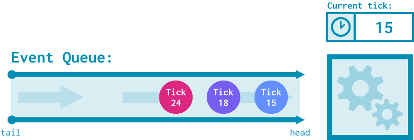
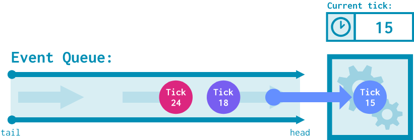
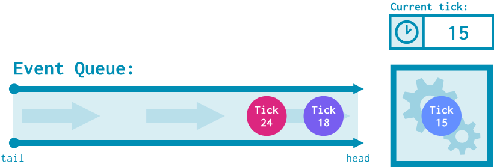
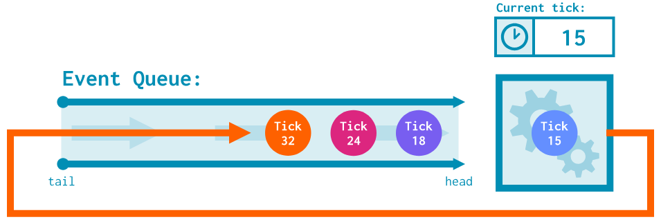
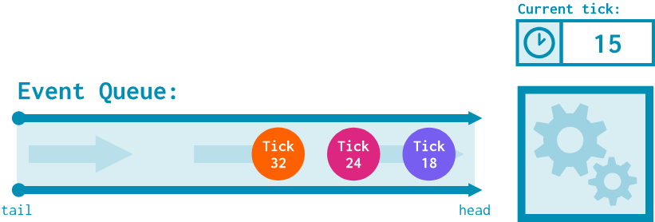
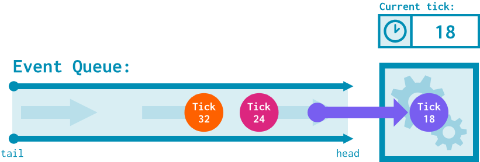

# Event-driven simulation

Let's take a look at how gem5 simulates SimObjects and how SimObjects interact with one another.

> By the end of this section, you will be able to:
>
> - **Explain** at a high level how gem5’s event-driven simulation is implemented as a series of events and callbacks.
> - **Describe** how gem5 uses SimObject parameters to allow for event-driven simulation.

## Events

gem5 is an *event-driven simulator*. This means that events are the core of how gem5 simulates behavior.

### Event-driven simulation refresher

As a reminder, gem5 performs **discrete event simulation**. This means that it maintains an **event queue**:



At each time tick, the event(s) at the top of the queue are dequeued and executed.





This might lead to the scheduling of new events at a future time tick. All SimObjects can enqueue events onto the event queue.



<!--  -->

This process continues until there are no more events to simulate!



> As a reminder, a gem5 tick is typically equivalent to 1 ps, meaning there are $10^{12}$ ticks in a simulated second.

It is important to point out the difference between **scheduling an event** and **calling a function**. While a scheduled event will occur *in the future* after some specified amount of simulation ticks, a function call will execute *on the same tick*. This means that we can think about a gem5 simulation as a series of scheduled events and function calls, with scheduled events advancing simulation time and function calls handling behavior within a tick.

### Events in gem5

Events in gem5 are implemented using the `Event` class, the declaration of which can be found in `gem5/src/sim/eventq.hh`. This file has a lot of event-related classes and declarations; for now, let's focus on the most important public method of the `Event` class:

```c++
 /*
     * This member function is invoked when the event is processed
     * (occurs).  There is no default implementation; each subclass
     * must provide its own implementation.  The event is not
     * automatically deleted after it is processed (to allow for
     * statically allocated event objects).
     *
     * If the AutoDestroy flag is set, the object is deleted once it
     * is processed.
     *
     * @ingroup api_eventq
     */
    virtual void process() = 0;
```

`process()` is the `Event`'s *callback function*: the function that executes on the tick the event was scheduled for. The behavior of this function determines what effects this event will have on the system. In order to define a new kind of event within gem5, we create a new class for it that inherits from `Event` and overrides the `process()` method.

Events can be scheduled from anywhere using the `schedule()` function:

```c++
void schedule(Event event, Tick when)
```

This function enqueues the provided event into the simulator's event queue, to be dequeued on tick `when`. When it is eventually dequeued, its `process()` function will be called.

### `m5.simulate()` and startup methods

So far, we know that:

1) Events are implemented by extending the `Event` class and overriding `process()`,
2) We can schedule events by calling `schedule()`.

...but where is the first event scheduled? How does simulation get off the ground? To figure this out, we can look at `m5.simulate` (found in `gem5/src/python/m5.simulate.py`). 

As you may remember from the previous section, this function is called to start simulation after calling `m5.instantiate`; we can think of this as setting up tick 0 of simulation after `m5.instantiate` instantiates the device tree. Within `m5.simulate()`, we can see the following lines:

```c++
def simulate(*args, **kwargs):
    # ...
    if need_startup:
        root = objects.Root.getInstance()
        for obj in root.descendants():
            obj.startup()
        need_startup = False
```

This loop calls a function called `startup()` for every single SimObject in the device tree. We can check the documentation for `startup()` in the `SimObject` class:

```c++
/**
     * startup() is the final initialization call before simulation.
     * All state is initialized (including unserialized state, if any,
     * such as the curTick() value), so this is the appropriate place to
     * schedule initial event(s) for objects that need them.
    */
    virtual void startup();
```

This means all "initial" events in the system originate from their SimObjects' `startup()` functions, which are called in `m5.simulate()`.

### Implementing `HelloEvent`

Let's follow the event creation process by adding an event to our `HelloSimObject` from the previous section. Our goal will be to print our `Hello, world!` message every 500 ticks `num_hello`s times; for example, if `num_hellos` is 4, we should print a message at tick 500, 1000, 1500, and 2000.

#### `hello_sim_object.hh`

Since we'll be modifying a SimObject's interface, we'll need to modify `hello_sim_object.hh`. First, we should import `eventq.hh` so that we can use the `Event` class:

```c++
#include "sim/eventq.hh"
```

> Remember to order your imports according to style guidelines!

This might feel a bit out of order, but let's declare the *callback function* now. Remember, this is what we want an instance of the event to do when it is processed. We'll define this as a public function under `HelloSimObject`:

```c++
public:
    ...
    void processHello();
```

We'll implement this function in the source file in a moment.

We now need to create a new class that extends `Event` to model our desired event behavior. We can call it `HelloEvent`. We'll define this event as a **private inner class** within `HelloSimObject`, then also create a private field in `HelloSimObject` that's an instance of the class:

```c++
private:
    // the class
    class HelloEvent : public Event
    {
        // we'll put things here in a moment!
    };

    // the instance
    HelloEvent nextHelloEvent;
```

`HelloEvent` needs some form of reference to its "owner": the SimObject that this event operates on. We know this will be an instance of `HelloSimObject`, so let's define it as a private field in `HelloEvent` like this:

```c++
private:
    // the class
    class HelloEvent : public Event
    {
        private:
            HelloSimObject* owner;
    };
    ...
```

Next, let's write the constructor. All the constructor needs to do is call `Event`'s constructor and set up the `owner` field:

```c++
    // the class
    class HelloEvent : public Event
    {
        private:
            HelloSimObject* owner;
        public:
            HelloEvent(HelloSimObject* owner): 
            Event(),
            owner(owner)
            {}
    };
    ...
```

In order to fully implement an `Event` subclass, we must override the `process()` method. Since this is the implementation of the callback function within `Event`, we can just call our owner's `processHello()` function:


```c++
    // the class
    class HelloEvent : public Event
    {
        private:
            HelloSimObject* owner;
        public:
            HelloEvent(HelloSimObject* owner): 
            Event(),
            owner(owner)
            {}

            virtual void process() override
            {
                owner->processHello();
            }
    };
    ...
```

To schedule the first `HelloEvent`, we need to implement `startup()` for `HelloSimObject`. Let's declare it here:

```c++
public:
    ...
    void processHello();
    virtual void startup() override;
```

> In summary, we made the following changes to `hello_sim_object.hh`:
>
> 1) Created the public `processHelloEvent()` method, a method that will implement the callback behavior for `HelloEvent`,
> 2) Defined the `HelloEvent` private inner class, which inherits from `Event`. `HelloEvent` has a `HelloSimObject` owner and overrides `Event`'s `process()` function to call its owner's `processHelloEvent()`.
> 3) Defined the override for `startup()` in `HelloSimObject`, which we'll need to schedule the first `HelloEvent`.

#### `hello_sim_object.cc`

Let's now turn our attention to `hello_sim_object.cc`. The first thing we should do is augment `HelloSimObject`'s constructor to initialize its `HelloEvent` instance, which we do by adding `nextHelloEvent` to the initialization list:

```c++
HelloSimObject::HelloSimObject(const HelloSimObjectParams& params):
    SimObject(params), nextHelloEvent(this)
{
    ...
}
```

We need to implement the `startup()` method to schedule the first `HelloEvent`. For safety, we can include a few panic statements. 

> We'll talk more about panics in the next section! For now, all you need to know is that they break out of simulation if a condition is met.

Since `m5.simulate()` is only called once at simulation tick 0, we can double-check that the current tick is 0 and that no `HelloEvent`s are somehow scheduled. We can then `schedule()` `nextHelloEvent` for simulation tick 500.

```c++
void
HelloSimObject::startup()
{
    panic_if(curTick() != 0, "startup called at a tick other than 0");
    panic_if(nextHelloEvent.scheduled(), "nextHelloEvent is scheduled before HelloSimObject::startup is called!");

    schedule(nextHelloEvent, 500);
}
```

> Note the use of the `curTick()` function: as the name suggests, this function returns the value of the current tick.

Finally, let's actually implement what this `HelloEvent` does when it's processed. As a reminder, we want to print a hello message, then schedule the next event 500 ticks from now, repeating this process a total of `num_hellos` times.

This means we need a way to keep track of how many hello messages we still need to print. We'll do this with a private field called `remainingHellos`, initializing it to the value of `num_hellos` and decrementing it every time we print a message.

We'll make one small detour to `hello_sim_object.hh` to declare it:

```c++
private:
    class HelloEvent : public Event
    {
        ...
    };
    HelloEvent nextHelloEvent;
    int remainingHellos; // add this line!
```

...and we'll initialize it in the initialization list of the constructor in `hello_sim_object.cc`:

```c++
HelloSimObject::HelloSimObject(const HelloSimObjectParams& params):
    SimObject(params), 
    nextHelloEvent(this), 
    remainingHellos(params.num_hellos) // add this!
{
    ...
}
```

We're now ready to implement `processHello()`, the method that `HelloEvent` calls in its `process()` function.

```c++
void
HelloSimObject::processHello()
{
    // Print a hello message that includes the current tick
    std::cout << "tick: " << curTick() << ", Hello from HelloSimObject::processHello!" << std::endl;

    // Decrement hellos remaining
    remainingHellos--;

    // Schedule the next event if we still have hellos to print
    if (remainingHellos > 0) {
        schedule(nextHelloEvent, curTick() + 500);
    }
}
```

We are (*finally*) done implementing this event! As a reminder, here's everything we did:

1) Created a private inner class `HelloEvent` that extends the `Event` class inside of `HelloSimObject`,
    - This class takes a reference to an owner instance of `HelloSimObject` and overrides `Event`'s `process()` method with its owner's `processHello()` method.
2) Created an instance of `HelloEvent` called `nextHelloEvent` in `HelloSimObject`.
3) Overrode `startup()` in `HelloSimObject` to schedule `nextHelloEvent` at tick 500,
4) Implemented `processHello()` to print out a hello message and schedule `nextHelloEvent` 500 ticks in the future if we still have more messages to print.

#### Let's run this thing!

It's time to rebuild gem5 and see our new behavior in action. Just like in the previous section, we rebuild gem5 with the following:

```bash
scons build/ALL/gem5.opt -j$(nproc)
```

Once that's done, we'll rerun the same configuration script from the previous section:

```bash
gem5 hello_sim_object_config.py
```

When you do, you should see the following:

```txt
i: 0, Hello from HelloSimObject's constructor!
i: 1, Hello from HelloSimObject's constructor!
i: 2, Hello from HelloSimObject's constructor!
i: 3, Hello from HelloSimObject's constructor!
tick: 500, Hello from HelloSimObject::processHello!
tick: 1000, Hello from HelloSimObject::processHello!
tick: 1500, Hello from HelloSimObject::processHello!
tick: 2000, Hello from HelloSimObject::processHello!
Exited simulation because: simulate() limit reached.
```
We still have the constructor's hellos, but now we can also see hello messages from ticks 500, 1000, 1500, and 2000, just like we wanted.

### EventFunctionWrapper

You may have noticed that we needed to write an entire `HelloEvent` class just to set up fairly simple callback function behavior. Good news! The `EventFunctionWrapper` class exists to simplify this process and eliminate the need for writing a new class. As the name suggests, `EventFunctionWrapper` takes a callback function and wraps it into an `Event` class.

Let's see this process by using `EventFunctionWrapper` for `HelloSimObject`.

#### `hello_sim_object.hh`

The biggest change we need to make is to delete the `HelloEvent` class entirely:

```c++
private:
    HelloEvent nextHelloEvent;
    int remainingHellos;
```

Since `HelloEvent` no longer exists, we replace it with `EventFunctionWrapper`:

```c++
private:
    EventFunctionWrapper nextHelloEvent;
    int remainingHellos;
```

...and that's it! Let's update `hello_sim_object.cc` with the implementation.

#### `hello_sim_object.hh`

The only change we need to make here is to the initialization list. While `HelloEvent`'s constructor only took a reference to its owner (in our case, `this`), `EventFunctionWrapper`'s constructor requires two parameters:

- The *callback function*, which in our case will be `processHello()`,
- A *name*, to better tell it apart from other `EventFunctionWrapper` being used in the simulation. We'll appropriately name our event with the name of the SimObject(`HelloSimObject`) and the name of the event (`HelloEvent`).

Modify the constructor of `HelloSimObject` to the following:

```c++
HelloSimObject::HelloSimObject(const HelloSimObjectParams& params):
    SimObject(params), 
    // new stuff here!
    nextHelloEvent([this](){ processHello(); }, 
                   name() + "HelloEvent"),
    //
    remainingHellos(params.num_hellos)
{
    ...
}
```

With these minimal changes, we're ready to go. `EventFunctionWrapper` gets rid of a lot of the boilerplate code required to get an event off the ground, leaving us with the work of defining the event behavior.

#### Let's run this thing!

Once again, we need to rebuild gem5:

```bash
scons build/ALL/gem5.opt -j$(nproc)
```

...and rerun the same configuration script:

```bash
gem5 hello_sim_object_config.py
```

You should see the same output from before:

```txt
i: 0, Hello from HelloSimObject's constructor!
i: 1, Hello from HelloSimObject's constructor!
i: 2, Hello from HelloSimObject's constructor!
i: 3, Hello from HelloSimObject's constructor!
tick: 500, Hello from HelloSimObject::processHello!
tick: 1000, Hello from HelloSimObject::processHello!
tick: 1500, Hello from HelloSimObject::processHello!
tick: 2000, Hello from HelloSimObject::processHello!
Exited simulation because: simulate() limit reached.
```

In summary, we have two options when creating events in gem5: extending the `Event` class ourselves or letting `EventFunctionWrapper` do it for us. The overall structure of the implementation looks the same, but `EventFunctionWrapper` allows the code to be a bit more compact.

## Preview: SimObjects as parameters

Last section, we looked at how to pass simple parameters (for example, an integer `num_hellos`) to our SimObjects. It's also possible to add a whole SimObject as a parameter to another! This allows us to connect related SimObjects to one another. These SimObjects can then call functions or trigger events for one another.

### Branch predictors

Let's take a look at an example of a SimObject taking a SimObject parameter: **CPU** SimObjects (which, as a reminder, represent **cores**) take a **branch predictor** SimObject as a parameter. For example, here's the declaration file of `BaseSimpleCPU` (found in `gem5/src/cpu/simple/BaseSimpleCPU.py`):

```python
class BaseSimpleCPU(BaseCPU):
    type = "BaseSimpleCPU"
    abstract = True
    cxx_header = "cpu/simple/base.hh"
    cxx_class = "gem5::BaseSimpleCPU"

    branchPred = Param.BranchPredictor(NULL, "Branch Predictor")
```

The `BaseSimpleCPU` class (which all the ISA-specific `SimpleCPU`s inherit from) takes the `branchPred` parameter, which can either be null (no branch prediction) or an instance of the `BranchPredictor` class. This branch predictor is then saved as a class field when `BaseSimpleCPU` is instantiated (see `gem5/src/cpu/simple/base.cc`):

```C++
BaseSimpleCPU::BaseSimpleCPU(const BaseSimpleCPUParams &p)
    : BaseCPU(p),
      curThread(0),
      branchPred(p.branchPred), // right here!
      traceData(NULL),
      _status(Idle)
{
  ...
}
```

...and the `branchPred` field is used for branch prediction behavior within the code, if it exists (see `gem5/src/cpu/simple/bse.cc`):

```C++
// if we have a branch predictor and are executing a branch instruction, do some prediction!
if (branchPred && curStaticInst &&
        curStaticInst->isControl()) {
        ...
        const bool predict_taken(
            branchPred->predict(curStaticInst, cur_sn, *t_info.predPC,
                curThread));
        ...
    }
```

> Here, the CPU SimObject is simply calling a public member function of the branch predictor SimObject, not scheduling an event.

Factoring out branch predictors into their own SimObjects with a common `BranchPredictor` interface allows gem5 CPUs to be modular: we can easily replace the branch predictor (or have no predictor at all) to compare behavior. 

> You'll be writing your own branch predictor in this unit! 

<link href="../../style.css" rel="stylesheet"></link>