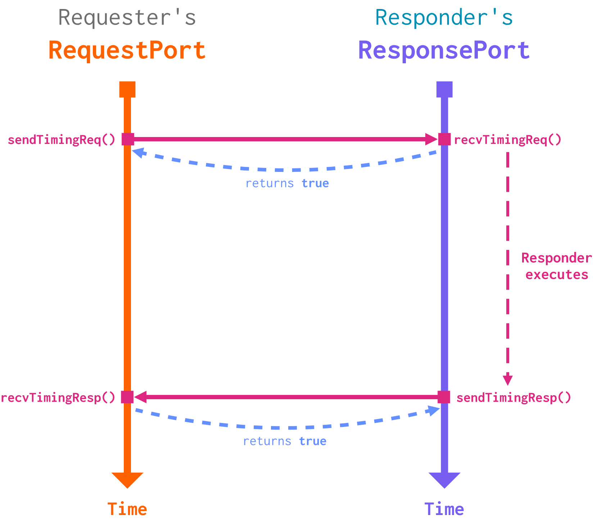
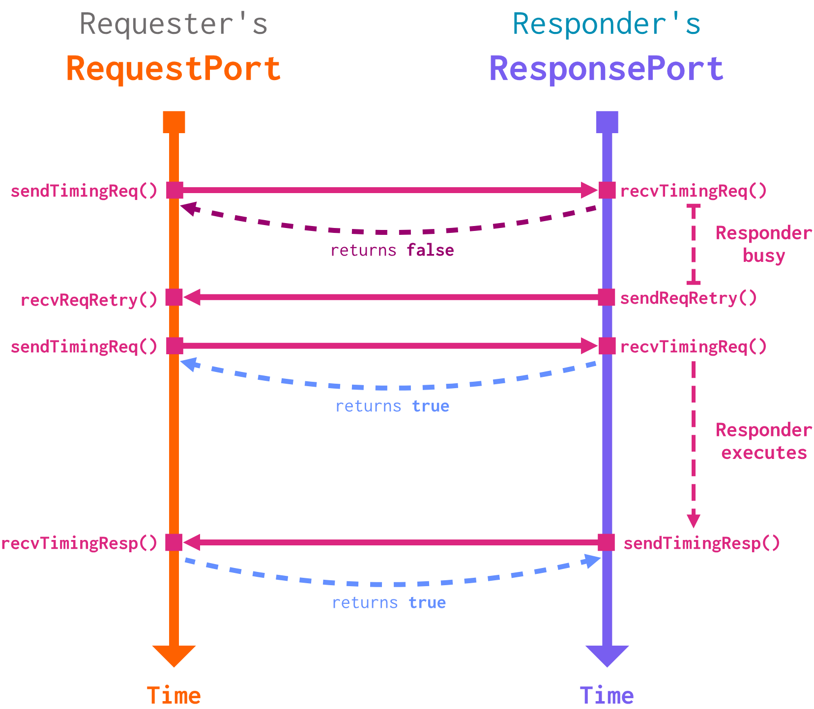
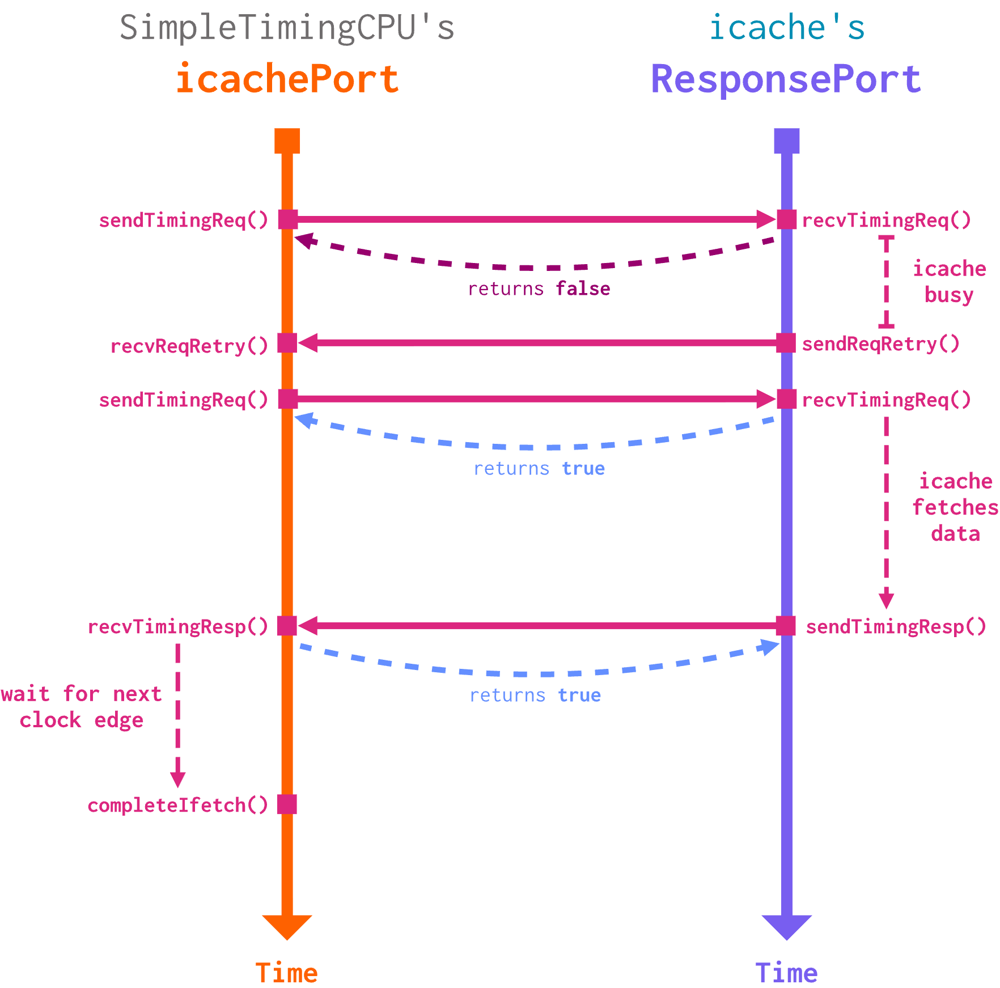
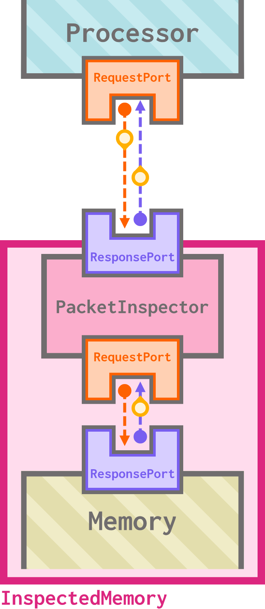
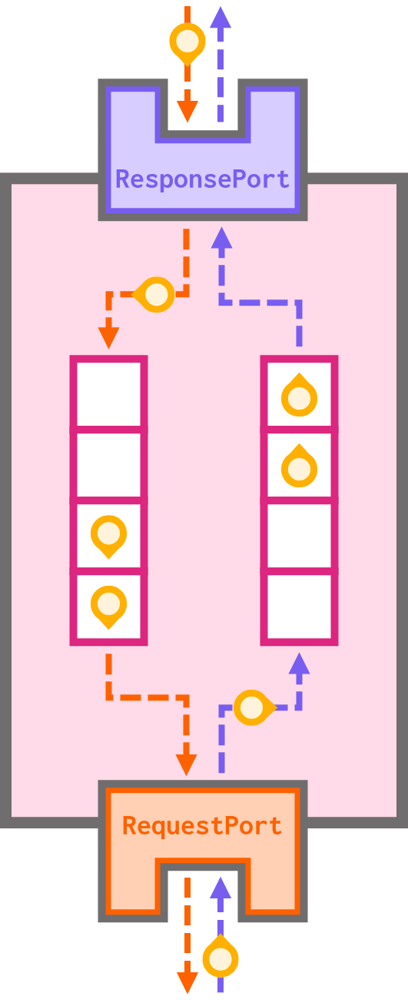

# Using ports in gem5

How do we model data requests and interface with the memory system?

> By the end of this section, you will be able to:
>
> - **Explain** at a high level how ports (`RequestPort` and `ResponsePort`) and packets facilitate communication in gem5.
> - **Create** CPU- and memory-side ports for a `SimObject` and facilitate packet sending and retries between them and their peers.
> - **Simulate** port request/response processing and retry latency using events.

## Ports and packets

### What are ports and packets?

A **port** is a kind of model used to send and receive data. Ports are the *main interface to memory* in gem5. There are two different kinds of ports:

- A `RequestPort` is used to request data,
- A `ResponsePort` is used to send data.

Ports communicate using **packets**. A `Packet` can either be a request packet or a response packet.

> Typically, a `Packet` starts its life as a *request* packet and is then transformed into a *response* packet once it is processed to be sent back at its destination `SimObject`.

Since packets describe memory accesses, every `Packet` has the following fields:

- `addr`: the address of the memory location being accessed,
- `data`: a pointer to the data the `Packet` is carrying (this field can be null),
- `cmd`: the specific memory command the `Packet` represents,
  - For example, whether it represents a request/response,the specific nature of the request/response (read vs. write, error, etc.), and whether it contains a memory payload.
- `req`: a pointer to the original memory request. This field allows us to access the ID of the `SimObject` that made the original request.

Together, ports and packets allow us to implement memory access protocols. **Each port can only be connected to one port of the opposite type**, and a connected pair can pass `Packet`s between them. A given `SimObject` can have any number of ports, each connected to a port on any other `SimObject`.


### Peeking into the source code

Let's take a look at the (partial) declarations of `RequestPort` and `ResponsePort`, both of which can be found at `gem5/src/mem/port.hh`:

```c++
class RequestPort {
  ...
  public:
    bool sendTimingReq(PacketPtr pkt);
    virtual bool recvTimingResp(PacketPtr pkt) = 0;
    virtual void sendRetryResp();
   ...
};

class ResponsePort {
  ...
  public:
    bool sendTimingResp(PacketPtr pkt);
    virtual bool recvTimingReq(PacketPtr pkt) = 0;
    virtual void sendRetryReq();
   ...
};
```

> You'll notice that these functions take a `PacketPtr` as an argument. This is equivalent to a `Packet*`, a pointer to a `Packet`.

We can see here that a `RequestPort` may only send requests and receive responses; conversely, a `ResponsePort` may only send responses and receive requests. If you take a closer look at the class definitions in the source code, you may also notice that these functions are pure-virtual; in order to use ports in your SimObjects, you *must* extend `RequestPort` and `ResponsePort` to fit the needs of the model.

## Ports and memory access modes

Ports can be used to simulate all three of gem5's **memory access modes**.

> As a reminder, these three modes are:
> - **Timing**: Timing memory requests affect simulator time. Therefore, their latency can have an impact on the interleaving and processing of requests.
> - **Atomic**: Atomic memory requests happen atomically, meaning they don't advance simulator time on their own and are not interleaved. It is up to the requester to advance simulator time if appropriate.
> - **Functional**: Functional memory requests are done through a series of function calls and don't affect simulator time. Like atomic requests, they are not interleaved.

The most complicated mode of these to implement is the **timing** mode, since this mode deals with latencies and interleaving. It's also the only realistic memory access mode! Let's take a look at how this works in gem5.

### Setup

Let's take a look at two simple `SimObject`s: `Requester` has a single `RequestPort`, and `Responder` has a single `ResponsePort` connected to `Requester`'s `RequestPort`:


At any given moment, each port can be **available** (ready to process a request) or **busy** (unable to process a request). We'll need to pay attention to those four functions we saw in the above code snippet:

**Requests**:
- `Requester::RequestPort::sendTimingReq()`
  - This function attempts to send a timing memory request to the connected `ResponsePort`. It calls `Responder::ResponsePort::recvTimingReq()`.
- `Responder::ResponsePort::recvTimingReq()`
  - This function returns `true` or `false` based on whether this port can accept the incoming timing request (`true`) or not (`false`). 

**Responses**:
- `Responder::ResponsePort::sendTimingResp()`
  - This function attempts to send a timing memory response to the connected `ResponsePort`. It calls `Requester::RequestPort::recvTimingResp()`.
- `Requester::RequestPort::recvTimingResp()`
  - This function returns `true` or `false` based on whether this port can accept the incoming timing response (`true`) or not (`false`). 

### Everything goes smoothly

Let's see what happens when all ports are available and ready to go.

1. `Requester` attempts to send a request by calling `Requester::RequestPort::sendTimingReq()`. This in turn calls `Responder::ResponsePort::recvTimingReq()`.

2. `Responder` is not busy, so it accepts the request. Thus, `Responder::ResponsePort::recvTimingReq()` returns `true`. This tells `Requester` that it can expect to receive a response in the future.

3. Simulator time advances, meaning that `Requester` and `Responder` continue execution. When `Responder` has a response ready, it attempts to send a response by calling `Responder::ResponsePort::sendTimingResp()`. This in turn calls `Requester::RequestPort::recvTimingResp()`.

4. `Requester` is not busy, so it accepts the response. Thus, `Requester::RequestPort::recvTimingResp()` returns `true`. `Responder` can now see that its response was received, and the transaction is complete!

Visually, we can think of it like this:



### `Responder` is busy

Now, let's consider a situation where `Responder` is busy when the initial request from `Requester` comes in. To facilitate this, we need to two additional functions:

- `Responder::ResponsePort::sendRetryReq()`
  - This function tells the requester to try sending a failed request again. It calls `Requester::RequestPort::recvReqRetry()`.
- `Requester::RequestPort::recvReqRetry()`
  - This function informs the `RequestPort` that it can now retry a failed request.

> Yes, the names for sending a receiving a retry are not consistent with one another! This is unfortunate, but it's how things are implemented.
> <details>
> <summary markdown="span"> <b>src/mem/timing.cc</b> </summary>
> 
> ```cpp
> void
> TimingResponseProtocol::sendRetryReq(TimingRequestProtocol *peer)
> {
>     peer->recvReqRetry();
> }
> ```
> 
> </details>

<br>

Let's go through it step-by-step:

1. `Requester` attempts to send a request by calling `Requester::RequestPort::sendTimingReq()`. This in turn calls `Responder::ResponsePort::recvTimingReq()`.

2. `Responder` *is busy*, so it rejects the request. Thus, `Responder::ResponsePort::recvTimingReq()` returns `false`. This tells `Requester` that it will not receive a response for this request.

3. When `Responder` is no longer busy, it tells `Requester` to retry its request by calling `Responder::ResponsePort::sendRetryReq()`. This in turn calls `Requester::RequestPort::recvReqRetry()`.

4. Now that it knows that it is safe to retry, `Requester` re-sends the request by calling `Requester::RequestPort::sendTimingReq()` again, which in turn calls `Responder::ResponsePort::recvTimingReq()`.

5. The responder is no longer busy, so it accepts the request this time. This means `Responder::ResponsePort::recvTimingReq()` returns `true`. 

6. Simulator time advances, meaning that `Requester` and `Responder` continue execution. When `Responder` has a response ready, it attempts to send a response by calling `Responder::ResponsePort::sendTimingResp()`. This in turn calls `Requester::RequestPort::recvTimingResp()`.

7. `Requester` is not busy, so it accepts the response. Thus, `Requester::RequestPort::recvTimingResp()` returns `true`. `Responder` can now see that its response was received, and the transaction is complete!

Visually, this looks like this:



> Other scenarios (where `Requester` is busy or both are busy) are technically possible, but they are quite rare.
> 
> If you design your `SimObjects` in such a way that a requester may return `false` from `recvTimingResp()`, this *could* be correct behavior, but you may want to double-check that you are simulating something realistic.

You may start to notice that the latencies inherent to timing memory requests map nicely onto the concept of **events** discussed in the previous section. We can schedule:

- On acceptance of a request, an event in the future where `Responder` finishes processing the request and calls `sendTimingResp()`,
- On rejection of a request, an event in the future where `Responder` is no longer busy and calls `sendRetryReq()`.
- On receipt of a response, an event in the future where the `Requester` processes the data, should adding latency be appropriate in that case.

## Ports in CPU models

Let's look at an example of ports in action in `TimingSimpleCPU` (`gem5/src/cpu/simple/timing.hh`). This CPU has two ports: `icachePort` to communicate with the instruction cache and `dcachePort` to communicate with the data cache:

```c++
 IcachePort icachePort;
 DcachePort dcachePort;
```

First, you'll notice these ports are instances of unique classes. Remember that `RequestPort` and `ResponsePort` cannot be instantiated directly, so we must extend them into custom port classes:

```c++
class IcachePort : public TimingCPUPort
```

```c++
class DcachePort : public TimingCPUPort
```

Both of these port classes extend `TimingCPUPort`, which extends `RequestPort`.

> These are both `RequestPort`s because the CPU will be making requests of the caches, not serving requests with responses.

### `TimingCPUPort`


```c++
class TimingCPUPort : public RequestPort
    {
      public:

        TimingCPUPort(const std::string& _name, TimingSimpleCPU* _cpu)
            : RequestPort(_name), cpu(_cpu),
              retryRespEvent([this]{ sendRetryResp(); }, name())
        { }

      protected:

        TimingSimpleCPU* cpu;

        struct TickEvent : public Event
        {
            PacketPtr pkt;
            TimingSimpleCPU *cpu;

            TickEvent(TimingSimpleCPU *_cpu) : pkt(NULL), cpu(_cpu) {}
            const char *description() const { return "Timing CPU tick"; }
            void schedule(PacketPtr _pkt, Tick t);
        };

        EventFunctionWrapper retryRespEvent;
    };
```

Let's break down this class declaration.

- The port keeps track of its name (`_name`) and the CPU that owns it (`_cpu`),
- It creates a new event, `retryRespEvent`, using `EventFunctionWrapper` and initializes it with a callback function (`sendRetryResp()`),
- It creates a new event, `TickEvent`, to model a tick of the timing CPU (which is different from a single simulation tick!); this event cares about  the CPU and the involved packet (which can be null).

This is the port we use as a basis for the icache and dcache ports. For this example, let's focus on `IcachePort`.

### `IcachePort`

```c++
class IcachePort : public TimingCPUPort
    {
      public:

        IcachePort(TimingSimpleCPU *_cpu)
            : TimingCPUPort(_cpu->name() + ".icache_port", _cpu),
              tickEvent(_cpu)
        { }

      protected:

        virtual bool recvTimingResp(PacketPtr pkt);

        virtual void recvReqRetry();

        struct ITickEvent : public TickEvent
        {

            ITickEvent(TimingSimpleCPU *_cpu)
                : TickEvent(_cpu) {}
            void process();
            const char *description() const { return "Timing CPU icache tick"; }
        };

        ITickEvent tickEvent;

    };

```

This declaration is structured very similarly to `TimingCPUPort`, further specifying its members to be icache-specific. Note `ITickEvent`, the event capturing an icache tick. Also note the two overridden functions: `recvTimingResp()` and `recvReqRetry()`.

### Okay, but how does it work?

Now that we have an idea of what these classes look like, let's see how

```c++
IcachePort icachePort
```

is used in practice. In `gem5/src/cpu/simple/timing.cc`, we see that the timing CPU uses the `icachePort` to make a request when sending a fetch:

```c++
void
TimingSimpleCPU::sendFetch(const Fault &fault, const RequestPtr &req, ThreadContext *tc)
{
        ...
        ifetch_pkt = new Packet(req, MemCmd::ReadReq);
        ...

        if (!icachePort.sendTimingReq(ifetch_pkt)) {
            // Need to wait for retry
            _status = IcacheRetry;
        } else {
            // Need to wait for cache to respond
            _status = IcacheWaitResponse;
            // ownership of packet transferred to memory system
            ifetch_pkt = NULL;
        }
    ...
}
```

> This is a *partial snippet!* The pieces of code dealing with setting up the details of the packet, fault handling, and updating cycle counts have been trimmed out.

#### Step 1: Make the request

After creating a packet containing the details of the fetch request (a packet containing a `ReadReq` command), the CPU invokes the `icachePort`'s `sendTimingReq()` function.

> We've seen this one before! This is how the request chain started in our `Requester` and `Responder` example above. 

You'll notice that neither `IcachePort` nor `TimingCPUPort` override `sendTimingReq()`; they use the behavior from `RequestPort`. As we discussed above, this will call the connected `ResponsePort`'s `recvTimingReq()` method.

#### Step 2: Receive the response

Let's suppose that the request was successfully accepted; that is, that `recvTimingReq()` on the connected `ResponsePort` returned `true` to `icachePort`'s `sendTimingReq()` (we'll circle back to the other case later). All we have to do now is wait for the response message to come in!

As you may recall, the way that `icachePort` is notified of an incoming response is by having its `recvTimingResp()` method called by the connected `ResponsePort`'s `sendTimingResp()` function. As we see in the `IcachePort` class declaration, this method *is* overridden. Here is `IcachePort`'s implementation:

```c++
bool
TimingSimpleCPU::IcachePort::recvTimingResp(PacketPtr pkt)
{
   ...

    // we should only ever see one response per cycle since we only
    // issue a new request once this response is sunk
    assert(!tickEvent.scheduled());
    // delay processing of returned data until next CPU clock edge
    tickEvent.schedule(pkt, cpu->clockEdge());

    return true;
}
```

> This snippet is also *partial*. An error handling case around hardware transactional memory was trimmed.

This function is quite simple: after sanity-checking that we do not have a `tickEvent` scheduled already, we schedule a `tickEvent` for the next clock edge. We needed to overwrite `RequestPort`'s `recvTimingResp()` so that we could add this delay.

#### Step 3: The big event

Once that next clock edge comes around, the `tickEvent` we scheduled in `recvTimingResp()` will be processed. The member `tickEvent` in `IcachePort` is an `ITickEvent`, so we can check its `process()` function to see what happens:

```c++
void
TimingSimpleCPU::IcachePort::ITickEvent::process()
{
    cpu->completeIfetch(pkt);
}
```

Now that it's the next clock edge and we have our response from the icache, we can complete the fetch! We'll stop our trace here to avoid digging into the details of how `SimpleCPU` instruction fetching works.

#### Step 4: But wait!

Let's go back to that assumption we made in Step 2. What if the icache's `ResponsePort` was busy and rejected our request (that is, `recvTimingReq()` returned `false`)? In that case, we won't be receiving a response for this request quite yet; we have to wait for a retry.

The connected `ReponsePort` will send `icachePort` a retry request by calling its `sendRetryReq()`, which calls `icachePort`'s `recvReqRetry()`. This is the other method overridden in `IcachePort`! Let's take a look at its implementation:

```c++
void
TimingSimpleCPU::IcachePort::recvReqRetry()
{
    // we shouldn't get a retry unless we have a packet that we're
    // waiting to transmit
    assert(cpu->ifetch_pkt != NULL);
    assert(cpu->_status == IcacheRetry);
    PacketPtr tmp = cpu->ifetch_pkt;
    if (sendTimingReq(tmp)) {
        cpu->_status = IcacheWaitResponse;
        cpu->ifetch_pkt = NULL;
    }
}
```

After sanity-checking that we are, in fact, waiting to retry a request to the icache, we use `sendTimingReq()` (just like we did in `sendFetch()`) to try sending our packet again. If we succeed this time, we're back on track! Refer to Step 2 above. If not, we don't have to change much; we just go back to waiting for the next retry request.

### Putting it all together

We just looked at an example of the **request path** of port communication. In this example, `TimingSimpleCPU` (the requester) interfaces with its icache (the responder) through its `icachePort` to send an instruction fetch.

`icachePort` is a member of the `TimingSimpleCPU` class, and it is of type `IcachePort`, a class that (eventually) extends `RequestPort`.

1. `icachePort` makes a fetch request by calling `sendTimingReq()`, which calls the responder port's `recvTimingReq()`. If this function returns `true`, the CPU waits for a response to the request, which will be sent at some point in the future. If it returns `false`, it instead waits for a retry request, which will be sent when the icache is no longer busy. 

2. The icache's `ResponsePort` sends a response by calling its `sendTimingResp()` method, which itself calls `icachePort`'s `recvTimingResp()` method. The `IcachePort` class overwrites `RequestPort`'s implementation of this method to schedule a processing event for the next CPU clock edge.

3. Alternatively, the icache's `ResponsePort` sends a retry request by calling its `sentReqRetry()` method, which calls `icachePort`'s `recvReqRetry()` method. The `IcachePort` class overwrites `RequestPort`'s implementation of this method to attempt to re-send the fetch request.

4. On the next clock edge after the response is received, `TimingSimpleCPU`'s `TickEvent` is processed, which completes the fetch based on the data received from the icache.

> This is not all too different from the more abstract `Requester` and `Responder` example we looked at before; all that changed here is having to deal with the peculiarities of gem5's codebase and the nuts and bolts of using events.



## Writing a component with ports

### `PacketInspector`

Let's try our hand at writing our own SimObject that makes use of ports. Since ports are used in gem5's memory system, we'll create a **packet inspector** unit that sits between memory and the processor (we'll ignore caches for now) and inspects packet traffic to memory to make sure everything looks safe.


> This diagram is *simplified*; in reality, we know that there is more than one request and response port involved in processor-memory communication.

We'll bundle up this new `PacketInspector` unit with the memory system to create a new `InspectedMemory` unit such that our system looks like this:



> This diagram is, again, simplified; in reality, we'll have one packet inspector per memory channel.

For the sake of this example, we'll just have our memory inspector buffer traffic using one FIFO buffer per packet direction:



### Let's make some files

`PacketInspector` is a new SimObject that needs to be declared and defined as usual.

#### Declaration file (`.py`)

The declaration file for `PacketInspector` is quite straightforward; the only difference between it and our previous `HelloSimObject` example is that `PacketInspector` should inherit from `ClockedObject`, not `SimObject`.

> **Wait, what's `ClockedObject`?**
> 
> `ClockedObject` is a child class of `SimObject` that provides functionality for managing time in cycles. Every `ClockedObject` takes a `clk_domain` parameter that defines its clock frequency. Using its `clk_domain`, `ClockedObject` provides functionality like:
>
> - `clockEdge(Cycles n)`: A function that returns the time of the nth clock edge into the future,
> - `nextCycle()`: A function that returns the time of first clock edge into the future, (i.e. `clockEdge(Cycles(1))`).
>
> You've already seen a `ClockedObject` before! `TimingSimpleCPU` (distantly) inherits from this class, and we saw it use `ClockedObject` functionality such as `clockEdge()` in its implementation.
>
> We want `PacketInspector` to inherit from `ClockedObject` so that we can buffer traffic for a certain number of clock cycles.

Let's write this declaration file now.

> **Your turn:** Write the declaration file for the `PacketInspector` SimObject:
> 
> 1) It should inherit from `ClockedObject`,
> 2) It takes no parameters (for now),
> 3) Much like `HelloSimObject`, its source files will be placed in the `src/bootcamp/packet-inspector` directory,
> 4) Its declaration should follow gem5 naming best practices.
>
> The import statement for `ClockedObject` is provided.
>
> <details>
> <summary markdown="span"> <b>Answer</b> </summary>
> 
> ```py
> from m5.objects.ClockedObject import ClockedObject
>
> class PacketInspector(ClockedObject):
>     type = "PacketInspector"
>     cxx_header = "bootcamp/packet-inspector/packet_inspector.hh"
>     cxx_class = "gem5::PacketInspector"
> ```
> 
> </details>

<br>

Now that we have a basic declaration file, let's add some parameters. Our `PacketInspector` should take 4 parameters:

- `cpu_side_port`: This is the port that receives request packets from the CPU. Thus, this needs to be a **`ResponsePort`**.
- `mem_side_port`: This is the port that receives response packets from memory. Thus, this needs to be a **`RequestPort`**.
- `inspection_buffer_entries`: This is the number of entries in the *inspection buffer*, the buffer that incoming packets queue up in.
- `response_buffer_entries`: This is the number of entries in the *response buffer*, the buffer that outgoing packets queue up in. 

> The `cpu_side` and `mem_side` terminology for ports is very common. You may remember seeing it when you created a custom cache hierarchy all the way back in Unit II.

We previously used `from m5.params import *` to add parameters to our SimObjects. As it turns out, while the Python `RequestPort` and `ResponsePort` classes do not actually import from the Python `Param` class, these classes are still defined in `gem5/src/python/m5/params.py`, so this import handles port SimObject parameters on its own.

> **Your turn:** Add the above parameters to `PacketInspector`'s declaration file. None of them should have default values.
>
>
> <details>
> <summary markdown="span"> <b>Answer</b> </summary>
> 
> ```py
> from m5.objects.ClockedObject import ClockedObject
> from m5.params import *
>
> class PacketInspector(ClockedObject):
>     type = "PacketInspector"
>     cxx_header = "bootcamp/packet-inspector/packet_inspector.hh"
>     cxx_class = "gem5::PacketInspector"
>
>     cpu_side_port = ResponsePort("ResponsePort to received requests from CPU side.")
>     mem_side_port = RequestPort("RequestPort to send received requests to memory side.")
>
>     inspection_buffer_entries = Param.Int("Number of entries in the inspection buffer.")
>     response_buffer_entries = Param.Int("Number of entries in the response buffer.")
> ```
> 
> </details>

#### `SConscript`

One file down! Let's register `PacketInspector` in a `SConscript`file.

> **Your turn:** Register `PacketInspector` in the `SConscript` file. Nothing special here! Remember that we name our files according to gem5 naming best practices.
>
>
> <details>
> <summary markdown="span"> <b>Answer</b> </summary>
> 
> ```py
> Import("*")
>
> SimObject("PacketInspector.py", sim_objects=["PacketInspector"])
>
> Source("packet_inspector.cc")
> ```
> 
> </details>

#### Header file

Let's take a look at the header file for `PacketInspector`. It currently contains only the basics we declared in the declaration file, minus ports:

```cpp
#ifndef __BOOTCAMP_PACKET_INSPECTOR_PACKET_INSPECTOR_HH__
#define __BOOTCAMP_PACKET_INSPECTOR_PACKET_INSPECTOR_HH__

#include "params/PacketInspector.hh"
#include "sim/clocked_object.hh"

namespace gem5
{

class PacketInspector : public ClockedObject
{
  private:
    int inspectionBufferEntries;
    int responseBufferEntries;

    Tick align(Tick when);

  public:
    PacketInspector(const PacketInspectorParams& params);
};


} // namespace gem5

#endif // __BOOTCAMP_PACKET_INSPECTOR_PACKET_INSPECTOR_HH__
```

You'll also notice a declaration for the `align()` method; this is a private helper method that will return the time (in ticks) of the first clock cycle after a given time (in ticks). In other words, it will *align* a given time in ticks to the nearest clock cycle, always rounding up. We'll get to its definition in a moment.

#### Source file

The source file for `PacketInspector` is pretty empty right now, but it includes a constructor and the definition of the `align()` helper:

```cpp
#include "bootcamp/packet-inspector/packet_inspector.hh"

#include <cmath>

namespace gem5
{

PacketInspector::PacketInspector(const PacketInspectorParams& params):
    ClockedObject(params),
    inspectionBufferEntries(params.inspection_buffer_entries),
    responseBufferEntries(params.response_buffer_entries),
{}

Tick
PacketInspector::align(Tick when)
{
    return clockEdge((Cycles) std::ceil((when - curTick()) / clockPeriod()));
}

} // namespace gem5
```

> We import `cmath` because `align()` uses `std::ceil()`.

Now that we're acquainted with all of our files, let's get to writing some ports.

### Port time!

As was mentioned before, and as we saw with `ICachePort` in `TimingSimpleCPU`, `RequestPort` and `ResponsePort` have pure-virtual methods, so we must extend them into our own classes and override those methods in order to use them in `PacketInspector`. We'll call these classes `CPUSidePort` (which extends `ResponsePort`) and `MemSidePort` (which extends `RequestPort`).

Let's write both of these classes as in `packet_inspector.hh` as private classes in the scope of `PacketInspector`. This way, we don't run into naming conflicts with other parts of gem5. The first thing we need to do is import the appropriate header files; we need both ports and packets:

```cpp
#include "mem/packet.hh"
#include "mem/port.hh"
```

We'll also need an instance of each as a private member of the `PacketInspector` class:

```cpp
  private:
    ...
    CPUSidePort cpuSidePort;
    MemSidePort memSidePort;
```

#### Declaring `CPUSidePort` (`ResponsePort`)

Let's start with `CPUSidePort`:

```cpp
private:
    ...
    class CPUSidePort: public ResponsePort
    {
      private:
        PacketInspector* owner;
        bool needToSendRetry;
        PacketPtr blockedPacket;

      public:
        CPUSidePort(PacketInspector* owner, const std::string& name):
            ResponsePort(name), owner(owner), needToSendRetry(false), blockedPacket(nullptr)
        {}
        bool needRetry() const { return needToSendRetry; }
        bool blocked() const { return blockedPacket != nullptr; }
        void sendPacket(PacketPtr pkt);
    };
```

You'll notice the following:
- **Private fields**
  - `owner` is a pointer to the `PacketInspector` which owns this instance of `CPUSidePort`. We need to keep track of our owner so that we can access it when receiving requests.
  - `needToSendRetry` is a flag that tracks whether we need to send a retry request (i.e., call `sendRetryReq()`) at some point in the future. As you might imagine, we initialize this to `false`, and we'll set it to `true` when we refuse a request.
  - `blockedPacket`, if it is not `null`, hangs onto a packet this port will need to send as part of a retry in the future. That is, `blockedPacket` is not `null` when this port previously attempted to send this packet as a response but was rejected by the receiving request port. When a response retry is eventually triggered, the port will attempt to re-send `blockedPacket`.

  > `needToSendRetry` tracks whether this port *issued* a rejection, `blockedPacket` tracks whether this port *received* a rejection.
- **Constructor**
  - We initialize `CPUSidePort` using its parent's constructor and set up the initial values of our private fields.
- **Public methods**
  - `needRetry()` and `blocked()` are simple getters for `needToSendRetry` and `blockedPacket`, respectively. Since they're so simple, we define them here.
  - `sendPacket()` will try to send a packet to the connected request port. As you might imagine, it will handle calling `sendTimingResp()` and the like.

Remember, though, that we also need to override some methods from `ResponsePort`. Let's add those declarations now:

```cpp
public:
  ...
  virtual AddrRangeList getAddrRanges() const override;
  virtual bool recvTimingReq(PacketPtr pkt) override;
  virtual Tick recvAtomic(PacketPtr pkt) override;
  virtual void recvFunctional(PacketPtr pkt) override;
  virtual void recvRespRetry() override;
```

- We are already familiar with `recvTimingReq()` and `recvRespRetry()`; these are foundational functions involved in the timing protocol.
- As you may imagine, `recvAtomic()` and `recvFunctional()` are the counterparts of timing's `recvTimingReq()` in the atomic and functional memory access modes, respectively. There are no retries needed in these modes, since requests do not take any simulated time.
- `getAddrRanges()` is a new function we have yet to discuss; this function returns the address ranges for which this port can respond. Remember that on an actual system, we may want to partition the address range between different `ResponsePort`s.

#### Declaring `MemSidePort` (`RequestPort`)

It's now time for `MemSidePort`:

```cpp
private:
  ...
  class MemSidePort: public RequestPort
    {
      private:
        PacketInspector* owner;
        bool needToSendRetry;
        PacketPtr blockedPacket;

      public:
        MemSidePort(PacketInspector* owner, const std::string& name):
            RequestPort(name), owner(owner), needToSendRetry(false), blockedPacket(nullptr)
        {}
        bool needRetry() const { return needToSendRetry; }
        bool blocked() const { return blockedPacket != nullptr; }
        void sendPacket(PacketPtr pkt);

        virtual bool recvTimingResp(PacketPtr pkt) override;
        virtual void recvReqRetry() override;
    };
```

You'll notice that this declaration looks *very* similar to `CPUSidePort`'s. This time, however, we don't have to override quite as many functions. `getAddrRanges()`, `sendAtomic()`, and `sendFunctional()` are already defined by the parent class.

> Now that we've defined their classes, don't forget to add these two fields to the constructor's initialization list in `packet_inspector.cc` as follows:
> 
> ```cpp
> PacketInspector::PacketInspector(const PacketInspectorParams& params):
>     ...
>     cpuSidePort(this, name() + ".cpu_side_port"),
>     memSidePort(this, name() + ".mem_side_port"),
>     ...
> {}
> ```

#### `SimObject::getPort()`

In order to correctly implement a SimObject with ports, we need to implement the `SimObject::getPort()` function. This function is used when ports are connected to one another; we never actually call `getPort()` in code, but it is called behind the scenes to establish a mapping between the ports we declare in Python and the port objects we write in C++. 

> In Unit II, when building a custom cache hierarchy, we said this about ports:
>
> *"You'll notice that the way we connect ports is using the `=` operator. This is **not** being used as an assignment operator here. For ports, `=` means connection!"*
>
> To resolve the `=` operators connecting ports, gem5 uses `getPort()`.

With all of that said, let's add this declaration to `packet_inspector.hh`:

```cpp
public:
    virtual Port& getPort(const std::string& if_name, PortID idxInvalidPortID);
```

...and the corresponding definition to `packet_inspector.cc`:

```cpp
Port&
PacketInspector::getPort(const std::string &if_name, PortID idx)
{
    if (if_name == "cpu_side_port") {
        return cpuSidePort;
    } else if (if_name == "mem_side_port") {
        return memSidePort;
    } else {
        return ClockedObject::getPort(if_name, idx);
    }
}
```

`PacketInspector` has two ports, and we can return a reference to either if them if requested by name. Otherwise, we refer to `ClockedObject`. The string names of the ports (`"cpu_side_port"` and `"mem_side_port"`) come from the names of the corresponding parameters in the `.py` declaration file.

> Don't worry about the `idx` parameter to this function in this section. This is related to *vector ports*, a kind of port that can connect to multiple peers, which neither of our ports are.

#### `getAddrRanges()`

We also need to implement `getAddrRanges`, which we previously declared in `CPUSidePort`. Let's do that in `packet_inspector.cc`:

```cpp
AddrRangeList
PacketInspector::CPUSidePort::getAddrRanges() const
{
    return owner->getAddrRanges();
}
```

You'll notice this implementation refers to the `owner`'s `getAddrRanges()` implementation, which we haven't written yet! Let's do this now by adding the declaration to `packet_inspector.hh`:

```cpp
public:
  ...
  AddrRangeList getAddrRanges() const;
```

...and the corresponding implementation to `packet_inspector.cc`:

```cpp
AddrRangeList
PacketInspector::getAddrRanges() const
{
    return memSidePort.getAddrRanges();
}
```

The CPU-side port refers to the owner, which in turn refers to the memory-side port! Remember that `RequestPort` already has an implementation of `getAddrRanges()`.

There's one more thing we need to do to handle our address ranges: when SimObjects with ports are initialized (i.e., `init()` is called on them), they need to propagate their address ranges to the rest of the memory hierarchy. 

> You may remember our discussion of `init()` from Section 1 in this unit, where we saw that `init()` is called on every SimObject after they have all been constructed.

We do this using the `sendRangeChange()` method, which is defined in `ResponsePort`. It is important we call `sendRangeChange()` in `init()` and not any earlier (i.e., in the constructor of `PacketInspector`) so that all SimObjects are already constructed at the time that we propagate our changes. All we need to do here is override `init()` with a declaration `in packet_inspector.hh`:

```cpp
public:
    ...
    virtual void init() override;
    ...
```

...then write its definition in `packet_inspector.cc` to call our `MemSidePort`'s `sendRangeChange()`:

```cpp
void
PacketInspector::init()
{
    cpuSidePort.sendRangeChange();
}
```

With that, we're all done with address range-related setup!

### Buffering packets

We mentioned that `PacketInspector` will be putting incoming and outgoing packets into local FIFO buffers and impose a clock cycle latency on these buffers. We express this latency through a minimum amount of time that a packet must spend in the queue before it can be dequeued.

While C++ has a queue implementation ([`std::queue`](https://cplusplus.com/reference/queue/queue/?kw=queue)), it does not capture our desired latency behavior; thus, we need to wrap `std::queue` in another class, which we'll call `TimedQueue`, which implements this functionality. `TimedQueue` exposes the following methods:

- `front()`, `push()`, `pop()`, `empty()`, and `size()`, which behave similarly to their `std` counterparts,
- `hasReady()`, which returns `true` if the `TimedQueue` has an element that is available to be dequeued (it has spent its requisite time in the queue) and `false` otherwise,
- `firstReadyTime()`, which returns the time (in ticks) in the future where the oldest item in the queue will become ready (i.e., the soonest time that `hasReady()` will return `true`).

Just like `CPUSidePort` and `MemSidePort`, we'll declare this class privately in `packet_inspector.hh`:

```cpp
private:
    template<typename T>
    class TimedQueue
    {
      private:
        Tick latency;

        std::queue<T> items;
        std::queue<Tick> insertionTimes;

      public:
        TimedQueue(Tick latency): latency(latency) {}

        void push(T item, Tick insertion_time) {
            items.push(item);
            insertionTimes.push(insertion_time);
        }
        void pop() {
            items.pop();
            insertionTimes.pop();
        }

        T& front() { return items.front(); }
        bool empty() const { return items.empty(); }
        size_t size() const { return items.size(); }
        bool hasReady(Tick current_time) const {
            if (empty()) {
                return false;
            }
            return (current_time - insertionTimes.front()) >= latency;
        }
        Tick firstReadyTime() { return insertionTimes.front() + latency; }
    };
```

> Since `TimedQueue` is mostly a helper class that allows us to make `PacketInspector` more interesting, we won't spend too long discussing its implementation. You are welcome to read through the code if you're curious!

We'll need one `TimedQueue` for each of our inspection and response buffers; let's declare them now in `packet_inspector.hh`:

```cpp
private:
  ...
  TimedQueue<PacketPtr> inspectionBuffer;
  TimedQueue<PacketPtr> responseBuffer;
```

> With new fields come new initializations for the constructor! Add these two fields to the initialization list in `packet_inspector.cc` as follows:
> 
> ```cpp
> PacketInspector::PacketInspector(const PacketInspectorParams& params):
>     ...
>     inspectionBuffer(clockPeriod()),
>     responseBuffer(clockPeriod()),
>     ...
> {}
> ```

### Implementing the request path

Now that we have our port classes declared and our buffers ready, let's get to the meat of implementing this packet inspector. We'll now work on the *request path*: what happens when a request packet comes in from `CPUSidePort`.


To do this, we'll need to implement:

- `recvTimingReq(PacketPtr pkt)`
- `recvAtomic(PacketPtr pkt)`
- `recvFunctional(PacketPtr pkt)`
- `recvReqRetry()`

#### Receiving packets in atomic and functional mode

Let's quickly tackle the atomic- and functional-mode access functions, since they're both quite simple and don't need to engage with any timing mechanics. 

```cpp
Tick
PacketInspector::CPUSidePort::recvAtomic(PacketPtr pkt)
{
  return owner->recvAtomic(pkt);
}

void
PacketInspector::CPUSidePort::recvFunctional(PacketPtr pkt)
{
  owner->recvFunctional(pkt);
}
```

Much like `getAddrRanges()`, we refer to the owner's implementation of these functions. Let's declare them for `PacketInspector` in `packet_inspector.hh`:

```cpp
public:
  ...
  Tick recvAtomic(PacketPtr pkt);
  void recvFunctional(PacketPtr pkt);
```

...and define them in `packet_inspector.cc`:

```cpp
Tick
PacketInspector::recvAtomic(PacketPtr pkt)
{
    return clockPeriod() + memSidePort.sendAtomic(pkt);
}

void
PacketInspector::recvFunctional(PacketPtr pkt)
{
    memSidePort.sendFunctional(pkt);
}
```

Thankfully, just like `getAddrRanges()`, `RequestPort` already implements these for us. For atomic accesses, we choose to add one clock cycle of latency to the access by calling `clockPeriod()` (defined in `ClockedObject`). This is **not** a realistic representation of latency, since it doesn't take the interleaving of multiple requests into account. 

#### Receiving packets in timing mode

```cpp
bool
PacketInspector::CPUSidePort::recvTimingReq(PacketPtr pkt)
{
  if (owner->recvTimingReq(pkt)) {
      return true;
  }
  needToSendRetry = true;
  return false;
}
```

In this method, we try to ask the owner to receive a packet; if it can, that's all we need to do, and we accept the request by returning `true`. If it can't, we take note of the fact that we'll need to send a retry in the future by setting `needToSendRetry` to `true` and reject the request by returning `false`.

You know the drill: we now need to handle the owner's version of `recvTimingReq()`. We declare it in `packet_inspector.hh`:

```cpp
public:
  ...
  bool recvTimingReq(PacketPtr pkt);
```

...and define it in `packet_inspector.cc`:

```cpp
bool
PacketInspector::recvTimingReq(PacketPtr pkt)
{
    if (inspectionBuffer.size() >= inspectionBufferEntries) {
        return false;
    }
    inspectionBuffer.push(pkt, curTick());
    return true;
}
```

Here, we reject the packet (return `false`) if we don't have room for it in the inspection buffer. Otherwise, we can enqueue the packet (setting its insertion time to the current tick) and return `true`.

#### Sending request packets along

So far, we've completed steps 1 and 2 of the request path:
- **Step 1: Receive request** 
  - `PacketInspector::CPUSidePort::recvTimingReq()`
  - `PacketInspector::CPUSidePort::recvAtomic()`
  - `PacketInspector::CPUSidePort::recvFunctional()`
  - `PacketInspector::recvAtomic()`
  - `PacketInspector::recvFunctional()`
- **Step 2: Enqueue packet**
  - `PacketInspector::recvTimingReq()`

Now, we need to implement the mechanism for dequeuing packets (Step 3) and sending them along out of the `MemSidePort` (Step 4). We can't do this immediately in `recvTimingReq()`, since we want to impose a latency on our packets. Instead, we want to *schedule a future event* for when the packet we just received will be dequeued.

#### Creating `nextReqSendEvent`

We'll define `nextReqSendEvent` as the event that controls the sending of request packets from the inspection buffer to `memSidePort`. To save us some lines of code, we'll use `EventFunctionWrapper` to define it using only its callback function. We need to add the following to the declaration of `PacketInspector`:

- **Private fields**
  - `nextReqSendEvent`
- **Private helper methods**
  - `processNextReqSendEvent()`, `nextReqSendEvent`'s callback function,
  - `scheduleNextReqSendEvent(Tick when)`, a function that takes care of scheduling a `nextReqSendEvent` at or after a given tick.

> `scheduleNextReqSendEvent()` is not a strictly-necessary part of using events in gem5; however, you'll soon see that we'll be scheduling `nextReqSendEvent` from more than one place, and that we want to perform additional checks/logic any time we do this. Thus, factoring out those checks into another method helps us avoid repeated code.

We declare all of these in `packet_inspector.hh`:

```cpp
#include "sim/eventq.hh"
```

```cpp
 private:
    ...
    EventFunctionWrapper nextReqSendEvent;
    void processNextReqSendEvent();
    void scheduleNextReqSendEvent(Tick when);
    ...
```

> We just added a field, so we must also add them to the constructor's initialization list in `packet_inspector.cc`:
>
> ```cpp
> PacketInspector::PacketInspector(const PacketInspectorParams& params):
>     ...
>     nextReqSendEvent([this](){ processNextReqSendEvent(); }, name() + ".nextReqSendEvent"),
>     ...
> ```

Now that we have `nextReqSendEvent` all declared (we'll initialize its callback and scheduler in just a moment), we can schedule it in `PacketInspector`'s `recvTimingReq()`

```cpp
bool
PacketInspector::recvTimingReq(PacketPtr pkt)
{
    if (inspectionBuffer.size() >= inspectionBufferEntries) {
        return false;
    }
    inspectionBuffer.push(pkt, curTick());
    scheduleNextReqSendEvent(nextCycle());
    return true;
}
```

You'll notice we choose to schedule this event for the *next cycle*. We do this under the assumption that it takes one cycle to enqueue a packet. However, we should always make sure before we schedule a `nextReqSendEvent` that a packet will be available to dequeue when the event is triggered. This is what `scheduleNextReqSendEvent()` is for! We implement it as follows in `packet_inspector.cc`:

```cpp
void
PacketInspector::scheduleNextReqSendEvent(Tick when)
{
    bool port_avail = !memSidePort.blocked();
    bool have_items = !inspectionBuffer.empty();

    if (port_avail && have_items && !nextReqSendEvent.scheduled()) {
        Tick schedule_time = align(std::max(when, inspectionBuffer.firstReadyTime()));
        schedule(nextReqSendEvent, schedule_time);
    }
}
```

First, we make sure that `memSidePort`, the port responsible for sending this packet out, is not blocked (waiting to retry sending a request that was previously rejected). We also double-check that the queue even has packets to send out. If we meet both of these conditions, we schedule a `nextReqSendEvent` in a way that satisfies both the `when` parameter and the first ready time of the queue. This means that if we ever choose to make the queue delay in `inspectionBuffer` longer, we can still schedule events correctly without changing the rest of the code. We also *align* this time such that we always send out a packet on the rising edge of the clock cycle.

> You'll notice we just silently don't schedule another event on the event that we can't. This is okay, and you'll see why in just a moment when we implement the callback function and implement retries.

Great! Now we have a way to schedule `nextReqSendEvent`. Let's write out what actually happens when that event is triggered by defining the callback function `processNextReqSendEvent()` in `packet_inspector.cc`:

```cpp
void
PacketInspector::processNextReqSendEvent()
{
    panic_if(memSidePort.blocked(), "Should never try to send if blocked!");
    panic_if(!inspectionBuffer.hasReady(curTick()), "Should never try to send if no ready packets!");

    PacketPtr pkt = inspectionBuffer.front();
    memSidePort.sendPacket(pkt);
    inspectionBuffer.pop();

    scheduleNextReqSendEvent(nextCycle());
}
```

We start out this method with some sanity-check panics: we should never try to send a packet if the port is blocked or if there are no ready packets; we already check for this in `scheduleNextReqSendEvent()`, but it's always good to double-check our assumptions. We then grab the packet from the front of the inspection buffer, send it on `memSidePort`, and dequeue it. We then call `scheduleNextReqSendEvent()` again, which will determine if we have any more packets to send and schedule an event for them if so, continuing to clear out the packets in the inspection buffer.

You'll notice we're making use of a function we haven't written yet, `memSidePort::sendPacket()`. Let's define this function now in `packet_inspector.cc`:

```cpp
void
PacketInspector::MemSidePort::sendPacket(PacketPtr pkt)
{
    panic_if(blocked(), "Should never try to send if blocked!");

    if (!sendTimingReq(pkt)) {
        blockedPacket = pkt;
    }
}
```

We double up on the panic check from `processNextReqSendEvent()` here; if we already have a rejected packet that we are waiting to re-send, we shouldn't be sending any other packets until we can clear the blocked packet. If we fail to send a packet, we designate that packet as our blocked packet and wait until we receive a signal that we should re-send it.

#### But wait!

We've now implemented all four steps of the request path:

- **Step 1: Receive request** 
  - `PacketInspector::CPUSidePort::recvTimingReq()`
  - `PacketInspector::CPUSidePort::recvAtomic()`
  - `PacketInspector::CPUSidePort::recvFunctional()`
  - `PacketInspector::recvAtomic()`
  - `PacketInspector::recvFunctional()`
- **Step 2: Enqueue packet**
  - `PacketInspector::recvTimingReq()`
- **Step 3: Dequeue packet**
  - `PacketInspector::scheduleNextReqSendEvent()`
  - `PacketInspector::processNextReqSendEvent()`
- **Step 4: Send request**
  - `PacketInspector::MemSidePort::sendPacket()`

*However,* we did not implement any retry functionality yet:
- If `cpuSidePort` rejects a packet due to its queue being full, it should send a retry signal at some point in the future to allow its peer to try sending the request again.
- If a packet becomes blocked in `memSidePort`, we have no way to clear it by acting on a retry signal from our peer,

Let's tackle these one by one, starting with the first issue: sending out retries.

#### Creating `nextReqRetryEvent`

We'll define `nextReqRetryEvent` as the event that controls the sending of retry signals to `CPUSidePort`'s peer when `CPUSidePort` rejects an incoming request. Just like `nextReqSendEvent`, we'll use `EventFunctionWrapper` to define `nextReqRetryEvent`, meaning we need to add the following to the declaration of `PacketInspector`:

- **Private fields**
  - `nextReqRetryEvent`
- **Private helper methods**
  - `processNextReqRetryEvent()`, `nextReqRetryEvent`'s callback function,
  - `scheduleNextReqRetryEvent(Tick when)`, a function that takes care of scheduling a `nextReqRetryEvent` at or after a given tick.

Once more, we declare these in `packet_inspector.hh`:

```cpp
private:
    ...
    EventFunctionWrapper nextReqRetryEvent;
    void processNextReqRetryEvent();
    void scheduleNextReqRetryEvent(Tick when);
    ...
```

> Another new field means another new item in the constructor's initialization list in `packet_inspector.cc`:
>
> ```cpp
> PacketInspector::PacketInspector(const PacketInspectorParams& params):
>     ...
>     nextReqRetryEvent([this](){ processNextReqRetryEvent(); }, name() + ".nextReqRetryEvent"),
>     ...
> ```

We then implement these new functions in `packet_inspector.cc`:

```cpp
void
PacketInspector::scheduleNextReqRetryEvent(Tick when)
{
    if (cpuSidePort.needRetry() && !nextReqRetryEvent.scheduled()) {
        schedule(nextReqRetryEvent, align(when));
    }
}
```

We should only schedule a retry event if we actually need one; that is, we already rejected a packet and we don't already have a retry event scheduled. We can find out if the former is true by checking `cpuSidePort`'s `needRetry()` function that we implemented so long ago.

If a retry event is successfully scheduled, we make sure that it was justifiably scheduled, then send a retry signal along to our peer:

```cpp
void
PacketInspector::processNextReqRetryEvent()
{
    panic_if(!cpuSidePort.needRetry(), "Should never try to send retry if not needed!");
    cpuSidePort.sendRetryReq();
}
```
You'll notice `sendRetryReq()` is not one of the functions we needed to overwrite; `ResponsePort`'s default behavior is just fine here.

Now that this new retry event is in place, we can go back and modify `processNextReqSendEvent()` to make use of it. When we successfully send a packet to our peer, we dequeue it from the inspection buffer and therefore make room for another packet. When this happens, we should try to schedule a `nextReqRetryEvent` for the next cycle in case we rejected a packet before:

```cpp
void
PacketInspector::processNextReqSendEvent()
{
    panic_if(memSidePort.blocked(), "Should never try to send if blocked!");
    panic_if(!inspectionBuffer.hasReady(curTick()), "Should never try to send if no ready packets!");

    PacketPtr pkt = inspectionBuffer.front();
    memSidePort.sendPacket(pkt);
    inspectionBuffer.pop();

    scheduleNextReqRetryEvent(nextCycle()); // We just added this!
    scheduleNextReqSendEvent(nextCycle());
}
```

> Remember that the logic for whether we actually *need* to send a retry signal is handled by `scheduleNextReqRetryEvent()`, which will just not schedule the retry event if it's not needed.

#### Clearing blocked packets

The last thing on our plate for the request path (finally!) is handling blocked packets in `memSidePort`. As it turns out, thanks to how we factored out our event scheduling code, we don't need a separate event for this, we just need to keep a few things in mind:

- We should not expect a request retry signal if we don't have a blocked packet,
- Receiving a request retry signal is not necessarily a guarantee that the retried request will be accepted; we might be rejected again and stay blocked,
- If we successfully clear our blocked packet, we can resume sending request packets normally from our queue.

Let's define our override of `MemSidePort`'s `recvReqRetry()` in `packet_inspector.cc`:

```cpp
void
PacketInspector::MemSidePort::recvReqRetry()
{
    panic_if(!blocked(), "Should never receive retry if not blocked!");

    PacketPtr pkt = blockedPacket;
    blockedPacket = nullptr;
    sendPacket(pkt);

    if (!blocked()) {
        owner->recvReqRetry();
    }
}
```

We try to send our blocked packet on its way, then let our owner know that we've received a retry if we successfully cleared the blocked packet. Remember that `sendPacket` includes logic for designating a packet as blocked if the attempt to send it is rejected; therefore, `blockedPacket` can become non-null again after calling `sendPacket()`, and thus we don't call the owner's `recvReqRetry()` unnecessarily.

Lastly, we haven't actually implemented `recvReqRetry()` in `PacketInspector` yet! We declare it in `packet_inspector.hh`:

```cpp
private:
    ...
    void recvReqRetry();
    ...
```

...and define it in `packet_inspector.cc`:

```cpp
void
PacketInspector::recvReqRetry()
{
    scheduleNextReqSendEvent(nextCycle());
}
```

If we successfully cleared our blocked packet, we should resume dequeuing and sending out packet from our inspection buffer, and all we need to do that is call `scheduleNextReqSendEvent()` for the next cycle!

> It should now become apparent why it's completely fine for `scheduleNextReqSendEvent()` to silently not schedule an event if it encounters a blocked packet in `memSidePort`. When that packet is eventually cleared, this method will be called again!

And with that, we are finally done with the request path!

### Your turn: implementing the response path

Halfway done! We now need to do all of this on the *response path*: what happens when a response packet comes in from `MemSidePort`.


The logic for doing this is very similar to the logic of the request path that we just implemented. The completed version of the code is available to you when you're ready to compare answers, and you can consult the following comprehensive list of response path methods if you get stuck: 

> <details>
> <summary markdown="span"> <b>Response path methods</b> </summary>
> 
> ```cpp
> bool MemSidePort::recvTimingResp(PacketPtr pkt);
> void CPUSidePort::sendPacket(PacketPtr pkt);
> void CPUSidePort::recvRespRetry();
> bool PacketInspector::recvTimingResp(PacketPtr pkt);
> void PacketInspector::recvRespRetry();
> void PacketInspector::processNextRespSendEvent();
> void PacketInspector::scheduleNextRespSendEvent(Tick when);
> void PacketInspector::processNextRespRetryEvent();
> void PacketInspector::scheduleNextRespSendEvent(Tick when);
> ```
> </details>

### Let's compile!

Finally, we can recompile gem5 to add our `PacketInspector` model. As always, from the gem5 directory, we run:

```bash
scons build/ALL/gem5.opt -j$(nproc)
```

If all goes well, you will see no compiler errors.

### `InspectedMemory`

Now that we have `PacketInspector` ready to go, let's bundle it up with a memory system to use in our configuration scripts. This will put a `PacketInspector` right before each channel of the memory controller.

We'll do this by making a new model, `InspectedMemory`, that extends `ChanneledMemory` (you may remember `ChanneledMemory` from Unit II!). You can see this implementation in `inspected_memory.py`; we'll focus on the highlights here.

First, along the regular `ChanneledMemory` parameters, we expose some of `PacketInspector`'s parameters and give them default values:

```python
def __init__(
        self,
        ...
        inspection_buffer_entries: int = 16,
        response_buffer_entries: int = 32,
        ...
    ) -> None:
```

Since we have one `PacketInspector` per channel, we keep track of our `PacketInspector`s in a local array:

```python
def __init__(...)
    ...
    self.inspectors = [
        PacketInspector(
            inspection_buffer_entries=inspection_buffer_entries,
            response_buffer_entries=response_buffer_entries,
        )
        for _ in range(num_channels)
    ]
```

`ChanneledMemory` calls a method called `incorporate_memory()` to add the memory system to the board. We now have to do an additional thing (connect the memory-side ports of our `PacketInspector`s to the CPU-side ports of each of our memory channels) when we do this, so we override this method to add this functionality:

```python
@overrides(ChanneledMemory)
    def incorporate_memory(self, board: AbstractBoard) -> None:
        super().incorporate_memory(board)
        for inspector, ctrl in zip(self.inspectors, self.mem_ctrl):
            inspector.mem_side_port = ctrl.port
```

> Note again the use of `=` to connect ports! Remember that this calls `getPort()` behind the scenes.

Lastly, `get_mem_ports()` in `ChanneledMemory` returns the memory ports that will connect to the cache hierarchy. For `InspectedMemory`, these are the CPU-side ports of its `PacketInspector`s, so we need to override this method as well:

```python
@overrides(ChanneledMemory)
    def get_mem_ports(self) -> Sequence[Tuple[AddrRange, Port]]:
        return [
            (ctrl.dram.range, inspector.cpu_side_port)
            for ctrl, inspector in zip(self.mem_ctrl, self.inspectors)
        ]
```

We now have a completed `InspectedMemory` unit that make use of our new `PacketInspectors`!

### Configuration script

At long last, let's see our new inspected memory in action. We'll modify a very simple configuration script we originally wrote in Unit III to demonstrate the use of traffic generators. You can find it in `packet_inspector_config.py`; again, we'll look at the highlights here.

First, we import our new `InspectedMemory` component:

```python
from inspected_memory import InspectedMemory
```

Then, we instantiate it just like we would any other memory system, providing values for all of the non-default parameters:

```python
memory = InspectedMemory(
  dram_interface_class=DDR3_1600_8x8,
  num_channels=2,
  interleaving_size=128,
  size="1GiB"
)
```

Since this board uses a traffic generator, we don't need any workload; we just run the simulation!

```python
simulator = Simulator (
  board = board
)

simulator.run(1_000_000_000)
```

### Time to run!

Let's run this configuration script now:

```bash
gem5 packet_inspector_config.py
```

When we do, there won't be too many interesting things in the terminal output, but we can take a look at the `config.ini` and `stats.txt` to get some information about our system. In `config.ini`, we can see the following lines:

```txt
[board.cache_hierarchy.membus]
...
mem_side_ports=board.memory.inspectors0.cpu_side_port board.memory.inspectors1.cpu_side_port
```

We can see that the memory-side ports of the system's cache hierarchy are connected to CPU-side ports of our packet inspectors, just like we dictated in `get_mem_ports()` in `InspectedMemory`. You'll also notice we have two inspectors, which matches the two memory channels we specified in our configuration script.

Later on, we see:

```txt
[board.memory]
type=SubSystem
children=inspectors0 inspectors1 mem_ctrl0 mem_ctrl1
```

The memory system has two memory controllers (one per channel) and two inspectors (also one per channel).

Lastly, we see:

```txt
[board.memory.inspectors0]
type=PacketInspector
children=power_state
clk_domain=board.clk_domain
eventq_index=0
inspection_buffer_entries=16
power_model=
power_state=board.memory.inspectors0.power_state
response_buffer_entries=32
cpu_side_port=board.cache_hierarchy.membus.mem_side_ports[0]
mem_side_port=board.memory.mem_ctrl0.port
```

We also see a similar block for the 2nd inspector. We can see that the inspector has the parameters we specified in `InspectedMemory`: it has the correct number of entries in each buffer, and its CPU-side and memory-side ports are connected to the cache hierarchy and the memory controller, respectively.

As it turns out, ports keep track of the number of packets they processed, which we can see in `stats.txt`:

```txt
board.cache_hierarchy.membus.pktCount_board.cache_hierarchy.l1dcaches.mem_side_port::board.memory.inspectors0.cpu_side_port        25043                       # Packet count per connected requestor and responder (Count)
board.cache_hierarchy.membus.pktCount_board.cache_hierarchy.l1dcaches.mem_side_port::board.memory.inspectors1.cpu_side_port        25042                       # Packet count per connected requestor and responder (Count)
```

As expected, these packet counts are just about identical, since `PacketInspector` just passes along every packet that goes through it.

That's it for this section! You're now ready to interface with the memory system using ports. Through both examining similar behavior in `ICachePort` and going through the process of writing `PacketInspector`, it should become clear that working with ports involves writing a lot of small methods and juggling the scheduling of a few events. With more practice, the process should become quite formulaic.

