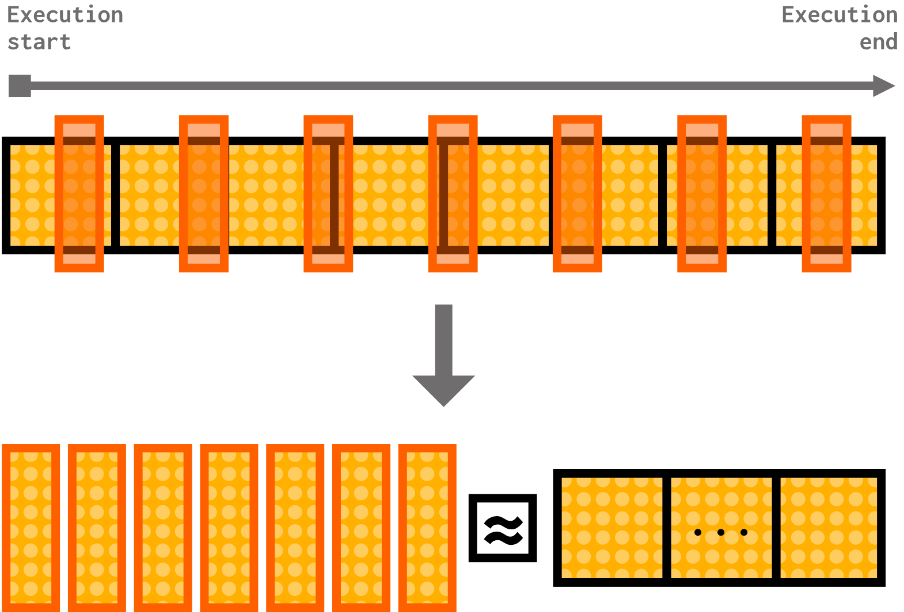

# Sampled simulation

The previous two sections on KVM fast-forwarding and checkpointing gave us tools for accelerating past the boring parts of a simulation and getting right to the good stuff. But what if there's too much good stuff?

> By the end of this section, you will be able to:  
>
> - **Demonstrate** analyzing a workload with a SimPoint probe, creating checkpoints based on SimPoint analysis, and running SimPoint checkpoints.
> - **Demonstrate** running a simulation with a SMARTS generator.
> - **Contrast** the benefits and drawbacks of targeted and statistical sampling methods.
> - **Predict** overall system performance based on the results of sampled simulation.
> - **Explain** broadly how targeted sampling techniques determine representative regions of a program.
> - **Explain** broadly how statistical sampling techniques determine when to simulate with higher fidelity.
>

## Sometimes the ROI is large

A large region of interest means that it might not be feasible to simulate the entire ROI every time!


This means that if we want to speed up the simulation process, we need to find solutions that allow us to simulate *representative portions* of the ROI in high detail such that we can infer helpful statistics: in other words, we need to *sample* the ROI. We'll discuss two ways of doing this and try them out on our own.

## Sampling methods

### Targeted sampling

Targeted sampling analyzes the execution patterns of a program, then selects samples of that program to act as representative regions for estimating overall performance.


Two well-known examples of this sampling technique are [SimPoint (paper)](https://cseweb.ucsd.edu/~calder/papers/ASPLOS-02-SimPoint.pdf) and [LoopPoint (paper)](https://alenks.github.io/pdf/looppoint_hpca2022.pdf). You don't have to be an expert on these techniques, but know that both of them do the following:

- Divide the program into **regions** that each execute a number of instructions (represented by the yellow dotted squares in the diagram above),
- Further divide each region into **basic blocks**,

  - > If you're curious, a **basic block** is a section of code with only one entry and exit point (it contains no branches or any kind, so no loops, conditionals, etc.).

- Analyze the execution behavior of basic blocks to create a **basic block vector** for each region. A basic block vector is like the "signature" of that region's execution.


- Use these basic block vectors to cluster and find representative regions of the program,

- Predict the overall program performance by weighting and summing up the performance of the representative regions.

The way that these techniques differ is in how they define their regions. SimPoint uses a fixed number of instructions executed to determine its regions, while LoopPoint uses the number of times a loop is executed.

LoopPoint can also take advantage of another tool called **ELFies**. ELFies is not a sampling method, but a checkpointing method for generating **executable checkpoints** out of large workload execution. Like LoopPoint, ELFies uses the number of times a loop has executed to demarcate regions of interest.

### Statistical Sampling

Instead of analyzing a program's execution pattern, statistical sampling randomly or periodically samples small execution slices from the program. The average performance of those slices can then be used to estimate the average performance of the real program.



Two well-known statistical sampling techniques are [SMARTS](https://web.eecs.umich.edu/~twenisch/papers/isca03.pdf) and [FSA](https://ieeexplore.ieee.org/document/7314164). Once again, you're not expected to be an expert on these, but they're nice to know about.

> **WORD OF WARNING!**
>
> Before using these techniques, make sure they are suitable for your experiments! These techniques have different benefits and limitations, which you should look into before applying them in your work.
>
> For example, SimPoint is designed for single-threaded workloads, and you should not attempt to use it on a multithreaded workload.

## Targeted sampling in gem5

gem5 includes support for program analysis, checkpoint generation of representative regions, and running the checkpoints of representative regions for both **SimPoint** and **LoopPoint**. It also supports executing **ELFies** in SE mode, but it does not support creating ELFie files or their weight information.

To show targeted sampling in action, let's go through the process of using SimPoint with gem5. We'll be going through:

1) Analyzing the program execution to generate representative regions,
2) Taking checkpoints for those representative regions,
3) Running the regions and using their performance to estimate overall performance.

Copy the `simpoint` directory from the resources folder to get started!

### Setting a baseline

To make this experiment worthwhile, we should do one full, detailed run of our system using our desired workload. This way, we have a baseline to compare to later. We'll be using a highly repetitive workload that allocates an array of 1,000 64 bit elements, stores a value at each index, then sums the entire array up 1,000 times. You can see it at `simpoint/workload/simple_workload.c`.

Since this might take a while, run the following in the command line now:

```bash
gem5 -re --outdir=full-detailed-run-m5out full-detailed-run.py
```

We'll be comparing the statistics of this full simulation to the SimPoint-generated statistics at the end.

### Analysis

In gem5, we use the `SimPoint` probe listener object to collect information for SimPoint to cluster program regions. This object is defined in `src/cpu/simple/probes/SimPoint.py`. The `SimPoint` object has two parameters:

1) `interval`: this parameter defines how large a region (yellow dotted square from the above diagram) is for our program. It is a number of instructions: every time we execute a total of `interval` instructions, we consider it the end of a region.

> The default value of `interval` is 100,000,000.

2) `profile_file`: this is the name of the output zip file for the SimPoint analysis process.

> The default value of `profile_file` is `simpoint.bb.gz`.

In order to use a `SimPoint` object, we need to attach it to an `ATOMIC` CPU. The probe will collect information as soon as the simulation starts and stop collecting information once the simulation ends.

Let's do some analysis! Open the `simpoint_analysis.py` file. This file currently defines an x86 board with no cache hierarchy, a single-channel DDR3-1600, and a single-core atomic `SimpleProcessor` (remember that a `SimPoint` probe must attach to an atomic CPU!).

> You'll notice these are *not* the same components as the full detailed run we just ran. Since the goal of this analysis step is just to find representative regions, we don't need to use the most performant or detailed system at this time. We'll use the real thing once we have our representative regions!

Our job will be to analyze this board with SimPoint. The only thing we need to do to accomplish this is to attach a `SimPoint` probe to our CPU's core. Thankfully, `SimpleCore`s have a member function called `addSimPointProbe()` that does this very thing.

> **Your turn:** Fill in `TODO (1)` in `simpoint_analysis.py` to attach a `SimPoint` probe to the processor's only core using the core's `addSimPointProbe` function. Pass in the agument `1_000_000` to this function to set our region size to 1,000,000 instructions.
> 
> <details>
> <summary> <b>Answer</b> </summary>
> 
> ```python
> processor.get_cores()[0].core.addSimPointProbe(1_000_000)
> ```
>
> </details>

<br>

Now that we have our probe all set up, let's run the analysis!

Run the following in the command line:

```bash
gem5 -re --outdir=simpoint-analysis-m5out simpoint-analysis.py
```

This analysis will generate a zip file named `simpoint.bb.gz` (remember the default value of the `profile_file` parameter?) under the `simpoint-analysis-m5out` directory. Let's unzip it and take a look inside!

Run the following in the command line:

```bash
gzip -d -k simpoint.bb.gz
```

Let's take a look at the `simpoint.bb` and see what kind of data the `SimPoint` probe generates. It should look something like this:

```HTML
T:1900:222 :1901:222 :1902:999216 :1903:333
T:1900:222 :1901:222 :1902:999225 :1903:333
T:1900:222 :1901:222 :1902:999225 :1903:333
T:1900:222 :1901:222 :1902:999225 :1903:333
T:1900:222 :1901:222 :1902:999216 :1903:333
T:1900:222 :1901:222 :1902:999225 :1903:333
T:1900:222 :1901:222 :1902:999225 :1903:333
T:1900:222 :1901:222 :1902:999225 :1903:333
```

Each `T:` indicates the basic block vector for a region. For this workload, the `SimPoint` probe found 9 regions.

Let's focus on the first basic block vector:

```HTML
T:1900:222 :1901:222 :1902:999216 :1903:333
```

Each set of numbers with a colon between them (for example, `1900:222`) indicates a basic block number and the total number of instructions executed in that basic block. This means that `1900:222` indicates that basic block 1900 ran a total of 222 *instructions*. Summing up all of the instructions executed in this basic block vector, we get:

```HTML
222 + 222 + 999216 + 333 = 999993
```

Hey, that's almost exactly 1,000,000: the value of the `interval` parameter we passed to `addSimPointProbe`! This makes sense, since a basic block vector is created for each region, which should be `interval` instructions long.

Looking back at all of the lines in `simpoint.bb`, we can see that regions 2 through 9 (excluding region 5) have identical basic block vectors. We expect those regions to be clustered together and for one representative region of the bunch to be chosen for analysis. Thankfully, we don't have to do this analysis ourselves. There are many methods available, but we'll be using the [SimPoint 3.2 tool](https://cseweb.ucsd.edu/~calder/simpoint/) provided by the paper's authors. This tool is already compiled for us in the `simpoint` folder, and it's aptly named... `simpoint`!

We run this tool with the following command, provided to you in `simpoint3.2-cmd.sh`:

<!-- TODO (Naama): Fix paths in command -->

```bash
simpoint \
    -inputVectorsGzipped -loadFVFile simpoint-analysis-m5out/simpoint.bb.gz -k 5 -saveSimpoints \
    results.simpts -saveSimpointWeights results.weights
```

This command:

- Passes in `simpoint.bb.gz` to the `simpoint` executable,
- Sets the number of expected clusters to 5 using `-k 5`,
- Saves the SimPoint information in `results.simpts` and their weights in `results.weights`.

Go ahead and run the command now by typing the following in the command line:

```bash
./simpoint3.2-cmd.sh
```

You should notice two new files named `results.simpts` and `results.weights`<!--TODO (Naama): Verify location-->. Let's look into those files and see what the analysis tool decided on. In `results.simpts` we see the following:

```HTML
2 0
1 1
0 3
```

The first column indicates the region number (this means we expect a number from 0 though 8, since we had 9 total regions). The second column is the SimPoint tag number (you'd think these tags would be contiguous, but they don't have to be; they're just tag numbers for the clusters the analysis found). This means that we discovered:

- Region 2 as SimPoint 0,
- Region 1 as SimPoint 1,
- Region 0 as SimPoint 3.

In `results.weights`, we see the following:

```HTML
0.666667 0
0.222222 1
0.111111 3
```

The first column indicates the discovered weight of a SimPoint, and the second column is the SimPoint tag of that SimPoint. This means that, putting our information together:

- SimPoint 0 (comprised of region 2) has a weight of 0.666667,
- SimPoint 1 (comprised of region 1) has a weight of 0.222222,
- SimPoint 3 (comprised of region 0) has a weight of 0.111111.

With this information, we know we can execute regions 2, 1, and 0 with detailed statistics, then combine these performance statistics with weights 0.666667, 0.222222, and 0.111111 to estimate the performance of the overall program.

### Creating checkpoints

Phew! That was quite a bit of analysis. The good news is that we can now use that analysis to generate checkpoints for our representative regions.

> As you might remember from the previous sections, we can also use KVM fast-forwarding to get to regions of interest. While you can do this with SimPoint, we usually choose to use checkpointing.

Open the `simpoint_checkpoint.py` file to get started. The first step we need to complete is to create an instance of the `SimPoint` tool with the appropriate parameters:

- `simpoint_interval`: this should correspond to the `interval` parameter we used for our SimPoint probe.
- `simpoint_file_path`: this should be the path to the file containing the discovered representative regions and their SimPoint tag, which we named `results.simpts`.
- `weight_file_path`: this should be the path to the file containing the weights for each SimPoint tag, which we named `results.weights`.
- `warmup_interval`: when we restore a checkpoint, we expect the microarchitectural state of our system to be cold. We set a warmup interval at the beginning of each of our checkpoints to "warm up" all of these components before collecting performance statistics.
  - > The SimPoint class can detect how much space we have for the warmup period! For example, if we found a SimPoint at the beginning of the program, the warmup period will be automatically adjusted to be 0, since we have no room to warm up before hitting the SimPoint.

<!--TODO (Naama): fix paths in answer-->
> **Your turn:** Fill in `TODO (2)` in `simpoint_checkpoint.py` to provide the correct parameter values to the `SimPoint` instance:
>
> - `simpoint_interval` should match `interval`, which we set at 1,000,000,
> - `simpoint_file_path` should point to `results.simpts`,
> - `weight_file_path` should point to `results.weights`,
> - `warmup_interval` should be 1,000,000.
>
> <details>
> <summary> <b>Answer</b> </summary>
> 
> ```python
> from gem5.utils.simpoint import SimPoint
> simpoint_info = SimPoint(
>     simpoint_interval=1_000_000,
>     simpoint_file_path=Path("simpoint/results.simpts"),
>     weight_file_path=Path("simpoint/results.weights"),
>     warmup_interval=1_000_000
> )
> ```
>
> </details>

<br>

The `SimPoint` class does a lot for us, like automatically sorting all of our SimPoints by their location in the program. It also has other nice utilities you might want to use in your own experiments; check out the `SimPoint` class definition for more information. The following steps are already completed for you, but let's take a brief look at what they do. 

The next step is to set up a workload for our board:

```python
board.set_se_simpoint_workload(
    binary=BinaryResource(local_path=Path("simpoint/workload/simple_workload").as_posix()),
    simpoint=simpoint_info
)
```

The `set_se_simpoint_workload()` function, as the name suggests, sets an SE-mode workload that uses SimPoints. We pass in the binary of our simple workload and the `SimPoint` object we just instantiated.

We then set up our `Simulator` to take our board and to have a custom handler for the `SIMPOINT_BEGIN` exit event:

```python
simulator = Simulator(
    board=board,
    on_exit_event={
        ExitEvent.SIMPOINT_BEGIN: simpoints_save_checkpoint_generator(dir, simpoint_info)
    },
)
```

The custom handler is defined using the `simpoints_save_checkpoint_generator`, which is an exit event generator function designed to generate multiple SimPoint checkpoints. It reads in the `SimPoint` object we created and appropriately either creates a checkpoint for the next SimPoint or exits the simulation if we're out of SimPoints.

We are now ready to create our checkpoints! Run the following in the command line:

```bash
gem5 -re --outdir=simpoint-checkpoint-m5out simpoint-checkpoint.py
```

After we finish checkpointing, we should find all of our checkpoints under the `simpoint-checkpoint` directory, since we passed that directory name to our `simpoints_save_checkpoints_generator`. You should see folders named `cpt.SimPoint0`, `cpt.SimPoint1`, and `cpt.SimPoint3`.

### Running SimPoint checkpoints

We can now (finally) run our SimPoint checkpoints on the system we want to analyze. Let's take a look at `simpoint_run.py`, which is designed to run one SimPoint checkpoint based on the command-line argument passed to it. This file does five major things (code we've already seen is omitted):

1) Set up the board with our full, detailed system,
2) Create a `SimPoint` object with the same parameters as the one we created for checkpoint creation,
3) Sets an SE SimPoint workload on the board, passing in the binary for our simple workload, the `SimPoint` object, and the path to the checkpoint (with the checkpoint number being decided by the `-sid` flag):

```python
checkpoint=Path(f"simpoint-checkpoint/cpt.SimPoint{args.sid}")
```

4) Creates a custom exit event handler called `max_inst()` and registers it with the simulator for the `MAX_INSTS` exit event:

```python
def max_inst():
    warmed_up = False
    while True:
        if warmed_up:
            print("end of SimPoint interval")
            yield True
        else:
            print("end of warmup, starting to simulate SimPoint")
            warmed_up = True
            # Schedule a MAX_INSTS exit event during the simulation
            simulator.schedule_max_insts(
                board.get_simpoint().get_simpoint_interval()
            )
            m5.stats.dump()
            m5.stats.reset()
            yield False

simulator = Simulator(
    board=board,
    on_exit_event={ExitEvent.MAX_INSTS: max_inst()},
)
```

- > This handler assumes that it will be triggered due to a `MAX_INSTS` exit event at the end of the warmup period; we will make sure that happens at the next step.

- When this handler is first triggered, it assumes the warmup period has just ended, so it prints this fact and gets ready for collecting statistics by dumping and resetting them. It also schedules another `MAX_INSTS` event for the end of the SimPoint interval. When that scheduled event happens, it will exit the simulation.

5) Sets up the first `MAX_INSTS` exit event at the end of the warmup interval and runs the simulation.

```python
warmup_interval = board.get_simpoint().get_warmup_list()[args.sid]
if warmup_interval == 0:
    warmup_interval = 1
print(f"Starting Simulation with warmup interval {warmup_interval}")
simulator.schedule_max_insts(warmup_interval)
simulator.run()

print("Simulation Done")
print(f"Ran SimPoint {args.sid} with weight {board.get_simpoint().get_weight_list()[args.sid]}")
```

- Notice the slight "hack" we have to use if we have no space for a warmup interval (for example, if the SimPoint we're running is at the beginning of the workload). The `schedule_max_insts()` function will not schedule a `MAX_INSTS` exit event if passed the argument 0, so we must put the exit event at instruction 1 instead.

Ok, let's run it! We want to run this script an amount of times equal to the number of SimPoint checkpoints we have. We have written a bash script to do just that named `run_all_simpoint.sh`. This script runs:

```bash
gem5 -re --outdir=simpoint<N>-run simpoint-run.py --sid=<N>
```

for `<N>` between 0 and 2, since that's how many SimPoints we have. It also handles waiting for all of these processes to finish and prints them out as they're done executing. Run the following in the command line:

```bash
./run-all-simpoint.sh
```

After the script is done running, you should notice 3 directories: `simpoint0-run`, `simpoint1-run`, and `simpoint3-run`. We should also already have the results of the full detailed run we executed much earlier in a directory called `full-detailed-run-m5out`.

### Predicting performance from SimPoint checkpoints

SimPoint relies on the weights we discovered during the analysis stage to predict performance. For this example, we'll focus on IPC (instructions per cycle) as our performance metric. As a reminder, weight is calculated as follows:

$$
\text{Weight of cluster } i = \frac{\text{Number of regions in cluster } i}{\text{Total number of regions in the workload execution}}
$$

To calculate the predicted IPC, we use:

$$
\text{Predicted IPC} = \sum_{i=1}^{n} (\text{Weight of cluster } i \times \text{IPC of cluster } i)
$$

We have a Python utility script that does this called `predict_overall_ipc.py`. The script calculates the predicted IPC from the SimPoints, grabs the IPC from the full detailed run, and compares the two. Most of this file is boilerplate for opening the SimPoint folders and finding the IPC statistic and SimPoint weight in each run's output. You can run it using:

```bash
python3 predict_overall_ipc.py
```

You should see the following results:

```bash
predicted IPC: 1.2577933618669999
actual IPC: 1.247741
relative error: 0.8056449108428648%
```

As you can see, we have quite a low relative error (around 0.81%)!

And that's it! We've successfully predicted statistics using SimPoint on a custom system. Thankfully, the process for using other sampling techniques like LoopPoint is very similar, so we won't be going over it in detail here. If you feel comfortable using SimPoint, you should be able to apply those skills to other sampling methods available in gem5.

## ELFies in gem5

As mentioned above, gem5 does not produce ELFies, but it can run them in SE mode. The class used to run ELFies is the `ELFieInfo` class; refer this class for details if you need to run ELFies in gem5. gem5 also provides some ELFie workloads in gem5 resources!

The `elfies/run_elfies.py` file goes through an example of using an ELFie workload named `wrf-s.1_globalr13`. Let's take a look through what that file is doing:

### Set up an ELFie workload

As previously mentioned, ELFies are executable checkpoints. This means that we can set up ELFie workloads like any other "normal" executable using the `set_se_binary_workload` function:

```python
board.set_se_binary_workload(
    binary=obtain_resource("wrf-s.1_globalr13")
)
```

### Set up the `ELFieInfo` instance

The `ELFieInfo` instance requires `PcCountPair` markers that indicate the start and end of the region of interest.

> A `PcCountPair` is a pair of a PC (program counter) value and a number of times the instruction at that program counter value has been executed.

Alongside every ELFie provided by gem5 resources, there is an accompanying ELFie info resource which provides the start and end `PcCountPair` values. For `wrf-s.1_globalr13`, the accompanying info is found at [elfie-info-wrf-s.1_globalr13](https://resources.gem5.org/resources/elfie-info-wrf-s.1_globalr13/raw?database=gem5-resources&version=1.0.0):

```json
...
"start_pc": "0x100b643",
"end_pc": "0x526730",
"start_pc_count": "1",
"end_pc_count": "297879"
...
```

We can then call the `ELFieInfo`'s `setup_processor` function to configure it with the simulated processor. Thus, we do the following:

```python
from gem5.resources.elfie import ELFieInfo
```

```python
elfie = ELFieInfo(start = PcCountPair(int("0x100b643",0),1), end = PcCountPair(int("0x526730",0),297879) )
elfie.setup_processor(
    processor = processor
)
```

### Exit event handler

Much like with SimPoint, we need to create and register a custom exit event handler for the `SIMPOINT_BEGIN` exit event:

```python
def start_end_handler():
    print(f"reached {targets[0]}\n")
    print("now reset stats\n")
    m5.stats.reset()
    print("fall back to simulation\n")
    yield False
    print(f"reached {targets[1]}\n")
    print("now dump stats and exit simulation\n")
    m5.stats.dump()
    yield True

simulator = Simulator(
    board=board,
    on_exit_event={
        ExitEvent.SIMPOINT_BEGIN : start_end_handler()
    }
)
```

This handler is a generator; it expects to be triggered upon the start and end of the region of interest. At the start, the handler resets the simulator statistics and falls back into simulation. When it is called again at the end, the handler dumps the stats and exits the simulation.

The whole provided example can be run with:

```bash
gem5 -re run_elfies.py
```

After we run ELFies, we can use the weights provided by the ELFie files to predict overall performance just like we did with SimPoint!

## Statistical sampling in gem5

Let's go through an example of using SMARTS with gem5. Unlike the checkpointing process we just went through with SimPoint, SMARTS works by fast-forwarding through the simulation until we hit a detailed sample window, then running a detailed simulation for the duration of the window before fast-forwarding again. SMARTS also includes a detailed warm-up period where the simulation is not fast-forwarded but statistics are not collected.

When working with SMARTS, we need to set a few statistical parameters:

- `n`: Number of samples (count)
  - How many detailed samples should we take over the course of our simulation?
- `U`: Sampling unit size (number of instructions)
  - How many instructions should be executed during the detailed simulation period?
- `W`: Warm-up period length (number of instructions)
  - How many instructions should be executed during the detailed warm-up period?
- `k`: Systematic sampling interval (count)
  - How many units (`U`) long is one sampling cycle (one sequence of fast forward, warm-up, sampling)

![A program timeline divided into repeating sections. Each section contains a yellow segment labeled "fast-forwarding" followed by an orange segment labeled "detailed warm-up period" followed by a pink segment labeled "detailed simulation period". One full section (yellow, then orange, then pink) is labeled "k * U instructions". An orange segment is labeled "W instructions". A pink segment is labeled "U instructions". The whole timeline is labeled "n * k * U instructions". A yellow segment is labeled "(k * U) - (W + U) instructions".](img/smarts.png)

Let's look at the `SMARTS.py` file to see how we run SMARTS in Python. There are three major steps:

1) Setting up the system with the appropriate processor,
2) Deciding on values of statistical parameters (`n`, `U`, `W`, and `k`)
3) Writing a custom exit event generator to handle fast-forwarding,
4) Running the simulation and interpreting statistics

This script uses the same simple workload from our SimPoint example, so we can once again compare the statistics from the full detailed run we ran then to the SMARTS-predicted statistics we'll generate shortly.

### Setting up the system

Unlike SimPoint, SMARTS has no analysis or checkpoint generation stage. This means that the system we're using in this file is the system we want to evaluate. The only difference is our choice of processor:

```python
processor = SimpleSwitchableProcessor(
    starting_core_type=CPUTypes.ATOMIC,
    switch_core_type=CPUTypes.O3,
    isa=ISA.X86,
    num_cores=1,
)
```

Instead of just using an O3 (out of order) processor for the entire duration, we use a `SimpleSwitchableProcessor` capable of switching between an atomic CPU and an O3 CPU. We'll be using the atomic CPU to fast-forward to our detailed simulation windows.

### Deciding statistical parameters

As mentioned, we need to decide on appropriate values of `n`, `U`, `W`, and `k` before we can run this simulation. An important piece of data for deciding these values is the program length: how many instructions will we be executing? For this workload, the program length is 9115640 instructions.

- The first variable we can decide on is `n`, the number of detailed simulation windows. In the SMARTS paper, they define a large sample size as `n > 30`. Let's use `n = 50` here.
  - This means the length of one sampling cycle (fast-forward, warm-up, sampling) is approximately $9115640 / 50 \approx 182000$ instructions.
- Let's set our sampling unit size `U` at 1000 and the warm up unit size `W` at twice that value to give ourselves ample warm-up time.
- Lastly, this means our `k` value is our region length (about 182,000) divided by `U`.

Here is all of that in Python, as written in `SMARTS.py`:

```python
program_length = 9115640
ideal_region_length = math.ceil(program_length/50)
ideal_U = 1000
ideal_k = math.ceil(ideal_region_length/ideal_U)
ideal_W = 2 * ideal_U
```

### SMARTS exit event handler

The real meat of this file is `smarts_generator()`, our custom exit event handler:

```python
def smarts_generator(
    k: int, U: int, W: int, processor
):
    is_switchable = isinstance(processor, SimpleSwitchableProcessor)
    warmup_start = (U * k) - (W + U)
    warmup_plus_detailed = U + W
    counter = 0

    while is_switchable:
        # reached warmup start
        processor.switch()
        processor.get_cores()[0]._set_simpoint([W, warmup_plus_detailed], True)
        yield False

        # reached warmup end
        m5.stats.reset()
        yield False

        # reached end of detailed simulation
        m5.stats.dump()
        processor.switch()
        processor.get_cores()[0]._set_simpoint([warmup_start], True)
        counter += 1
        yield False
```

This generator uses our values of `k`, `U`, and `W` to schedule `SIMPOINT_BEGIN` exit events at the boundaries between simulation phases.

> The core's `_set_simpoint()` function takes a list of instruction numbers to set `SIMPOINT_BEGIN` exit events at. It also takes a boolean indicating whether the board is initialized or not.

> Much like the SimPoint exit event generator, this generator relies on there being a `SIMPOINT_BEGIN` exit event at the beginning of the simulation. We'll make sure that happens soon.

- The first time the generator is triggered, it assumes it reached the beginning of the warm-up period. Therefore, it switches to the detailed processor, sets `SIMPOINT_BEGIN` exit events to occur `W` and `W + U` instructions from now (so that it is triggered again at the beginning and end of the detailed simulation window), and falls back into simulation.

- The second time the generator is triggered, it is the beginning of the detailed sampling period. The CPU is already set up correctly from the warm-up period, so all there is to do it reset the statistics and fall back into simulation.

- The third time the generator is triggered, it is the end of the detailed simulation period. Therefore, it dumps the statistics, switches back to the atomic processor, and sets another `SIMPOINT_BEGIN` exit event at the beginning of the next warm-up period, which can be calculated as $(U * k) - (W + U)$, as shown in the above diagram. We also increment our sample counter so we can keep track of how many simulation cycles we've gone through.

- Just like that, the cycle repeats! The next time the generator is triggered, it will be at the beginning of the warm-up period again.

We can now register the exit event with our simulator with our calculated statistical parameter values:

```python
simulator = Simulator(
    board=board,
    on_exit_event={
        ExitEvent.SIMPOINT_BEGIN: smarts_generator(
            k=ideal_k,
            U=ideal_U,
            W=ideal_W,
            processor=processor,
        )
    }
)
```

To get the exit event cycle started, we set a `SIMPOINT_BEGIN` event at the first instruction before running the simulation:

```python
processor.get_cores()[0]._set_simpoint([1], False)
simulator.run()
```

### Interpreting statistics

We can now run our SMARTS simulation by typing the following in the command line:

```bash
gem5 -re SMARTS.py
```

Once that's done, we can use a similar Python file to the one we used for SimPoint analysis to predict the IPC of the system. What this file does it sum up the IPCs from each sample and divide the sum by the total number of samples.

$$\text{Average IPC} = \frac{\sum_{i=1}^{n} \text{IPC}_i}{n}$$

We can run this file by typing the following in the command line:

```bash
python3 predict_ipc.py
```

You should see something like this for the output:

```
Number of samples: 50
Predicted Overall IPC: 1.2563117400000001
Actual Overall IPC: 1.247741
Relative Error: 0.6869005667041583%
```

As you can see, SMARTS also achieved a very small relative error between the predicted an actual IPC!

## Tradeoffs

Targeted and statistical analysis techniques are both useful tools for simulating workloads with large regions of interest. At the same time, they both have benefits and drawbacks you should be aware of when selecting which one to use.

| Method/Tradeoff | Resource requirement | Prediction accuracy | Cost to change configuration |
| :---- | :---- | :---- | :---- |
| **Targeted sampling** | Storage | Impacted by the clustering algorithm used to determine representative regions; also impacted by the cluster signature. | Almost no cost to changing hardware configuration (can reuse checkpoints), but a large cost to change software (must redo analysis). |
| **Statistical sampling** | KVM, parallel resources | Impacted by the input statistical parameters. | Equal cost to changing hardware and software configurations (rerun simulation). |

<link href = "../style.css" rel="stylesheet"></link>