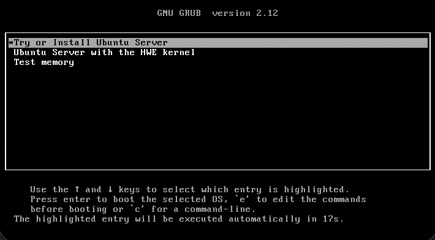

# Creating custom disk images

We know full-system simulation requires a disk image, so how do we make our own?

> By the end of this section, you will be able to:  
>
> - **Use** disk image resources in gem5 simulations.
> - **Explain** how disk images are created for use in gem5 simulations.
> - **Modify** and build a base disk image to specialize it for research needs.
>

## What's a disk image?

A **disk image** is an exact saved snapshot of a disk's contents (including, crucially, operating system files). Disk images are used for a variety of purposes, but here we are interested in using them for simulation. We need to provide a disk image when we simulate in *full-system mode*, since FS mode simulates the entire system, including the disk.

So far, we've used existing disk image resources from gem5 resources when simulating in FS mode.


> You may remember that in the [simulation modes lesson](../03-intermediate-features/01-simulation-modes.md), we obtained the `arm-ubuntu-24.04-img` disk image resource and passed it to `set_kernel_disk_workload()` (alongside a kernel and bootloader) to run an FS mode simulation.

This lesson is all about making your own disk images. You may want to do this to make an image with specific benchmarks installed to fit your simulation needs.

## Creating a disk image

We can build a custom disk image by setting up a blank disk image, installing all of the dependencies we want on it, then saving that disk image. We can use [QEMU](https://www.qemu.org), which has a disk image creation utility ([documentation](https://qemu.readthedocs.io/en/master/tools/qemu-img.html)) to do this. To make our job easier, we'll also use [Packer](https://developer.hashicorp.com/packer), a tool for automating the process of building machine images, instead of interfacing with QEMU directly.

In the workspace directory for this lesson, you'll find `x86-ubuntu`, a directory containing the files used to create the [`x86-ubuntu-24.04` gem5 disk image resource](https://resources.gem5.org/resources/x86-ubuntu-24.04-img?version=4.0.0). We'll take a look at how that disk image is created, then we'll extend it to add a benchmark.

> This image is built using [Ubuntu autoinstall](https://canonical-subiquity.readthedocs-hosted.com/en/latest/intro-to-autoinstall.html) to install Ubuntu. This is a "hands off" installation format that allows you configure everything ahead of installation then just let the installation process run.

### Installing QEMU

QEMU installation instructions can be found [here](https://www.qemu.org/download/).

> **TL;DR**, you should run:
>
> ```bash
> sudo apt-get install qemu
> ```

You can double-check that everything is installed as expected by running:

```bash
qemu-system-x86_64 --version
```

You should see something that looks like this:

```bash
QEMU emulator version 11.1.2
Copyright (c) 2003-2026 Fabrice Bellard and the QEMU Project developers
```

### Let's look at `build.sh`

In the top level of the `x86-ubuntu` directory, `build.sh` is the script being used to build the disk image. Let's break down what happens here.

#### Installing Packer

The first portion of the script checks for the Packer binary in the directory, and downloads it if not found:

```bash
if [ ! -f ./packer ]; then
    wget https://releases.hashicorp.com/packer/${PACKER_VERSION}/packer_${PACKER_VERSION}_linux_amd64.zip;
    unzip packer_${PACKER_VERSION}_linux_amd64.zip;
    rm packer_${PACKER_VERSION}_linux_amd64.zip;
fi
```

> If this fails for any reason, you can download the Packer binary yourself [here](https://developer.hashicorp.com/packer/install). 

#### Configuration file

Next, `build.sh` looks for a configuration file provided as a command-line argument. If this file is found, it uses the script to install plugins and build a disk image using this file:

```bash
...
if [ -f "$config_file" ]; then
    # Install the needed plugins
    ./packer init "$config_file"
    # Build the image
    ./packer build "$config_file"
...
```

This configuration file is a `.pkr.hcl` file that describes the parameters of the disk image to build. The `x86-ubuntu.pkr.hcl` file is provided; let's investigate this file!

### The Packer script

The Packer script is divided into several sections; we'll focus on the important ones.

#### QEMU options

```packer
source "qemu" "initialize" {
  ...
  boot_command     = ["e<wait>",
                      "<down><down><down>",
                      "<end><bs><bs><bs><bs><wait>",
                      "autoinstall  ds=nocloud-net\\;s=http://{{ .HTTPIP }}:{{ .HTTPPort }}/ ---<wait>",
                      "<f10><wait>"
                    ]
  ...
  iso_checksum     = "sha256:5e38b55d57d94ff029719342357325ed3bda38fa80054f9330dc789cd2d43931"
  iso_urls         = ["https://old-releases.ubuntu.com/releases/jammy/ubuntu-22.04.2-live-server-amd64.iso"]
  ...
  qemuargs         = [["-cpu", "host"], ["-display", "none"]]
  ...
```

This block specifies options for QEMU. The most important thing to look for here is `boot_command`, which will open the [GRUB menu](https://en.wikipedia.org/wiki/GNU_GRUB) and edit the boot command to add the autoinstall command.

You will also see options pertaining to the ISO (a type of disk image) for the version of Ubuntu we want to use. `iso_urls` passes a link to the ISO, and `iso_checksum` provides its checksum to check against.

Lastly, note `qemu-args`. This provides the arguments for the QEMU command to be run. In this case, we tell QEMU to run with the host CPU and to not use a display.

> This script uses KVM for acceleration. If your environment does not allow you to use KVM, you should modify a few lines in this block: 
> - Remove the `accelerator=kvm` line,
> - Remove the `["-cpu", "host"]` option from `qemuargs`. 
>

> If your QEMU installation is not located at `/usr/bin/qemu-system-x86_64`, you should update the `qemu_binary` line to point to your installation. You can find this path using:
>
> ```bash
> which qemu-system-x86_64
>```
>

#### File provisioners

After the QEMU options, you'll see several blocks with this format:

```packer
provisioner "file" {
    destination = <...>
    source      = <...>
}
```

These provisioners allow us to copy files from the host machine (your machine) to the disk image. We copy over a few scripts we want to be run after Ubuntu is installed.

#### Shell provisioner

Finally, you can see a single shell provisioner:

```packer
provisioner "shell" {
    execute_command = "echo '${var.ssh_password}' | {{ .Vars }} sudo -E -S bash '{{ .Path }}'"
    scripts         = ["scripts/post-installation.sh"]
  }
```

This provisioner allows us to run a bash script (`post-installation.sh`) after Ubuntu is installed. This script downloads a few useful packages and libraries (including `gem5-bridge`), then builds those libraries.

#### Detour: Getting a `user-data` file

As previously mentioned, this Packer script uses Ubuntu autoinstall. To use Ubuntu autoinstall, we need a `user-data` file. This file specifies the configuration for installing Ubuntu. For the sake of this example, this file is already provided; if you're curious about how to get this file yourself, expand the tooltip below. 

<details markdown="span">
<summary> <b>How to use QEMU to get a user-data file </b> </summary>

Any time a system is installed using the Ubuntu installer, the `user-data` file is automatically created. 

> If you have Ubuntu installed on a machine, you can fetch this file (called `autoinstall-user-data`) from `/var/log/installer/autoinstall-user-data` after the system's first reboot.

We can take advantage of this here by using QEMU to install Ubuntu and grab this file. First, we create an empty disk image and install Ubuntu on it:

```bash
qemu-img create -f raw ubuntu-22.04.2.raw 5G
```

> You'll notice this image is **5GB** in size.

You should now have two files in your working directory: the `.iso` file we got in Step 1 and the `.raw` file we just created.

Now that we have a disk image, let's boot it:

```bash
qemu-system-x86_64 -m 2G \
      -cdrom ubuntu-22.04.2-live-server-amd64.iso \
      -boot d -drive file=ubuntu-22.04.2.raw,format=raw \
      -net nic \
      -net user,hostfwd=tcp::2222-:22
```

This will launch a QEMU window:



Go through the steps of installing Ubuntu. You can then grab the `autoinstall-user-data` file! 

</details>
<br>

If you'd like, you can now run `./build.sh x86-ubuntu-24-04.pkr.hcl` to see the process of building this basic disk image. If not, you can download the finished image from [gem5 resources](https://resources.gem5.org/resources/x86-ubuntu-24.04-img?version=4.0.0). 

> Be warned that *this will take a while*, especially if not using KVM!

We'll now be adding a benchmark to this disk image using Packer.

## Extending a disk image

Let's say we want to run the GABPS benchmark suite in a full-system simulation, meaning we need to add these benchmarks to our disk image. We can use a similar-looking Packer script to the one we used to create the disk image to do this! 

### Packer script

We'll be modifying the `x86-ubuntu.pkr.hcl` file. The first thing we need to do is tell this script that we're no longer installing Ubuntu from an ISO; rather, we're working from a base disk image. To do this, we add this line to the QEMU options block:

```packer
disk_image = true
```

Since we're no longer installing from an ISO, we can also remove the `http` directory, which contains the `user-data` file:

```packer
http_directory = "http"     # DELETE this line!
```

We should also change `iso_urls` and `iso_checksum` to point to our base image. We change `iso_urls` to the absolute path to the disk image:

```packer
iso_urls = ["<path_to_workspace>/05-advanced-topics/05-disk-images/x86-ubuntu/x86-ubuntu-24.04-20250515.gz"]
```

We can get the checksum for this new disk image using:

```bash
sha256sum ./x86-ubuntu-24-04.gz
```

Then, we can update `iso_checksum`:

```packer
iso_checksum = "sha256:<new checksum>"
```

Since all of the files listed in the provisioners on this script are already on our disk image, we don't need to copy them again. Therefore, we can remove all file provisioners, too.

Lastly, we need to change our boot command! Our old command was for using installing Ubuntu, and we aren't doing that anymore. Instead, we'll `ssh` into QEMU and re-enable the network:

```packer
boot_command = ["<wait180>",
                "gem5<enter><wait>",
                "12345<enter><wait>",
                "sudo mv /etc/netplan/50-cloud-init.yaml.bak /etc/netplan/50-cloud-init.yaml<enter><wait>",
                "12345<enter><wait>",
                "sudo netplan apply<enter><wait>",
                "<wait>"
]
```

### Post-installation

Our new Packer script is now ready to go! The last thing we need to do is modify our post-installation script to clone and make the GAPBS repository. Replace the contents of `scripts/post-installation.sh` with:

```bash
git clone https://github.com/sbeamer/gapbs
cd gapbs
make
```

...and with that, we can run `build.sh`!

```bash
./build.sh x86-ubuntu-24.04.pkr.hcl
```

> This will take a bit, but not *nearly* as long as it takes to build the original image.

Once the script wraps up, you should have a new directory within `x86-ubuntu` containing our new disk image!

## Using our custom disk image

Now that we have our custom disk image, we can use it in our gem5 simulations as a local resource. Since this section is not about creating local gem5 resources, the `.json` file for our new disk image resource has already been created for you! All you need to add to this file is the absolute path to your newly-created disk image and provide the correct `md5sum`.

Fill out the path after `file:/`:

```json
"url": "file:/<ABSOLUTE_PATH_TO_DISK_IMAGE>",
```

Get the `md5sum` by running:

```bash
md5sum x86-ubuntu-24-04
```

...then add it to the `.json`:

```json
"md5sum": "<MD5SUM>",
```

### The configuration script

Let's take a look at the configuration script. It sets up an `X86Board` with a MESI cache hierarchy and obtains our local resource using its id, `x86-ubuntu-with-gapbs-img`:

```python
disk_image = obtain_resource("x86-ubuntu-with-gapbs-img")
```

It then uses `set_kernel_disk_workload()` to set the board's workload. Remember that a disk image is not enough to run a full-system workload; this function requires a disk image, a kernel, and (on ARM) a bootloader. Thankfully, we're using x86, and we can grab the kernel relatively easily:

```python
board.set_kernel_disk_workload (
    kernel = obtain_resource("x86-linux-kernel-6.8.0-52-generic"),
    kernel_args = [
            "earlyprintk=ttyS0",
            "console=ttyS0",
            "lpj=7999923",
            "root=/dev/sda2"
        ],
    disk_image = disk_image,
    readfile_contents = "./gapbs/bfs -g 10 -n 10"
)
```

> These are the same kernel and kernel arguments used in [`x86-ubuntu-24.04-boot-with-systemd`](https://resources.gem5.org/resources/x86-ubuntu-24.04-boot-with-systemd?version=5.0.0). 

You'll also notice the last argument, `readfile_contents`. This allows us to start the GAPBS BFS benchmark automatically. 

We're ready to run! Remember that since we're using a local resource, we need to append our `.json` file to the command:

```bash
GEM5_RESOURCE_JSON_APPEND=./local-gapbs-resource.json gem5 x86-fs-gapbs-run.py
```

> Full-system simulations take a while, even when using an `ATOMIC` CPU like we are here. If [KVM fast-forwarding](./01-kvm-fast-forwarding.md) is available to you, you may want to use it here!

Congratulations! You created and used a custom disk image in a gem5 simulation. This same process can be used to add whichever benchmarks you may need for your simulations.
